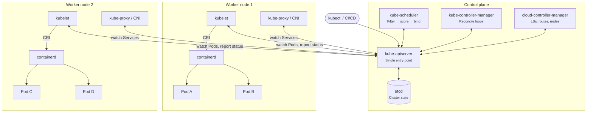
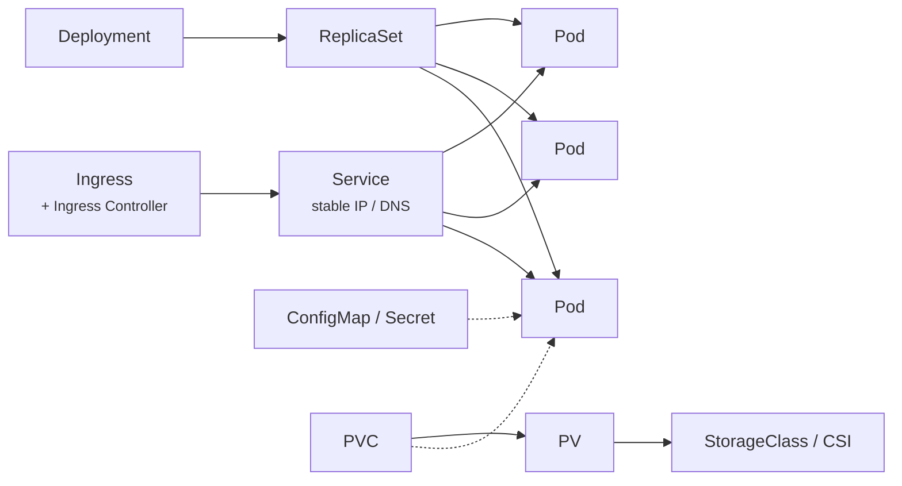

# Kubernetes (K8s) Components: Detailed Interview Preparation

A Senior or Lead DevOps interview expects more than definitions. You should be able to explain **how components communicate**, **how a Pod gets scheduled and started**, **how Service networking works**, and **how to troubleshoot failures in production**.

## Table of contents

1. [Architecture overview](#1-architecture-overview)
2. [Control plane components](#2-control-plane-components)
3. [Worker node components](#3-worker-node-components)
4. [Workload and networking resources](#4-workload-and-networking-resources)
5. [Additional components you should know](#5-additional-components-you-should-know)
6. [What happens when you deploy an application](#6-what-happens-when-you-deploy-an-application)
7. [Production troubleshooting](#7-production-troubleshooting)
8. [Top interview questions and answers](#8-top-interview-questions-and-answers)
9. [Senior DevOps practical scenarios](#9-senior-devops-practical-scenarios)
10. [Quick revision sheet](#10-quick-revision-sheet)

---

## 1. Architecture overview

Kubernetes is a container orchestration platform that automates deploying, scaling, networking and managing containerized applications. A cluster has two parts:

- **Control plane**: makes decisions and stores the desired state of the cluster.
- **Worker nodes**: run your applications inside Pods.

The one-line answer: **every component talks through the API server, and only the API server talks to etcd.**



---

## 2. Control plane components

### 2.1 kube-apiserver

**Purpose:** The front door to the cluster. Every request from `kubectl`, CI/CD pipelines, controllers, the scheduler and kubelets goes through it over REST/HTTPS.

**Request pipeline (know this order):**

1. **Authentication**: client certificates, bearer tokens, OIDC, or cloud IAM (e.g. `aws-iam-authenticator` on EKS, Entra ID on AKS).
2. **Authorization**: RBAC (plus Node and Webhook authorizers).
3. **Admission control**: *mutating* webhooks run first, then *validating* webhooks (e.g. Pod Security Admission, OPA Gatekeeper, Kyverno).
4. **Validation and persistence**: schema validation, then the object is written to etcd.

**Other responsibilities:**

- Exposes the **watch** API that every controller, the scheduler and kubelets use to react to changes.
- It is **stateless**, so it scales horizontally behind a load balancer.

```bash
kubectl get pods -n production
kubectl apply -f deployment.yaml
kubectl auth can-i create deployments -n production --as=system:serviceaccount:ci:deployer
```

> **Interview Q: What happens if the API server goes down?**
> Running containers keep running and kubelets keep restarting failed containers locally. But no new API operations succeed: nothing is scheduled, scaled, rolled out or failed over until it recovers.

### 2.2 etcd

**Purpose:** A distributed, strongly consistent key-value store and the **single source of truth** for all API objects.

**What it stores:**
- Deployments, Pods, Services, ConfigMaps and Secrets
- Node and namespace metadata
- Leases and the desired state of everything

**What it does NOT store:**
- Container images
- Application data
- Container filesystems

**Key points:**

- It uses the **Raft** consensus protocol. Writes need a quorum of `(n/2)+1` members.
  - **3 members** tolerate 1 failure.
  - **5 members** tolerate 2 failures.
  - Always use an odd number of members.
- Back it up with `etcdctl snapshot save`, and **test restores**.
- Secrets are only **base64-encoded** by default. Enable **encryption at rest** with an `EncryptionConfiguration` or a KMS provider.
- etcd is very sensitive to disk latency, so run it on SSDs.

```bash
ETCDCTL_API=3 etcdctl snapshot save /backup/etcd-$(date +%F).db \
  --endpoints=https://127.0.0.1:2379 \
  --cacert=/etc/kubernetes/pki/etcd/ca.crt \
  --cert=/etc/kubernetes/pki/etcd/server.crt \
  --key=/etc/kubernetes/pki/etcd/server.key
```

> **Interview Q: What happens if etcd loses quorum?**
> The API server can't persist changes, so the cluster is effectively read-only or unavailable for writes. Existing workloads keep running, but reconciliation stops. Recovery means restoring quorum or restoring from a snapshot.

### 2.3 kube-scheduler

**Purpose:** Picks a node for every Pod that has no `nodeName`. It **decides placement only**; the kubelet starts the Pod.

**How scheduling works:**

1. It watches for unscheduled Pods.
2. **Filtering** removes nodes that can't run the Pod.
3. **Scoring** ranks the nodes that remain.
4. It writes a **Binding** through the API server.
5. The kubelet on the chosen node takes over.

| Filtering (hard constraints) | Scoring (preferences) |
| --- | --- |
| CPU/memory **requests** vs allocatable | Spread across nodes/zones |
| Taints without matching tolerations | Image already present on node |
| `nodeSelector` / required node affinity | Preferred node/pod affinity |
| Pod anti-affinity (required) | Topology spread constraints |
| Volume zone / topology constraints | Balanced resource allocation |

```bash
kubectl describe pod my-pod -n production
kubectl get events -n production --sort-by=.lastTimestamp
```

A Pod stuck in `Pending` shows events such as `0/3 nodes are available: 3 Insufficient cpu`, or `node(s) had untolerated taint`.

### 2.4 kube-controller-manager

**Purpose:** Runs many controllers in one binary. Each controller is a **reconciliation loop**: it watches the actual state, compares it with the desired state, and acts to close the gap.

| Controller | Job |
| --- | --- |
| Deployment | Manages ReplicaSets, rollouts and rollbacks |
| ReplicaSet | Keeps the desired number of Pod replicas |
| Node | Detects unhealthy nodes, triggers eviction |
| Job / CronJob | Runs Pods to completion / on a schedule |
| EndpointSlice | Keeps Service endpoints in sync with ready Pods |
| Namespace | Cleans up resources when a namespace is deleted |
| ServiceAccount | Creates default ServiceAccounts |

In HA control planes, only **one instance is active** at a time. It is chosen by **leader election** using `Lease` objects.

> **Interview Q: A Pod crashes. Who recreates it?**
> There are two different mechanisms:
> - **Container crash:** the **kubelet** restarts the container in the same Pod, according to `restartPolicy`, with CrashLoopBackOff delays.
> - **Pod deleted or its node lost:** the **ReplicaSet controller** creates a *new* Pod to restore the replica count.

### 2.5 cloud-controller-manager

**Purpose:** Holds cloud-specific logic so the Kubernetes core stays cloud-agnostic. It:

- provisions cloud load balancers for `Service type: LoadBalancer`
- manages node lifecycle and metadata (e.g. it deletes the Node object when the VM is gone)
- configures cloud routes in some networking setups

On **managed Kubernetes (EKS, AKS, GKE)** the provider runs and patches the whole control plane. You own the worker nodes, add-ons, networking choices and workloads.

---

## 3. Worker node components

### 3.1 kubelet

**Purpose:** The node agent. It makes sure the Pods assigned to its node are running as specified. It:

- watches the API server for Pods bound to its node
- talks to the container runtime through the **CRI**
- sets up storage through **CSI** and networking through **CNI**
- runs **startup, readiness and liveness probes**
- reports node and Pod status, and sends heartbeats through `Lease` objects
- runs **static Pods** from `/etc/kubernetes/manifests` (this is how kubeadm runs the control plane itself)

```bash
kubectl get nodes
kubectl describe node worker-node-1
systemctl status kubelet && journalctl -u kubelet -f   # on the node
```

> **Interview Q: What happens if the kubelet stops?**
> Containers keep running, but the node stops reporting. After the grace period the node becomes `NotReady`. After about 5 minutes (the default `tolerationSeconds` for `node.kubernetes.io/unreachable`) its Pods are evicted and controllers recreate them elsewhere.

### 3.2 Container runtime

**Purpose:** Pulls images and creates, starts and stops containers. Common runtimes are **containerd** and **CRI-O**. The kubelet talks to them through the **Container Runtime Interface (CRI)**.

**Common interview distinctions:**

- **Docker** is a platform and toolset. **containerd** is a runtime (Docker itself uses containerd underneath).
- **dockershim was removed in v1.24.** Docker-built images still work because they are standard **OCI images**.

```bash
crictl ps        # list containers on the node
crictl images    # list images on the node
```

### 3.3 kube-proxy

**Purpose:** Implements **Service** networking. It watches Services and EndpointSlices, then programs **iptables** or **IPVS** rules so that traffic to a ClusterIP or NodePort is load-balanced across backend Pods.

It is **not always present.** eBPF data planes such as **Cilium** can replace it entirely.

```bash
kubectl get daemonset kube-proxy -n kube-system
kubectl get svc,endpointslices -n production
```

### 3.4 CNI plugin (Container Network Interface)

**Purpose:** Provides Pod networking: every Pod gets its own IP and can reach every other Pod without NAT.

**Examples:** Amazon VPC CNI (EKS), Azure CNI (AKS), Calico, Cilium.

**Depending on the plugin, it provides:**
- Pod IP address allocation
- Routing between nodes
- **NetworkPolicy** enforcement (the policy objects do nothing unless the CNI supports them)
- Integration with the cloud VPC/VNet

> **Interview Q: CNI vs kube-proxy?**
>
> | CNI | kube-proxy |
> | --- | --- |
> | Pod-to-Pod connectivity and Pod IPs | Service virtual IP → Pod forwarding |
> | May enforce NetworkPolicy | Uses iptables / IPVS |
> | Calico, Cilium, VPC CNI, Azure CNI | Replaceable by eBPF (Cilium) |
>
> They solve related but different problems: **CNI connects Pods; kube-proxy makes Services work.**

---

## 4. Workload and networking resources

These are **API objects**, not processes, but interviewers ask about them alongside the architecture.



| Resource | What to say |
| --- | --- |
| **Pod** | The smallest deployable unit. One or more containers sharing a network namespace (same IP, they talk over `localhost`) and volumes. |
| **Deployment / ReplicaSet** | A Deployment manages rollouts and rollbacks through ReplicaSets, and a ReplicaSet keeps N Pods running. |
| **StatefulSet** | Stable Pod names (`db-0`, `db-1`), ordered rollout, and its own PVC per replica. Used for databases and Kafka. |
| **DaemonSet** | One Pod per node (or per selected nodes). Used for log shippers, monitoring agents and CNI agents. |
| **Service** | A stable virtual IP and DNS name in front of a changing set of Pods. Types: `ClusterIP`, `NodePort`, `LoadBalancer`, `ExternalName`. |
| **Ingress + Controller** | Ingress holds the HTTP/HTTPS routing rules. A controller (NGINX, ALB, AGIC, Traefik) must be installed for the rules to take effect. The Gateway API is the newer successor. |
| **ConfigMap / Secret** | Non-sensitive and sensitive config. Secrets need RBAC, encryption at rest and ideally an external store (Secrets Store CSI, External Secrets). |
| **PV / PVC / StorageClass** | A PV is the storage, a PVC is a request for it, and a StorageClass provisions it dynamically through a CSI driver (EBS, Azure Disk, EFS). |

---

## 5. Additional components you should know

| Component | Purpose |
| --- | --- |
| **CoreDNS** | Cluster DNS, e.g. `web-app.production.svc.cluster.local` |
| **CSI driver** | Plugs storage systems (EBS, Azure Disk, EFS) into Kubernetes |
| **Device plugin** | Exposes special hardware such as GPUs (`nvidia.com/gpu`) |
| **Metrics Server** | Resource metrics for `kubectl top` and CPU/memory-based HPA |
| **HPA** | Scales replica count based on metrics |
| **VPA** | Recommends or sets container requests and limits |
| **Cluster Autoscaler / Karpenter** | Adds or removes **nodes** when Pods can't be scheduled |
| **NetworkPolicy** | Allow-lists Pod traffic (needs a CNI that supports it) |
| **RBAC** | Role/ClusterRole plus bindings that control who can do what in the API |
| **Admission controllers** | Mutate or validate requests before they are persisted |
| **CRDs and Operators** | Extend the API with custom resources and automate app lifecycle |

---

## 6. What happens when you deploy an application

This is **the most important interview question.** Example: a web app with 3 replicas.

```mermaid
sequenceDiagram
    participant U as kubectl
    participant API as API server
    participant E as etcd
    participant DC as Deployment ctrl
    participant RC as ReplicaSet ctrl
    participant S as Scheduler
    participant K as kubelet
    participant R as Runtime / CNI / CSI
    U->>API: kubectl apply -f deployment.yaml
    API->>API: AuthN → AuthZ → Admission → Validate
    API->>E: Persist Deployment
    DC->>API: Watch Deployment → create ReplicaSet
    RC->>API: Watch ReplicaSet → create 3 Pods (Pending)
    S->>API: Watch unscheduled Pods → Binding to node
    K->>API: Watch Pods bound to my node
    K->>R: Pull image, start containers, attach network + volumes
    K->>API: Report status; readiness passes → Ready
    Note over API: EndpointSlice updated → kube-proxy reprograms rules → Service routes traffic
```

1. **Submit:** `kubectl apply` sends the manifest to the API server.
2. **Validate:** authentication, authorization, admission and schema validation run.
3. **Persist:** the object is stored in etcd.
4. **Reconcile:** the Deployment controller creates a ReplicaSet, and the ReplicaSet controller creates 3 Pods in `Pending`.
5. **Schedule:** the scheduler filters and scores nodes, then binds each Pod.
6. **Start:** the kubelet calls the runtime (CRI) to pull the image and start containers, the CNI to give the Pod an IP, and CSI to mount volumes.
7. **Ready:** probes pass, the Pod IP joins the EndpointSlice, and kube-proxy updates its rules.
8. **Serve:** traffic flows through the Ingress or LoadBalancer, then the Service, then the ready Pods.

> **Key insight:** no component commands another. Each one **watches the API server and reacts**. This declarative, level-triggered design is why Kubernetes self-heals.

### Sample Deployment + Service

```yaml
apiVersion: apps/v1
kind: Deployment
metadata:
  name: web-app
  namespace: production
spec:
  replicas: 3
  selector:
    matchLabels:
      app: web-app
  strategy:
    type: RollingUpdate
    rollingUpdate:
      maxUnavailable: 0
      maxSurge: 1
  template:
    metadata:
      labels:
        app: web-app
    spec:
      containers:
        - name: web
          image: nginx:1.28
          ports:
            - containerPort: 80
          readinessProbe:
            httpGet:
              path: /
              port: 80
            initialDelaySeconds: 5
          livenessProbe:
            httpGet:
              path: /
              port: 80
            initialDelaySeconds: 15
          resources:
            requests:
              cpu: 100m
              memory: 128Mi
            limits:
              cpu: 500m
              memory: 256Mi
---
apiVersion: v1
kind: Service
metadata:
  name: web-app
  namespace: production
spec:
  type: ClusterIP
  selector:
    app: web-app
  ports:
    - port: 80
      targetPort: 80
```

---

## 7. Production troubleshooting

| Symptom | Investigate | First command |
| --- | --- | --- |
| Pod `Pending` | Scheduler, requests vs capacity, taints, PVC binding | `kubectl describe pod POD -n NS` |
| Pod `ContainerCreating` | Image pull, CNI IP allocation, CSI volume attach | `kubectl describe pod POD -n NS` |
| `ImagePullBackOff` | Image name/tag, registry auth (`imagePullSecrets`, IRSA/ACR) | `kubectl describe pod POD -n NS` |
| `CrashLoopBackOff` | App error, bad config, failing liveness probe | `kubectl logs POD -n NS --previous` |
| `OOMKilled` | Memory limit too low or a leak | `kubectl describe pod` → *Last State* |
| Service not reachable | Selector/labels, EndpointSlices empty, NetworkPolicy | `kubectl get svc,endpointslices -n NS` |
| DNS fails | CoreDNS Pods, `ndots`, NetworkPolicy blocking port 53 | `kubectl exec -it POD -- nslookup kubernetes.default` |
| Node `NotReady` | kubelet, runtime, disk/memory pressure, network | `kubectl describe node NODE` |
| Volume won't mount | PVC/PV binding, CSI driver, AZ mismatch | `kubectl describe pvc PVC -n NS` |
| HPA not scaling | Metrics Server, missing requests, HPA targets | `kubectl describe hpa -n NS` |
| Rollout stuck | Readiness probe, image errors, capacity | `kubectl rollout status deploy/NAME -n NS` |

**General toolkit:**

```bash
kubectl get events -A --sort-by=.lastTimestamp
kubectl get pods -A -o wide
kubectl top nodes && kubectl top pods -A        # needs Metrics Server
kubectl logs POD -n NS --previous
kubectl debug -it POD -n NS --image=busybox      # ephemeral debug container
kubectl rollout undo deploy/NAME -n NS           # quick rollback
```

> A `Running` Pod is **not** necessarily `Ready`. Only Ready Pods receive Service traffic.

---

## 8. Top interview questions and answers

<details>
<summary><b>1. Pod vs container?</b></summary>

A container runs one application process. A Pod is the Kubernetes scheduling unit: one or more tightly coupled containers sharing a network namespace (one IP, `localhost`) and volumes. Sidecars, such as log shippers or service-mesh proxies, live in the same Pod.
</details>

<details>
<summary><b>2. Deployment vs StatefulSet?</b></summary>

A **Deployment** is for stateless apps: its Pods are interchangeable, get random names, and may share a volume.

A **StatefulSet** gives each Pod:
- a stable identity (`app-0`, `app-1`) with a stable DNS name through a headless Service
- ordered create, update and delete
- its own PVC through `volumeClaimTemplates`, which persists across rescheduling

Use it for databases, Kafka, ZooKeeper and Elasticsearch.
</details>

<details>
<summary><b>3. Readiness vs liveness vs startup probes?</b></summary>

- **Readiness**: should this Pod receive traffic? On failure it is removed from the endpoints, but it is **not** restarted.
- **Liveness**: is the container stuck? On failure the kubelet **restarts** it.
- **Startup**: gives slow apps time to boot. Liveness and readiness are held off until it passes.

A common mistake is a liveness probe that checks downstream dependencies, which causes cascading restarts.
</details>

<details>
<summary><b>4. What happens when a worker node fails?</b></summary>

1. The kubelet's heartbeats (Lease updates) stop.
2. After about 40 seconds the Node controller marks the node `NotReady` and taints it `node.kubernetes.io/unreachable`.
3. After about 5 minutes (`tolerationSeconds: 300` by default) its Pods are evicted.
4. ReplicaSet and StatefulSet controllers recreate them on healthy nodes.

Bare Pods with no controller are **not** recreated. StatefulSet Pods may wait until the node is confirmed gone, to avoid two Pods with the same identity.
</details>

<details>
<summary><b>5. Requests vs limits?</b></summary>

- **Requests** are what the **scheduler** reserves. A Pod only lands on a node with that much allocatable capacity.
- **Limits** are the runtime ceiling, enforced through cgroups:
  - **CPU** over the limit is **throttled**.
  - **Memory** over the limit gets the container **OOMKilled**.

Together they set the QoS class:
- **Guaranteed**: requests = limits
- **Burstable**: requests are lower than limits
- **BestEffort**: no requests or limits

Under node pressure, BestEffort Pods are evicted first and Guaranteed Pods last.
</details>

<details>
<summary><b>6. How does Kubernetes provide high availability?</b></summary>

- **Control plane:** multiple API servers behind a load balancer, 3 or 5 etcd members, and leader-elected scheduler and controller-manager. Managed services (EKS, AKS) handle this for you.
- **Workloads:**
  - multiple replicas
  - Pod anti-affinity or topology spread across nodes and **availability zones**
  - **PodDisruptionBudgets** to survive drains
  - readiness probes
  - autoscaling of Pods (HPA) and nodes (Cluster Autoscaler or Karpenter)
</details>

<details>
<summary><b>7. ClusterIP vs NodePort vs LoadBalancer?</b></summary>

- **ClusterIP** (default): a virtual IP reachable only inside the cluster.
- **NodePort**: ClusterIP plus a port (30000–32767) opened on every node.
- **LoadBalancer**: NodePort plus a cloud load balancer provisioned by the cloud-controller-manager or an LB controller (an NLB on EKS, an Azure LB on AKS).

For HTTP, put an **Ingress** or Gateway in front of ClusterIP Services instead of one LoadBalancer per service.
</details>

<details>
<summary><b>8. Secret vs ConfigMap?</b></summary>

Both inject configuration as environment variables or mounted files.

**Secrets** are meant for sensitive data. They are base64-encoded (**not encrypted**) by default, can be encrypted at rest in etcd, can be restricted separately through RBAC, and are mounted on tmpfs.

In production, prefer an external secret store (AWS Secrets Manager or Azure Key Vault) through the **Secrets Store CSI Driver** or **External Secrets Operator**.
</details>

<details>
<summary><b>9. How does autoscaling work?</b></summary>

Kubernetes has three layers of autoscaling:

- **HPA** changes the number of replicas based on CPU or memory (from Metrics Server) or custom and external metrics. KEDA adds event-driven scaling, e.g. on queue length.
- **VPA** right-sizes requests and limits. Don't combine it with HPA on the same CPU or memory metric.
- **Cluster Autoscaler or Karpenter** adds nodes when Pods are `Pending` for lack of capacity, and removes underused nodes.

HPA **needs requests set**, because utilization is calculated as a percentage of the request.
</details>

<details>
<summary><b>10. What is a DaemonSet?</b></summary>

A DaemonSet runs exactly one Pod on every node, or on the nodes matched by a selector or tolerations. New nodes get the Pod automatically. Typical uses:

- log agents (Fluent Bit)
- monitoring agents (node-exporter, Datadog)
- CNI and kube-proxy
- CSI node plugins
</details>

<details>
<summary><b>11. Job vs CronJob?</b></summary>

A **Job** runs Pods until a set number complete successfully, with `backoffLimit` retries and optional `parallelism`. Use it for migrations and batch tasks.

A **CronJob** creates Jobs on a cron schedule. Key settings:
- `concurrencyPolicy` (Allow, Forbid or Replace)
- `startingDeadlineSeconds`
- history limits
</details>

<details>
<summary><b>12. How do you do a zero-downtime deployment?</b></summary>

- Use a `RollingUpdate` with `maxUnavailable: 0` and `maxSurge: 1` or more.
- Use an accurate **readiness probe**, so new Pods receive traffic only when they are truly ready.
- Handle graceful shutdown: a `preStop` sleep plus a `terminationGracePeriodSeconds` the app respects, so in-flight requests drain before the endpoint is removed.
- Add a **PodDisruptionBudget** and at least 2 replicas spread across zones.
- Make database schema changes backward-compatible.
- For higher-risk releases, use **blue/green** or **canary** deployments (Argo Rollouts, Flagger, service mesh).
- Roll back with `kubectl rollout undo`.
</details>

---

## 9. Senior DevOps practical scenarios

Practise answering these out loud, with the commands you'd run and why.

1. **All Pods are Running but the app is not reachable.** Work from the outside in:
   - DNS and the cloud LB health checks
   - Ingress rules and controller logs
   - the Service selector against Pod labels, and whether EndpointSlices are empty
   - NetworkPolicy
   - whether the app listens on `0.0.0.0` on the right `targetPort`
2. **Pods restart frequently.** Use `describe` to read *Last State* and the exit code:
   - exit code 137 or `OOMKilled` means memory
   - liveness probe failures in events
   - the app's own error in `logs --previous`
   - node pressure evictions
3. **A Deployment update is stuck.**
   - Check `rollout status`.
   - Check the new ReplicaSet's Pods for `ImagePullBackOff`, failing readiness, or `Pending` for lack of capacity.
   - Check `progressDeadlineSeconds`.
   - Roll back if needed.
4. **The app can't connect to the database.** Check in this order:
   - DNS resolution from the Pod
   - NetworkPolicy egress
   - security groups or NSGs, and route tables
   - TLS settings
   - credentials and Secret mounts
   - database health and connection limits
5. **The control plane is unavailable but workloads are running.** Running Pods and Services continue to work. Scheduling, scaling, rollouts, self-healing and `kubectl` access are disrupted.
6. **The cluster is running out of CPU or memory.**
   - Compare requests with actual usage (`kubectl top`, Prometheus).
   - Find Pods with no requests or inflated requests.
   - Check node allocatable capacity, autoscaler and Karpenter behaviour, and ResourceQuotas and LimitRanges.

---

## 10. Quick revision sheet

| Component | Key phrase |
| --- | --- |
| API Server | Single entry point: AuthN → AuthZ → Admission → etcd |
| etcd | Source of truth; Raft; odd quorum; back it up |
| Scheduler | Filter → score → bind; decides, doesn't start |
| Controller Manager | Reconciliation loops; desired vs actual |
| Cloud Controller Manager | Cloud LBs, routes, node lifecycle |
| kubelet | Node agent; CRI/CNI/CSI; probes; status |
| Container runtime | containerd / CRI-O; pulls images, runs containers |
| kube-proxy | Service VIP → Pod forwarding (iptables/IPVS) |
| CNI | Pod IPs and Pod-to-Pod networking; NetworkPolicy |
| CoreDNS | Cluster DNS / service discovery |
| Deployment | Stateless rollouts via ReplicaSets |
| StatefulSet | Stable identity + per-Pod storage |
| DaemonSet | One Pod per node |
| Service | Stable IP/DNS for changing Pods |
| Ingress Controller | Implements HTTP/HTTPS routing rules |
| CSI | Storage integration |
| HPA / VPA / CA | Scale Pods / right-size Pods / scale nodes |

---

### Final tip

For Lead or Senior DevOps roles, prioritise:

1. the full Pod lifecycle (Section 6)
2. API server and etcd failure scenarios
3. scheduler troubleshooting
4. Service networking (CNI vs kube-proxy)
5. probes and zero-downtime deployments
6. autoscaling
7. production debugging

If you work on **managed Kubernetes (EKS / AKS / GKE)**, be ready to say exactly which parts the cloud provider manages and which you configure and troubleshoot yourself:

- **Provider manages:** the control plane and etcd.
- **You own:** nodes, CNI, add-ons, IAM integration, networking and workloads.
