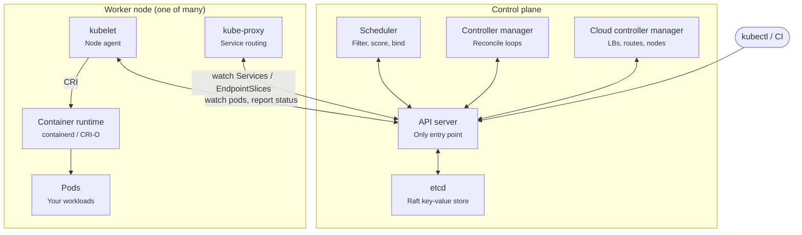
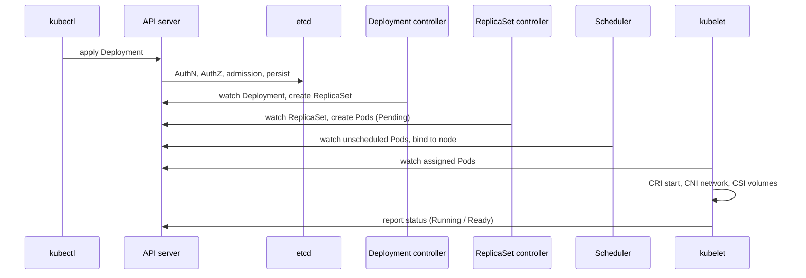

# Kubernetes Components: Interview Guide

A quick but thorough reference to Kubernetes architecture, written for DevOps / SRE interview preparation.

## Table of contents

- [The one-line answer](#the-one-line-answer)
- [Architecture diagram](#architecture-diagram)
- [Control plane components](#control-plane-components)
- [Worker node components](#worker-node-components)
- [Add-ons](#add-ons-often-asked-as-a-follow-up)
- [What happens on `kubectl apply`](#the-killer-question-what-happens-when-you-run-kubectl-apply--f-deploymentyaml)
- [Quick-fire follow-ups](#quick-fire-follow-ups-to-prepare)

---

## The one-line answer

A Kubernetes cluster has a **control plane**, which makes decisions and stores the desired state, and **worker nodes**, which run the containers. Everything talks through the API server, and nothing else talks to etcd.

## Architecture diagram

The kubelet on each node watches the API server for its pods and reports status back. No component talks to etcd except the API server.

---

## Control plane components

### 1. kube-apiserver

- It is the only entry point to the cluster. kubectl, kubelets, controllers, the scheduler and CI tools all talk to it over REST/HTTPS.
- Every request passes through three stages in order:
  1. **Authentication**: certs, tokens, OIDC, or IAM via aws-iam-authenticator on EKS.
  2. **Authorization**: RBAC.
  3. **Admission control**: mutating webhooks first, then validating webhooks (e.g. OPA/Kyverno, PodSecurity).
- It validates objects and persists them to etcd.
- It is stateless, so you scale it horizontally behind a load balancer.
- It provides the **watch** mechanism that every other component uses to react to changes.

### 2. etcd

- A distributed, consistent key-value store that holds all cluster state: objects, Secrets, ConfigMaps, leases.
- It uses the **Raft consensus** algorithm and needs a quorum of `(n/2)+1` members. That is why clusters run 3 or 5 members: 3 tolerates 1 failure, 5 tolerates 2.
- Interview favourites:
  - Backup with `etcdctl snapshot save`.
  - Secrets are only base64-encoded by default. Enable encryption at rest with an `EncryptionConfiguration` or KMS.
  - etcd is sensitive to disk latency, so it needs SSDs.

### 3. kube-scheduler

- It watches for pods that have no `nodeName` and assigns each one to a node. It only makes the decision; it does not start the pod.
- It works in two phases:
  - **Filtering** removes nodes that can't run the pod: not enough CPU or memory requests, taints without matching tolerations, nodeSelector or affinity mismatches, port conflicts, volume zone constraints.
  - **Scoring** ranks the remaining nodes: spreading, image locality, preferred affinity, topology spread constraints.
- It writes the decision back as a **binding** through the API server.

### 4. kube-controller-manager

- A single binary that runs many **controllers**. Each controller is a reconciliation loop: watch the current state, compare it with the desired state, act to close the gap.
- Examples:
  - Deployment controller manages ReplicaSets.
  - ReplicaSet controller manages Pods.
  - Node controller marks unhealthy nodes and evicts their pods.
  - Others include Job, EndpointSlice and ServiceAccount controllers.
- In HA setups only one instance is active at a time, chosen through **leader election** using Lease objects.

### 5. cloud-controller-manager

- It contains the cloud-specific logic: creating an ELB/NLB for a `Service` of `type: LoadBalancer`, managing node lifecycle against EC2, and setting up routes.
- On EKS, AWS runs the entire control plane for you. You only manage worker nodes (managed node groups, Karpenter or Fargate).

---

## Worker node components

### 1. kubelet

- An agent that runs on every node.
- It watches the API server for pods assigned to its node and makes sure their containers are running.
- It talks to the runtime through the **CRI**.
- It runs liveness, readiness and startup probes.
- It mounts volumes through **CSI**.
- It reports node and pod status back to the API server.
- It also runs **static pods** from `/etc/kubernetes/manifests`. This is how kubeadm bootstraps the control plane itself.

### 2. kube-proxy

- It implements **Services**. It watches Services and EndpointSlices and programs iptables or IPVS rules so traffic to a ClusterIP is load-balanced to backend pods.
- Note: some CNIs replace it entirely. Cilium does this with eBPF.

### 3. Container runtime

- It pulls images and runs containers. Common runtimes are containerd and CRI-O.
- Classic question: dockershim was removed in v1.24. Docker-built images still work because they are OCI images.

---

## Add-ons (often asked as a follow-up)

| Add-on | Purpose |
| --- | --- |
| **CNI plugin** (VPC CNI on EKS, Calico, Cilium) | Gives each pod its own IP and handles pod-to-pod networking |
| **CoreDNS** | Service discovery, e.g. `svc.namespace.svc.cluster.local` |
| **Ingress controller / Gateway API** | L7 routing into the cluster |
| **Metrics Server** | Required for HPA and `kubectl top` |

---

## The killer question: what happens when you run `kubectl apply -f deployment.yaml`?

1. kubectl sends the manifest to the **API server**, which authenticates, authorizes, runs admission and stores it in **etcd**.
2. The **Deployment controller** sees the new Deployment and creates a ReplicaSet.
3. The **ReplicaSet controller** sees the ReplicaSet and creates Pod objects. These pods are still Pending with no node assigned.
4. The **Scheduler** sees the unassigned pods, filters and scores nodes, and binds each pod to a node.
5. The **kubelet** on that node sees the pod. It calls the CRI to start the containers, the CNI to set up networking and the CSI to attach storage.
6. Once the readiness probe passes, the pod's IP is added to the EndpointSlice, and **kube-proxy** updates its rules. The Service now routes traffic to the pod.
7. kubelet keeps reporting status. Controllers keep reconciling forever.

> **Key point:** no component orders another one around. Each one watches the API server and reacts. This **declarative, level-triggered** design is why Kubernetes heals itself.

---

## Quick-fire follow-ups to prepare

<b>What if the control plane goes down?</b>

Running pods keep running and kubelet still restarts failing containers locally. But nothing new gets scheduled, nothing scales, and no failover happens.

<b>What if etcd loses quorum?</b>

The cluster becomes read-only or unavailable for writes. You restore from a snapshot.

<b>What if a node dies?</b>

The Node controller marks it `NotReady`. After the eviction timeout (about 5 minutes by default, via the `node.kubernetes.io/unreachable` toleration), its pods are recreated elsewhere. Pods with no controller are not recreated.

<b>What is the difference between requests and limits?</b>

The scheduler uses **requests** to place pods. **Limits** are enforced at runtime: CPU is throttled, and exceeding the memory limit gets the container OOMKilled.

