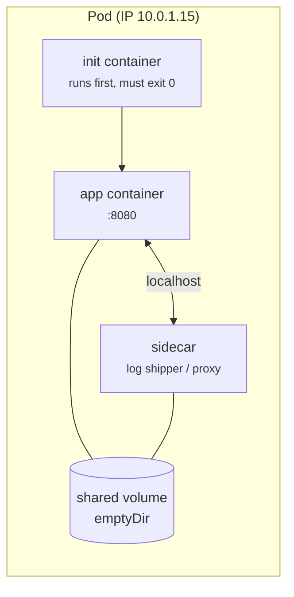

# 02 - Pod

> **One-liner:** A Pod is the smallest deployable unit in Kubernetes. It holds one or more containers that share a network namespace (one IP) and volumes, and are always scheduled together on the same node.

---

## What it is

- Containers in a Pod share:
  - the **IP address and port space**, so they talk to each other over `localhost`;
  - **volumes**, such as `emptyDir`, ConfigMaps and Secrets;
  - the same **lifecycle**: they are scheduled, started and evicted together.
- Pods are **ephemeral and disposable**. If a Pod dies, it is not resurrected; a controller creates a *new* Pod with a new name and IP.
- In production you almost never create bare Pods. You use a Deployment, StatefulSet, DaemonSet or Job, which manages Pods for you.



## Pod lifecycle

| Phase | Meaning |
| --- | --- |
| `Pending` | Accepted by the API, but not all containers are running yet. It may be waiting for scheduling or for an image pull. |
| `Running` | Bound to a node, and at least one container is running. |
| `Succeeded` | All containers exited 0 and will not restart. This is typical for Jobs. |
| `Failed` | All containers have terminated, and at least one failed. |
| `Unknown` | The node is unreachable, so its state can't be read. |

**Container states:**
- `Waiting`, with a reason such as `ContainerCreating`, `ImagePullBackOff` or `CrashLoopBackOff`.
- `Running`.
- `Terminated`, with a reason (`Completed`, `Error`, `OOMKilled`) and an exit code.

**restartPolicy:**

| Value | Behaviour | Typical use |
| --- | --- | --- |
| `Always` | Restart the container whenever it stops | Default; Deployments |
| `OnFailure` | Restart only if the exit code is non-zero | Jobs |
| `Never` | Never restart | One-off tasks |

## Multi-container patterns

| Pattern | Example |
| --- | --- |
| **Init container** | Wait for the DB, run migrations, or fetch config before the app starts |
| **Sidecar** | Log shipper, Envoy/Istio proxy, secret refresher. Native sidecars are `initContainers` with `restartPolicy: Always` (beta in v1.29, stable in v1.33). |
| **Ambassador** | A local proxy to an external service |
| **Adapter** | Converts the app's output, e.g. metrics, into a standard format |

## QoS classes

| Class | Rule | Eviction order under node pressure |
| --- | --- | --- |
| **Guaranteed** | Every container has requests equal to limits, for both CPU and memory | Evicted last |
| **Burstable** | Some requests or limits are set, but not equal | Evicted in the middle |
| **BestEffort** | No requests or limits at all | Evicted first |

## Example YAML

```yaml
apiVersion: v1
kind: Pod
metadata:
  name: web
  namespace: demo
  labels:
    app: web
spec:
  initContainers:
    - name: wait-for-db
      image: busybox:1.36
      command: ["sh", "-c", "until nc -z postgres 5432; do echo waiting; sleep 2; done"]
  containers:
    - name: app
      image: nginx:1.28
      ports:
        - containerPort: 80
      env:
        - name: APP_ENV
          valueFrom:
            configMapKeyRef:
              name: web-config
              key: env
      resources:
        requests: { cpu: 100m, memory: 128Mi }
        limits:   { cpu: 500m, memory: 256Mi }
      startupProbe:
        httpGet: { path: /, port: 80 }
        failureThreshold: 30
        periodSeconds: 2
      readinessProbe:
        httpGet: { path: /, port: 80 }
        periodSeconds: 5
      livenessProbe:
        httpGet: { path: /, port: 80 }
        periodSeconds: 10
      volumeMounts:
        - name: cache
          mountPath: /cache
  volumes:
    - name: cache
      emptyDir: {}
  restartPolicy: Always
  terminationGracePeriodSeconds: 30
```

## Common commands

```bash
kubectl run tmp --image=busybox:1.36 -it --rm -- sh      # throwaway debug pod
kubectl apply -f pod.yaml
kubectl get pods -n demo -o wide                          # node + IP
kubectl get pod web -n demo -o yaml                       # full spec + status
kubectl describe pod web -n demo                          # events, last state, exit codes
kubectl logs web -n demo -c app                           # specific container
kubectl logs web -n demo -c app --previous                # logs from the crashed instance
kubectl logs web -n demo -c wait-for-db                   # init container logs
kubectl exec -it web -n demo -c app -- sh
kubectl port-forward pod/web 8080:80 -n demo
kubectl delete pod web -n demo
```

## Troubleshooting

| Status / symptom | Likely cause | What to check |
| --- | --- | --- |
| `Pending` | No node fits: insufficient CPU or memory, taints, affinity, unbound PVC | `kubectl describe pod` → **Events** (`FailedScheduling`) |
| `ContainerCreating` (stuck) | CNI can't assign an IP, a volume can't attach or mount, or a Secret or ConfigMap is missing | `describe pod` events; `kubectl get pvc`; CNI pod logs in `kube-system` |
| `ErrImagePull` / `ImagePullBackOff` | Wrong image or tag, a private registry without auth, rate limiting | `describe pod`; check `imagePullSecrets` and node IAM (ECR/ACR) |
| `CreateContainerConfigError` | A referenced ConfigMap, Secret or key does not exist | `describe pod`; `kubectl get cm,secret -n NS` |
| `CrashLoopBackOff` | The app exits on start, has bad config or a bad command, or a liveness probe kills it | `logs --previous`; exit code in `describe` |
| `OOMKilled` (exit 137) | The memory limit is too low, or the app leaks memory | `describe pod` → *Last State: Terminated, Reason: OOMKilled* |
| `Running` but not `Ready` | Readiness probe failing | `describe pod` → probe failure events |
| `Init:0/1`, `Init:CrashLoopBackOff` | An init container is failing or waiting forever | `logs POD -c <init-container>` |
| `Evicted` | Node pressure on memory, disk or ephemeral storage | `describe node` → Conditions; `kubectl get pods -A --field-selector=status.phase=Failed` |
| `Terminating` (stuck) | A finalizer, or the node is unreachable | `get pod -o yaml` → finalizers; a force delete is a last resort |

```bash
# Why did it die? Exit code + reason
kubectl get pod web -n demo -o jsonpath='{.status.containerStatuses[*].lastState.terminated}'

# Exit codes: 0 = clean, 1 = app error, 126/127 = command not executable/found,
#             137 = SIGKILL (OOM or liveness kill), 143 = SIGTERM (graceful stop)

# Recent events in the namespace
kubectl get events -n demo --sort-by=.lastTimestamp

# Debug a distroless/minimal container with an ephemeral container
kubectl debug -it web -n demo --image=busybox:1.36 --target=app

# Copy the pod with a different command to inspect a crashing app
kubectl debug web -n demo -it --copy-to=web-debug --container=app -- sh

# Clean up evicted/failed pods
kubectl delete pods -n demo --field-selector=status.phase=Failed

# Force-delete a stuck Terminating pod (last resort; dangerous for StatefulSets)
kubectl delete pod web -n demo --grace-period=0 --force
```

## Interview questions

<details>
<summary><b>Why does Kubernetes use Pods instead of scheduling containers directly?</b></summary>

Some processes must be co-located and share network and storage, such as an app with its log shipper or proxy. A Pod is the atomic unit that guarantees this: one IP, shared volumes, and one scheduling decision. It also gives a uniform abstraction over different runtimes.
</details>

<details>
<summary><b>What happens when you delete a Pod (graceful termination)?</b></summary>

1. The Pod is marked `Terminating` and removed from the Service EndpointSlices.
2. The `preStop` hook runs.
3. The containers are sent `SIGTERM`.
4. Kubernetes waits up to `terminationGracePeriodSeconds` (default 30).
5. Any container still running gets `SIGKILL`.

A `preStop` sleep of a few seconds helps avoid dropped requests while load balancers catch up.
</details>

<details>
<summary><b>Init container vs sidecar?</b></summary>

Init containers run **sequentially before** the app containers, and each must exit successfully.

Sidecars run **alongside** the app for the Pod's whole life. Native sidecars (`initContainers` with `restartPolicy: Always`) start before the app and stop after it, which fixes the old problem of Jobs that never finished because a sidecar kept running.
</details>

<details>
<summary><b>CrashLoopBackOff: how do you debug it?</b></summary>

1. Run `kubectl describe pod` to see the exit code and events.
2. Run `kubectl logs --previous` to see the crashed container's output.
3. Interpret the exit code:
   - 137 means OOM or a liveness kill;
   - 1 means an app error;
   - 127 means the command was not found.
4. Check the config, env, Secrets and command/args.
5. Check whether the liveness probe is too aggressive.
6. Reproduce with `kubectl debug --copy-to`, overriding the command.
</details>

<details>
<summary><b>What is a static Pod?</b></summary>

A static Pod is managed directly by the kubelet from a manifest in `/etc/kubernetes/manifests`, not by the API server. kubeadm runs the control plane this way. The API server only shows a read-only "mirror Pod".
</details>

## Quick revision

| Topic | Remember |
| --- | --- |
| Networking | One IP per Pod; containers talk over `localhost` |
| Lifetime | Ephemeral; replaced, never repaired |
| Probes | Startup → then readiness (traffic) + liveness (restart) |
| QoS | Guaranteed > Burstable > BestEffort (eviction order reversed) |
| Exit 137 | OOMKilled or killed by liveness |
| Production | Use controllers, not bare Pods |
