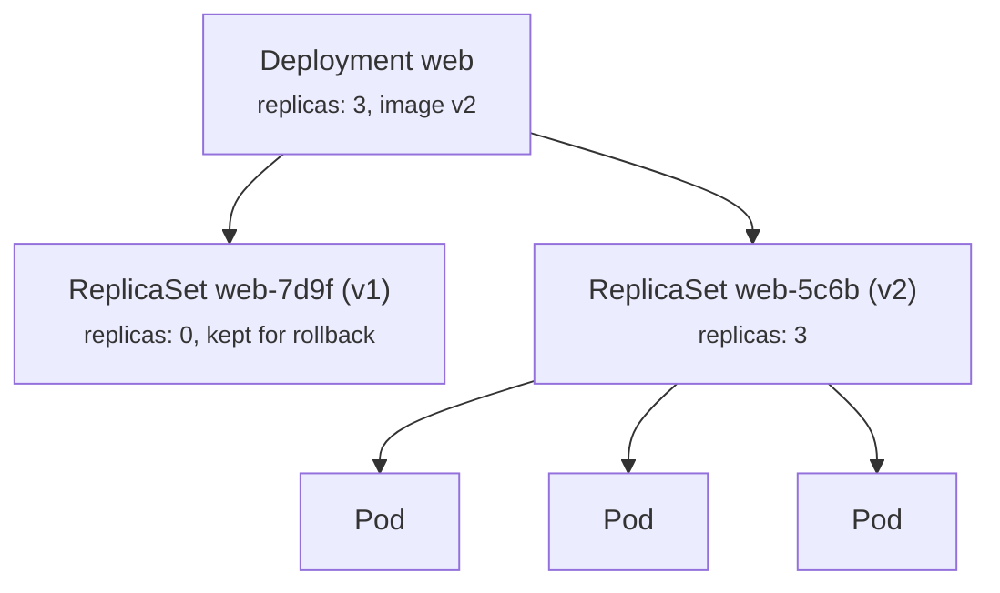
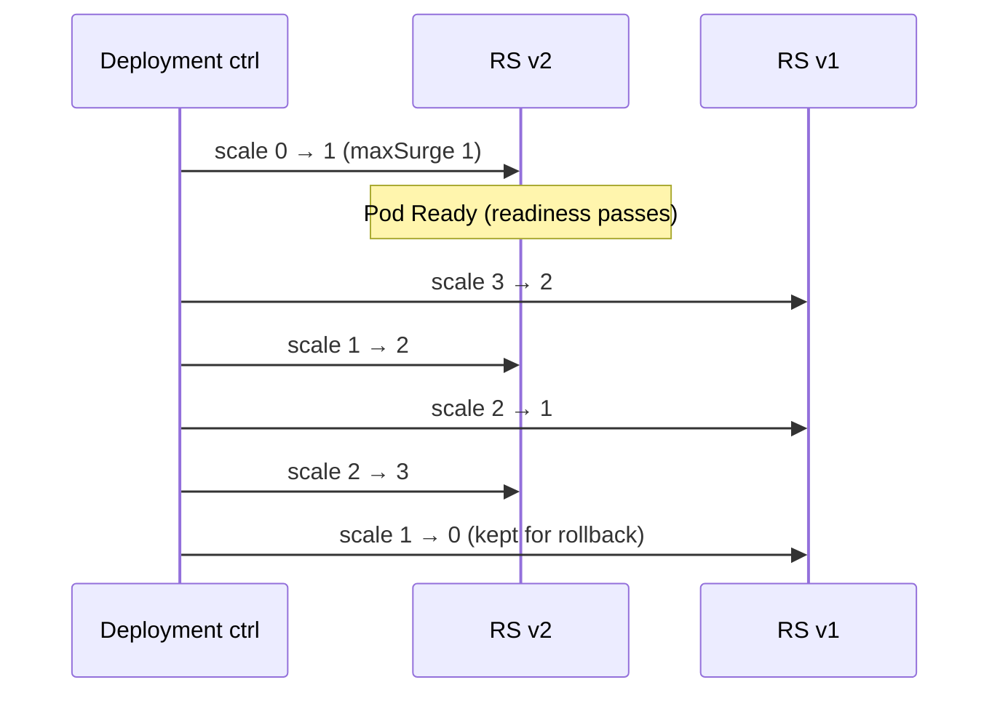

# 03 - Deployment

> **One-liner:** A Deployment declaratively manages **stateless** applications. It owns ReplicaSets, which own Pods, and it handles **rolling updates, rollbacks and scaling**.

---

## What it is

- You declare the desired state: the image, the number of replicas and the update strategy. The **Deployment controller** reconciles the cluster to match.
- Every change to the Pod template (`spec.template`) creates a **new ReplicaSet**. The Deployment then shifts Pods from the old ReplicaSet to the new one.
- Old ReplicaSets are kept, scaled to 0, so you can **roll back**. How many are kept is set by `revisionHistoryLimit` (default 10).
- Changing only `replicas` does **not** create a new ReplicaSet, because only the template hash matters.



## Update strategies

| Strategy | How it works | Downtime | Use when |
| --- | --- | --- | --- |
| `RollingUpdate` (default) | Replace Pods gradually, controlled by `maxSurge` and `maxUnavailable` | None, if readiness is correct | Most stateless apps |
| `Recreate` | Kill all old Pods, then start the new ones | Yes | The app can't run two versions at once (schema lock, singleton) |

**RollingUpdate knobs:**

| Setting | Meaning | Default |
| --- | --- | --- |
| `maxSurge` | Extra Pods allowed **above** `replicas` during a rollout | 25% |
| `maxUnavailable` | Pods allowed to be **unavailable** during a rollout | 25% |
| `minReadySeconds` | How long a Pod must stay Ready before it counts as available | 0 |
| `progressDeadlineSeconds` | Time before the rollout is marked as **failed to progress** | 600 |

For zero downtime, set `maxUnavailable: 0` and `maxSurge: 1`, and use a real **readiness probe**.

Blue/green and canary deployments are **not** built in. Use Argo Rollouts, Flagger, or two Deployments behind a Service or Ingress.



## Example YAML

```yaml
apiVersion: apps/v1
kind: Deployment
metadata:
  name: web
  namespace: demo
  labels:
    app: web
spec:
  replicas: 3
  revisionHistoryLimit: 5
  minReadySeconds: 5
  progressDeadlineSeconds: 300
  selector:
    matchLabels:
      app: web            # immutable after creation
  strategy:
    type: RollingUpdate
    rollingUpdate:
      maxSurge: 1
      maxUnavailable: 0
  template:
    metadata:
      labels:
        app: web          # must match the selector
    spec:
      topologySpreadConstraints:
        - maxSkew: 1
          topologyKey: topology.kubernetes.io/zone
          whenUnsatisfiable: ScheduleAnyway
          labelSelector:
            matchLabels: { app: web }
      containers:
        - name: web
          image: nginx:1.28
          ports:
            - containerPort: 80
          resources:
            requests: { cpu: 100m, memory: 128Mi }
            limits:   { memory: 256Mi }
          readinessProbe:
            httpGet: { path: /, port: 80 }
          livenessProbe:
            httpGet: { path: /, port: 80 }
            initialDelaySeconds: 15
          lifecycle:
            preStop:
              exec:
                command: ["sh", "-c", "sleep 10"]
      terminationGracePeriodSeconds: 30
---
apiVersion: policy/v1
kind: PodDisruptionBudget
metadata:
  name: web-pdb
  namespace: demo
spec:
  minAvailable: 2
  selector:
    matchLabels: { app: web }
```

## Common commands

```bash
kubectl create deployment web --image=nginx:1.28 --replicas=3 -n demo --dry-run=client -o yaml > deploy.yaml
kubectl apply -f deploy.yaml
kubectl get deploy,rs,pods -n demo -l app=web
kubectl describe deploy web -n demo

# Scale
kubectl scale deploy web --replicas=5 -n demo

# Update image (triggers a rollout)
kubectl set image deploy/web web=nginx:1.29 -n demo
kubectl annotate deploy/web kubernetes.io/change-cause="upgrade to 1.29" -n demo

# Watch / inspect rollout
kubectl rollout status deploy/web -n demo
kubectl rollout history deploy/web -n demo
kubectl rollout history deploy/web --revision=3 -n demo

# Roll back
kubectl rollout undo deploy/web -n demo
kubectl rollout undo deploy/web --to-revision=2 -n demo

# Pause/resume to batch several changes into one rollout
kubectl rollout pause deploy/web -n demo
kubectl rollout resume deploy/web -n demo

# Restart all pods (e.g. to pick up a changed Secret)
kubectl rollout restart deploy/web -n demo
```

## Troubleshooting

| Symptom | Likely cause | What to check |
| --- | --- | --- |
| Rollout stuck at "Waiting for rollout to finish" | New Pods never become Ready | `kubectl get pods -l app=web`; `describe` a new Pod; readiness probe events |
| `ProgressDeadlineExceeded` | The rollout didn't progress within `progressDeadlineSeconds` | `kubectl describe deploy` → Conditions |
| New Pods `Pending` | `maxSurge` needs extra capacity the cluster doesn't have | Scheduler events; the node autoscaler |
| New Pods `ImagePullBackOff` | Bad tag or registry auth | `describe pod` |
| `READY 2/3` permanently | One Pod is failing or can't be scheduled | `get pods -o wide`; `describe` the bad Pod |
| `selector does not match template labels` | The labels differ | Fix the template labels; remember the selector is **immutable** |
| Changed a ConfigMap but nothing happened | Pods don't restart on ConfigMap or Secret changes | `kubectl rollout restart`, or a checksum annotation in Helm |
| Downtime during deploy | No readiness probe, `maxUnavailable` > 0, or no graceful shutdown | Add readiness, a `preStop` sleep and a PDB |
| `kubectl drain` blocked | The PDB doesn't allow any disruption | `kubectl get pdb`; check `ALLOWED DISRUPTIONS` |

```bash
# Conditions: Available / Progressing (reason tells you why)
kubectl get deploy web -n demo -o jsonpath='{range .status.conditions[*]}{.type}={.status} {.reason}: {.message}{"\n"}{end}'

# Which ReplicaSet is current, and how many pods each has
kubectl get rs -n demo -l app=web -o wide

# Compare what's running with what you expect
kubectl get deploy web -n demo -o jsonpath='{.spec.template.spec.containers[*].image}'
kubectl get pods -n demo -l app=web -o jsonpath='{range .items[*]}{.metadata.name}{"\t"}{.spec.containers[*].image}{"\n"}{end}'

# Events for the deployment and its pods
kubectl get events -n demo --sort-by=.lastTimestamp | grep -i web
```

## Interview questions

<details>
<summary><b>Deployment vs ReplicaSet: why not use a ReplicaSet directly?</b></summary>

A ReplicaSet only keeps N Pods running. It cannot do rolling updates or rollbacks.

A Deployment adds versioning: it creates a new ReplicaSet for each template change, shifts traffic gradually, and keeps the old ReplicaSets for `rollout undo`.
</details>

<details>
<summary><b>How do you achieve zero-downtime deployments?</b></summary>

- `maxUnavailable: 0` and `maxSurge: 1`
- an accurate readiness probe
- `minReadySeconds`
- graceful shutdown: a `preStop` sleep, plus an app that handles SIGTERM within `terminationGracePeriodSeconds`
- a PodDisruptionBudget
- at least 2 replicas spread across zones
- backward-compatible database migrations
</details>

<details>
<summary><b>How does rollback work?</b></summary>

`kubectl rollout undo` scales the previous ReplicaSet back up and the current one down, using the same rolling strategy. It works because old ReplicaSets are kept, up to `revisionHistoryLimit`.

In GitOps (Argo CD, Flux), you roll back by reverting the Git commit instead.
</details>

<details>
<summary><b>How do you do canary or blue/green deployments?</b></summary>

They are not native. The options are:
- Argo Rollouts or Flagger, which use weighted traffic through an ingress or service mesh, with analysis;
- two Deployments with a Service selector switch (blue/green);
- weighted Ingress annotations (canary).
</details>

## Quick revision

| Topic | Remember |
| --- | --- |
| Owns | ReplicaSets → Pods |
| New ReplicaSet created | Only when `spec.template` changes |
| Zero downtime | `maxUnavailable: 0` + readiness + `preStop` + PDB |
| Rollback | `kubectl rollout undo` (kept via `revisionHistoryLimit`) |
| Selector | Immutable |
| Config change | Needs `rollout restart` |
