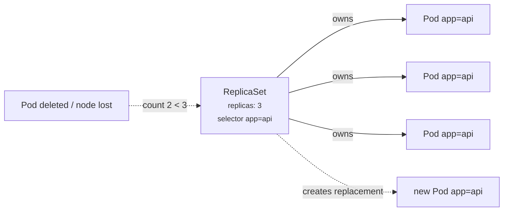

# 04 - ReplicaSet

> **One-liner:** A ReplicaSet makes sure a specified number of identical Pods is **always running**. It replaces the legacy ReplicationController and is normally managed by a Deployment rather than used directly.

---

## What it is

- The **ReplicaSet controller** (inside `kube-controller-manager`) runs a reconciliation loop:
  1. Count the Pods matching the selector.
  2. Compare that count with `spec.replicas`.
  3. Create or delete Pods to close the gap.
- It finds Pods by **label selector**, and it adopts any orphan Pod that matches. Pods it owns carry an `ownerReferences` entry pointing to it.
- It does **not** update existing Pods when you change its template. Only newly created Pods get the new template. That is why rolling updates need a Deployment.



## ReplicaSet vs ReplicationController vs Deployment

| | ReplicationController | ReplicaSet | Deployment |
| --- | --- | --- | --- |
| Selector | Equality-based only (`app=web`) | **Set-based** (`In`, `NotIn`, `Exists`) | Same as ReplicaSet |
| Rolling update | `kubectl rolling-update` (removed) | No | **Yes** |
| Rollback | No | No | **Yes** |
| Status | Legacy | Building block | **Use this** |

## Which Pod gets deleted on scale-down?

The controller prefers to delete, in this order:
1. Pods that are Pending or unscheduled
2. Pods that are not Ready
3. Pods on nodes with more replicas
4. Newer Pods

You can influence the choice with the `controller.kubernetes.io/pod-deletion-cost` annotation.

## Example YAML

```yaml
apiVersion: apps/v1
kind: ReplicaSet
metadata:
  name: api
  namespace: demo
  labels:
    app: api
spec:
  replicas: 3
  selector:
    matchExpressions:
      - key: app
        operator: In
        values: ["api"]
      - key: tier
        operator: NotIn
        values: ["canary"]
  template:
    metadata:
      labels:
        app: api
        tier: stable
    spec:
      containers:
        - name: api
          image: hashicorp/http-echo:1.0
          args: ["-text=hello"]
          ports:
            - containerPort: 5678
          resources:
            requests: { cpu: 50m, memory: 32Mi }
```

## Common commands

```bash
kubectl apply -f rs.yaml
kubectl get rs -n demo
kubectl get rs api -n demo -o wide          # shows selector + images
kubectl describe rs api -n demo             # events: SuccessfulCreate / SuccessfulDelete

# Scale
kubectl scale rs api --replicas=5 -n demo

# Self-healing demo: delete a pod, watch a new one appear
kubectl delete pod -n demo -l app=api --wait=false
kubectl get pods -n demo -l app=api -w

# Who owns this pod?
kubectl get pod <pod> -n demo -o jsonpath='{.metadata.ownerReferences[*].kind}/{.metadata.ownerReferences[*].name}{"\n"}'

# Delete the ReplicaSet but keep its pods (orphan them)
kubectl delete rs api -n demo --cascade=orphan
```

## Troubleshooting

| Symptom | Likely cause | What to check |
| --- | --- | --- |
| `DESIRED 3, CURRENT 0` | Pod creation is rejected: quota, LimitRange, admission policy (PSA, Kyverno) | `describe rs` → `FailedCreate` events |
| `CURRENT 3, READY 0` | The Pods exist but readiness fails or they are crashing | `get pods`; `describe pod`; `logs --previous` |
| Changed the RS image but the Pods are still old | ReplicaSets don't update existing Pods | Delete the Pods, or use a Deployment |
| More Pods than expected | Another RS or manual Pods match the same selector, causing adoption fights | `get pods --show-labels`; avoid overlapping selectors |
| Pods keep getting deleted | Your manual Pod matches the selector and pushes the count over `replicas` | Labels and `ownerReferences` |
| Edited a Deployment's ReplicaSet directly and it reverted | The Deployment controller owns it | Edit the Deployment, not the RS |
| `exceeded quota` events | A ResourceQuota is blocking new Pods | `kubectl describe quota -n demo` |

```bash
# The most useful one: why can't it create pods?
kubectl describe rs api -n demo | sed -n '/Events/,$p'

# Show which pods match the selector and their labels
kubectl get pods -n demo -l 'app in (api)' --show-labels

# Quotas / limits that may block creation
kubectl get resourcequota,limitrange -n demo
kubectl describe resourcequota -n demo
```

## Interview questions

<details>
<summary><b>If you change the image in a ReplicaSet, what happens?</b></summary>

Nothing happens to existing Pods. Only new Pods, created on a scale-up or to replace a failed Pod, use the new template. That is why Deployments exist: they create a *new* ReplicaSet and roll Pods across.
</details>

<details>
<summary><b>How does a ReplicaSet know which Pods it owns?</b></summary>

It matches Pods by label selector, and it sets an `ownerReferences` entry on the Pods it creates or adopts. Garbage collection uses those owner references. When you delete the ReplicaSet, its Pods are deleted too, unless you pass `--cascade=orphan`.
</details>

<details>
<summary><b>What is the difference between a ReplicaSet and a ReplicationController?</b></summary>

A ReplicaSet supports **set-based** selectors (`In`, `NotIn`, `Exists`). A ReplicationController supports equality only. ReplicationController is legacy, and its rolling-update command has been removed.
</details>

<details>
<summary><b>When would you use a ReplicaSet directly?</b></summary>

Rarely. Typical cases are a custom orchestration layer that handles updates itself, or demonstrating the controller's behaviour. Otherwise always use a Deployment.
</details>

## Quick revision

| Topic | Remember |
| --- | --- |
| Job | Keep N Pods running |
| Matches Pods by | Label selector (set-based) + `ownerReferences` |
| Template change | Affects only **new** Pods |
| Managed by | A Deployment (don't edit it directly) |
| Creation failures | `describe rs` → `FailedCreate` (quota, admission) |
