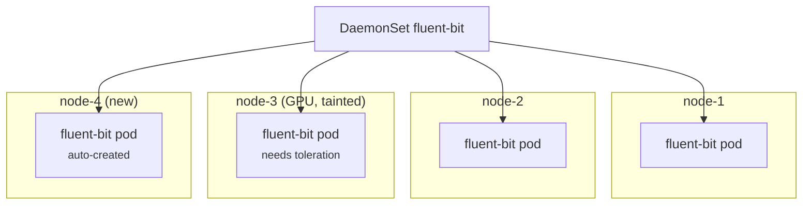

# 05 - DaemonSet

> **One-liner:** A DaemonSet runs **exactly one copy of a Pod on every node**, or on a selected subset of nodes. New nodes get the Pod automatically, and removed nodes take theirs away.

---

## What it is

Typical uses are **node-level agents**:

| Category | Examples |
| --- | --- |
| Logging | Fluent Bit, Fluentd, Vector, Promtail |
| Monitoring | node-exporter, Datadog agent, CloudWatch agent |
| Networking | kube-proxy, aws-node (VPC CNI), Calico, Cilium agent |
| Storage | CSI node plugins (EBS, EFS, Azure Disk) |
| Security | Falco, Defender agents |

DaemonSet Pods are placed by the **default scheduler**: the controller sets node affinity for each target node. They automatically tolerate taints such as `not-ready`, `unreachable`, `disk-pressure`, `memory-pressure` and `unschedulable`.



## Targeting nodes

| Need | Use |
| --- | --- |
| Only some nodes | `nodeSelector` or `nodeAffinity` in the Pod template |
| Run on tainted nodes (control plane, GPU) | Matching `tolerations` |
| Every node, including control-plane nodes | `tolerations: [{operator: Exists}]` |

## Update strategies

| Strategy | Behaviour |
| --- | --- |
| `RollingUpdate` (default) | Replaces Pods node by node. `maxUnavailable` defaults to 1. `maxSurge` lets the new Pod start before the old one stops. |
| `OnDelete` | New Pods are created only when you delete the old ones manually. This gives controlled, node-by-node upgrades. |

## Example YAML

```yaml
apiVersion: apps/v1
kind: DaemonSet
metadata:
  name: node-exporter
  namespace: monitoring
  labels:
    app: node-exporter
spec:
  selector:
    matchLabels:
      app: node-exporter
  updateStrategy:
    type: RollingUpdate
    rollingUpdate:
      maxUnavailable: 1
  template:
    metadata:
      labels:
        app: node-exporter
    spec:
      priorityClassName: system-node-critical   # don't get evicted before workloads
      hostNetwork: true
      hostPID: true
      tolerations:
        - operator: Exists                      # run on every node, incl. tainted
      nodeSelector:
        kubernetes.io/os: linux
      containers:
        - name: node-exporter
          image: quay.io/prometheus/node-exporter:v1.8.2
          args:
            - --path.rootfs=/host
          ports:
            - containerPort: 9100
              hostPort: 9100
          resources:
            requests: { cpu: 50m, memory: 64Mi }
            limits:   { memory: 128Mi }
          volumeMounts:
            - name: root
              mountPath: /host
              readOnly: true
      volumes:
        - name: root
          hostPath:
            path: /
```

## Common commands

```bash
kubectl apply -f daemonset.yaml
kubectl get ds -A                                       # DESIRED / CURRENT / READY / UP-TO-DATE / AVAILABLE
kubectl get ds node-exporter -n monitoring -o wide
kubectl describe ds node-exporter -n monitoring

# Which node has which pod
kubectl get pods -n monitoring -l app=node-exporter -o wide

# Rolling update / rollback
kubectl set image ds/node-exporter node-exporter=quay.io/prometheus/node-exporter:v1.9.0 -n monitoring
kubectl rollout status ds/node-exporter -n monitoring
kubectl rollout history ds/node-exporter -n monitoring
kubectl rollout undo ds/node-exporter -n monitoring
kubectl rollout restart ds/node-exporter -n monitoring

# Drain a node (DaemonSet pods are ignored, not evicted)
kubectl drain node-1 --ignore-daemonsets --delete-emptydir-data
```

## Troubleshooting

| Symptom | Likely cause | What to check |
| --- | --- | --- |
| `DESIRED` is lower than the node count | Taints without tolerations, or `nodeSelector`/affinity excluding nodes | `kubectl describe node X` → Taints; the Pod template's tolerations and selector |
| `DESIRED 5, CURRENT 4` | A Pod can't be created on one node (quota, admission, `hostPort` conflict) | `describe ds` → events |
| A Pod is `Pending` on a specific node | The node is out of CPU or memory | `describe pod`; set `priorityClassName: system-node-critical` |
| `hostPort` conflict | Another Pod on that node already uses the port | `kubectl get pods -A -o wide --field-selector spec.nodeName=X` |
| `UP-TO-DATE` lower than `DESIRED` after an update | The rollout is stuck on a failing Pod, or the strategy is `OnDelete` | `rollout status`; `describe` the new Pod |
| `drain` fails with "DaemonSet-managed pods" | Normal behaviour | Add `--ignore-daemonsets` |
| Agent can't read host files | Missing `hostPath` mount, security context, or Pod Security level | Namespace PSA labels (`privileged` may be needed) |

```bash
# Compare node count vs desired pods
kubectl get nodes --no-headers | wc -l
kubectl get ds node-exporter -n monitoring -o jsonpath='{.status.desiredNumberScheduled}{"\n"}'

# Find nodes WITHOUT the daemon pod
comm -23 \
  <(kubectl get nodes -o name | sed 's|node/||' | sort) \
  <(kubectl get pods -n monitoring -l app=node-exporter -o jsonpath='{range .items[*]}{.spec.nodeName}{"\n"}{end}' | sort)

# Taints on all nodes
kubectl get nodes -o custom-columns=NAME:.metadata.name,TAINTS:.spec.taints

# Pods on a specific node
kubectl get pods -A -o wide --field-selector spec.nodeName=node-1
```

## Interview questions

<details>
<summary><b>DaemonSet vs Deployment?</b></summary>

A Deployment runs N replicas wherever the scheduler puts them. A DaemonSet runs **one per node** and scales with the cluster automatically, which suits node-level agents that need host access such as logs, metrics and networking.
</details>

<details>
<summary><b>How do you run a DaemonSet only on some nodes?</b></summary>

Add a `nodeSelector` or `nodeAffinity` to the Pod template, e.g. `node-role: gpu`. To run on tainted nodes, add matching `tolerations`.
</details>

<details>
<summary><b>How is a DaemonSet scheduled?</b></summary>

The DaemonSet controller creates one Pod per eligible node, with node affinity pinning it to that node. The default scheduler then binds it. DaemonSet Pods automatically tolerate node-condition taints, so they keep running on unhealthy or cordoned nodes.
</details>

<details>
<summary><b>Why use `priorityClassName: system-node-critical`?</b></summary>

So that node agents such as CNI, logging and CSI are not preempted or evicted ahead of workloads. If the CNI DaemonSet Pod is evicted, every Pod on that node loses networking.
</details>

## Quick revision

| Topic | Remember |
| --- | --- |
| Count | One Pod per (matching) node |
| New node | Gets the Pod automatically |
| Targeting | `nodeSelector` / affinity + tolerations |
| Update | `RollingUpdate` (`maxUnavailable` 1) or `OnDelete` |
| Drain | `--ignore-daemonsets` |
| Priority | `system-node-critical` for core agents |
