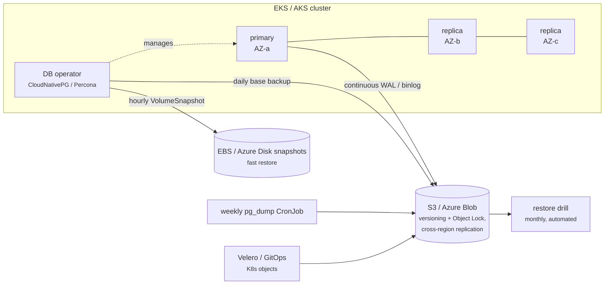
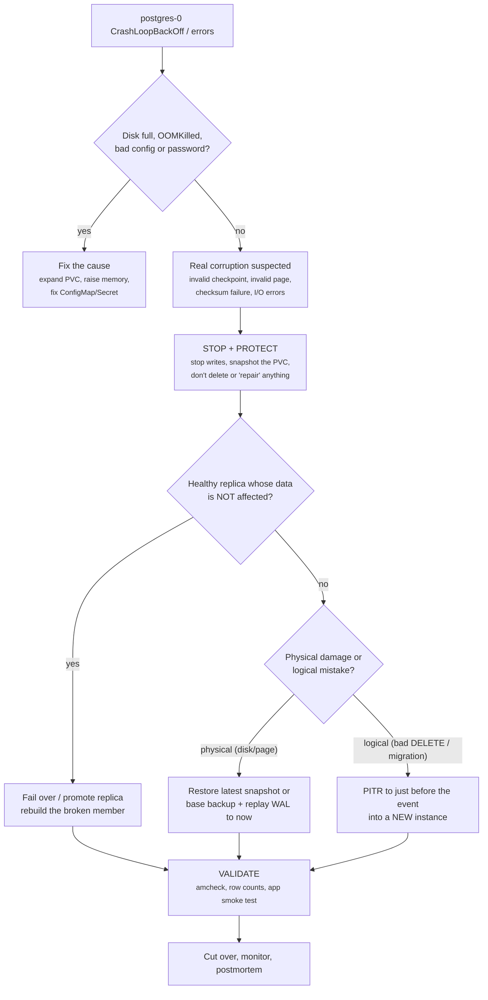

# 06b - Databases on StatefulSets: Crash, Corruption, Backup and Restore

> **One-liner:** A StatefulSet keeps a database Pod's **identity and volume**. It restarts the Pod and reattaches the same PVC, but it **cannot repair corrupted data** and **does not replicate or back up anything**. Data protection comes from the **database layer**: replication, backups, WAL/binlog archiving with point-in-time recovery (PITR), and storage snapshots. You also need **tested restores**.

**Pod recovery** restores the running workload. **Database recovery** restores the integrity of the data. You need both.

Examples use **PostgreSQL** (namespace `database`, StatefulSet `postgres`, Pod `postgres-0`, PVC `data-postgres-0`) on **EKS (EBS)** and **AKS (Azure Disk)**. MySQL equivalents are given where they differ.

---

## Table of contents

1. [Failure scenarios: what Kubernetes does vs what you must do](#1-failure-scenarios)
2. [Backup options compared](#2-backup-options-compared)
3. [Recommended production setup (best way)](#3-recommended-production-setup)
4. [Option 1: Logical backups (pg_dump / mysqldump)](#4-option-1-logical-backups)
5. [Option 2: CSI VolumeSnapshots](#5-option-2-csi-volumesnapshots)
6. [Option 3: Point-in-time recovery with an operator (CloudNativePG)](#6-option-3-point-in-time-recovery-with-cloudnativepg)
7. [Option 4: PITR without an operator (WAL-G / MySQL binlogs)](#7-option-4-pitr-without-an-operator)
8. [Option 5: Velero and cloud backup services](#8-option-5-velero-and-cloud-backup-services)
9. [Runbook: the database is crashing or corrupted](#9-runbook-the-database-is-crashing-or-corrupted)
10. [Troubleshooting backups and restores](#10-troubleshooting-backups-and-restores)
11. [Interview questions](#11-interview-questions)
12. [Quick revision](#12-quick-revision)

---

## 1. Failure scenarios

| Failure | What Kubernetes does | Is the data safe? | What you do |
| --- | --- | --- | --- |
| DB process crashes (bug, OOMKilled) | kubelet restarts the container | Usually; the DB replays its WAL/redo log on start | Find the cause (`logs --previous`, exit code 137 = OOM) |
| Pod deleted | StatefulSet recreates `postgres-0`, reattaches `data-postgres-0` | Yes, the PVC stays | Nothing, unless it keeps happening |
| Node fails | Pod rescheduled after the node is confirmed gone; the EBS/Azure Disk volume reattaches (same AZ) | Yes, if the disk is healthy | Watch for `Multi-Attach` errors and AZ capacity |
| **Disk full** | Container crash-loops (`No space left on device`, `PANIC: could not write to file "pg_wal/..."`) | Yes, **this is not corruption** | Expand the PVC; find the cause (WAL archiving failing, bloat, logs) |
| **Data files corrupted** (bad page, invalid checkpoint) | Keeps restarting the Pod; **can't fix the data** | **At risk** | Protect the volume → fail over to a healthy replica, or restore (Sections 5–7) |
| Underlying disk lost or damaged | Pod stuck `ContainerCreating` / unable to mount | Only if snapshots or backups exist | Restore the latest snapshot or backup |
| **PVC deleted** | Nothing brings it back. With `reclaimPolicy: Delete` the **cloud disk is deleted too** | Only if a backup exists | Restore; prevent with `Retain` and RBAC |
| **Accidental `DELETE`/`DROP` or bad migration** | Nothing. Replicas **replicate the mistake** immediately | Only with PITR or a backup taken before it | PITR to just before the event, into a **new** instance |
| AZ outage | Pod can't move: the EBS/Azure Disk volume is zonal | Yes, but unavailable | Fail over to a replica in another AZ, or restore from snapshot/backup |
| Region outage or cluster deleted | Everything gone | Only with **off-region** backups | Restore in another region (cross-region copies) |

> **A StatefulSet is not high availability.** Three Pods (`postgres-0`, `-1`, `-2`) with three PVCs are three **separate** databases unless **replication and failover** are configured at the database layer (Patroni, CloudNativePG, Percona operators, MySQL Group Replication...).

---

## 2. Backup options compared

| Method | Consistency | Typical RPO | Restore speed (RTO) | Protects against | Does **not** protect against |
| --- | --- | --- | --- | --- | --- |
| **Replica** (streaming replication) | — | ~0 | Seconds (failover) | Pod, node, disk, AZ failure | `DROP TABLE`, bad migrations, logical corruption. **A replica is not a backup.** |
| **Logical dump** (`pg_dump`, `mysqldump`) | Consistent (single transaction) | Backup interval, e.g. 24h | Slow for large DBs (hours) | Logical mistakes, version upgrades, migration between platforms | Changes since the last dump |
| **CSI VolumeSnapshot** (EBS / Azure Disk) | **Crash-consistent** | Snapshot interval, e.g. 1h | Fast (minutes) | Lost or deleted volume, bad change caught early | Changes since the snapshot; region loss (unless copied); corruption already on disk |
| **Base backup + WAL/binlog archive (PITR)** | Consistent | **Seconds to minutes** | Medium (restore base + replay logs) | Everything above, **to a chosen second** | A broken WAL archive (you must monitor it) |
| **Velero** | Depends on the volume method + hooks | Backup interval | Medium | Namespace or cluster loss (objects + volumes together) | Gives DB-level PITR only when combined with the methods above |
| **Managed DB** (RDS, Azure Database for PostgreSQL/MySQL) | Consistent | Minutes (automated PITR, up to 35 days) | Minutes to hours | All of the above, managed for you | Nothing extra to build, but less control and cost to consider |

**Key facts:**
- A snapshot taken at **2:00 PM cannot restore the database to 1:45 PM**. Only **PITR** (base backup + WAL/binlogs) can.
- PostgreSQL and InnoDB can recover from a **crash-consistent** snapshot (like after a power cut) **if the data files and WAL/redo logs are on the same volume**. With a separate WAL volume, you need a coordinated backup (an operator's `volumeSnapshot` method) or an app-consistent freeze.

---

## 3. Recommended production setup

**Best option overall:** if you don't need to run the database in Kubernetes, use a **managed database** (RDS / Aurora, Azure Database for PostgreSQL Flexible Server). Backups, PITR, Multi-AZ failover and patching are built in.

**If the database runs on Kubernetes, layer the protections:**



| Layer | Setting | Why |
| --- | --- | --- |
| HA | Operator with **3 instances across 3 AZs**, automatic failover | Survives Pod, node, disk and AZ failure in seconds |
| PITR | **Continuous WAL/binlog archiving** + **daily base backup** to S3/Blob, **14–30 day** retention | Recover from human error to the second |
| Fast restore | **Hourly volume snapshots**, 24–48h retention | Quick recovery from volume loss |
| Portability | **Weekly logical dump**, long retention | Major-version upgrades, restoring a single table, leaving the platform |
| Off-site | Object storage with **versioning + Object Lock (immutable)**, **cross-region replication**, KMS encryption | Ransomware, account compromise, region loss |
| Safety rails | PV `reclaimPolicy: Retain`; StatefulSet `persistentVolumeClaimRetentionPolicy: Retain`; RBAC denying `delete pvc` | Stops a `kubectl delete` from destroying data |
| Monitoring | Alerts on **last successful backup age**, **WAL archive failures** (`pg_stat_archiver`), replication lag, disk usage above 80% | Backups fail silently otherwise |
| Proof | **Automated monthly restore test** with row-count checks | An untested backup is not a backup |

Write down an **RPO** (how much data you may lose) and an **RTO** (how long you may be down) for each database, and check that the setup meets them.

---

## 4. Option 1: Logical backups

### PostgreSQL: nightly `pg_dump` to S3 (EKS with IRSA)

The ServiceAccount `db-backup` maps to an IAM role that allows `s3:PutObject` on the bucket (see folder 22). Take dumps from a **replica** when one exists, to keep load off the primary.

```yaml
apiVersion: batch/v1
kind: CronJob
metadata:
  name: postgres-logical-backup
  namespace: database
spec:
  schedule: "30 1 * * *"
  timeZone: "Asia/Kolkata"
  concurrencyPolicy: Forbid
  successfulJobsHistoryLimit: 3
  failedJobsHistoryLimit: 3
  jobTemplate:
    spec:
      backoffLimit: 2
      activeDeadlineSeconds: 7200
      template:
        spec:
          serviceAccountName: db-backup
          restartPolicy: OnFailure
          initContainers:
            - name: dump
              image: postgres:17                      # same major version as the server
              command: ["/bin/bash", "-c"]
              args:
                - |
                  set -euo pipefail
                  TS=$(date +%Y%m%d-%H%M)
                  pg_dump -h postgres-1.postgres -U "$PGUSER" -d app -Fc -Z 6 -f /backup/app-$TS.dump
                  pg_dumpall -h postgres-1.postgres -U "$PGUSER" --globals-only > /backup/globals-$TS.sql
                  pg_restore --list /backup/app-$TS.dump > /dev/null    # fails if the archive is unreadable
                  echo "$TS" > /backup/ts
              env:
                - name: PGUSER
                  valueFrom: { secretKeyRef: { name: postgres-secret, key: username } }
                - name: PGPASSWORD
                  valueFrom: { secretKeyRef: { name: postgres-secret, key: password } }
              volumeMounts:
                - { name: backup, mountPath: /backup }
          containers:
            - name: upload
              image: amazon/aws-cli:2.17.0
              command: ["/bin/sh", "-c"]
              args:
                - |
                  set -eu
                  TS=$(cat /backup/ts)
                  aws s3 cp /backup/app-$TS.dump     s3://my-db-backups/postgres/logical/app-$TS.dump     --sse aws:kms
                  aws s3 cp /backup/globals-$TS.sql  s3://my-db-backups/postgres/logical/globals-$TS.sql  --sse aws:kms
              volumeMounts:
                - { name: backup, mountPath: /backup }
          volumes:
            - name: backup
              emptyDir:
                sizeLimit: 50Gi
```

**AKS:** swap the upload container for `mcr.microsoft.com/azure-cli` and use `az storage blob upload --auth-mode login`, with Azure Workload Identity on the ServiceAccount.

### Restore a logical dump

Restore into a **new database first**, validate it, then switch over.

```bash
NS=database
TS=20261019-0130

# 1. Fetch the dump and copy it into the DB pod
aws s3 cp s3://my-db-backups/postgres/logical/app-$TS.dump /tmp/app.dump
kubectl cp /tmp/app.dump $NS/postgres-0:/tmp/app.dump

# 2. Restore into a new database
kubectl exec -it postgres-0 -n $NS -- createdb -U postgres app_restore
kubectl exec -it postgres-0 -n $NS -- pg_restore -U postgres -d app_restore --no-owner -j 4 /tmp/app.dump

# 3. Validate
kubectl exec -it postgres-0 -n $NS -- psql -U postgres -d app_restore -c "SELECT count(*) FROM orders;"

# Restore only ONE table (e.g. someone dropped "customers")
kubectl exec -it postgres-0 -n $NS -- pg_restore -U postgres -d app -t customers /tmp/app.dump

# Roles/permissions (globals) if restoring to a fresh server
kubectl exec -i postgres-0 -n $NS -- psql -U postgres < globals-$TS.sql
```

### MySQL equivalents

```bash
# Backup (consistent InnoDB snapshot, records binlog position for PITR)
kubectl exec mysql-1 -n database -- sh -c \
  'mysqldump -u root -p"$MYSQL_ROOT_PASSWORD" --single-transaction --routines --triggers --events \
   --source-data=2 --all-databases' | gzip > all-$(date +%F).sql.gz

# Restore
gunzip < all-2026-10-19.sql.gz | kubectl exec -i mysql-0 -n database -- sh -c 'mysql -u root -p"$MYSQL_ROOT_PASSWORD"'
```

`--source-data` needs MySQL 8.0.26 or later; older versions use `--master-data`. For large MySQL databases, physical backups with **Percona XtraBackup** are much faster to restore.

---

## 5. Option 2: CSI VolumeSnapshots

### 5.1 Prerequisites

Snapshots need **three** things: the snapshot **CRDs**, the **snapshot controller**, and a **VolumeSnapshotClass** for your CSI driver.

```bash
kubectl api-resources | grep -i volumesnapshot      # CRDs present?
kubectl get pods -A | grep -i snapshot-controller   # controller running?
kubectl get volumesnapshotclass
kubectl get csidriver
kubectl get pvc -n database                          # find the DB PVCs
```

| | EKS | AKS |
| --- | --- | --- |
| CSI driver | `ebs.csi.aws.com` (EBS CSI add-on) | `disk.csi.azure.com` (built in) |
| Snapshot controller | Install the `snapshot-controller` EKS add-on: `aws eks create-addon --cluster-name my-cluster --addon-name snapshot-controller` | Installed by default |
| VolumeSnapshotClass | You create it (below) | Default `csi-azuredisk-vsc` exists |
| IAM | The EBS CSI role needs `ec2:CreateSnapshot`, `DeleteSnapshot`, `DescribeSnapshots`, `CreateTags` (in the managed policy) | Managed identity needs rights on the snapshot resource group |

```yaml
# EKS
apiVersion: snapshot.storage.k8s.io/v1
kind: VolumeSnapshotClass
metadata:
  name: ebs-vsc
  annotations:
    snapshot.storage.kubernetes.io/is-default-class: "true"
driver: ebs.csi.aws.com
deletionPolicy: Retain          # keep the cloud snapshot even if the VolumeSnapshot object is deleted
---
# AKS (only if you want Retain instead of the default class)
apiVersion: snapshot.storage.k8s.io/v1
kind: VolumeSnapshotClass
metadata:
  name: azuredisk-vsc-retain
driver: disk.csi.azure.com
deletionPolicy: Retain
parameters:
  incremental: "true"           # cheaper incremental snapshots
```

### 5.2 Take a snapshot (on demand)

Run a `CHECKPOINT` first. It flushes dirty pages, so the restored copy has less WAL to replay.

```bash
kubectl exec postgres-0 -n database -- psql -U postgres -c "CHECKPOINT;"
```

```yaml
apiVersion: snapshot.storage.k8s.io/v1
kind: VolumeSnapshot
metadata:
  name: postgres-0-20261019-1500
  namespace: database
  labels:
    app: postgres
spec:
  volumeSnapshotClassName: ebs-vsc        # csi-azuredisk-vsc on AKS
  source:
    persistentVolumeClaimName: data-postgres-0
```

```bash
kubectl apply -f snapshot.yaml
kubectl get volumesnapshot -n database -w
kubectl get volumesnapshot postgres-0-20261019-1500 -n database -o jsonpath='{.status.readyToUse}{"\n"}'   # → true
kubectl describe volumesnapshot postgres-0-20261019-1500 -n database
kubectl get volumesnapshotcontent                                                                       # cluster-scoped, holds the cloud snapshot ID
```

`readyToUse: true` only means the **storage** snapshot exists. It does **not** prove the database will start from it. Only a restore test proves that.

### 5.3 Schedule snapshots with retention

Use **SnapScheduler** (backube/snapscheduler, installed with Helm), or the operator's snapshot schedule (Section 6), or AWS Backup / Azure Backup policies.

```yaml
apiVersion: snapscheduler.backube/v1
kind: SnapshotSchedule
metadata:
  name: postgres-hourly
  namespace: database
spec:
  claimSelector:
    matchLabels:
      app: postgres              # StatefulSet PVCs carry the selector labels
  schedule: "0 * * * *"          # hourly
  retention:
    expires: "48h"
    maxCount: 48
  snapshotTemplate:
    snapshotClassName: ebs-vsc
    labels:
      backup: hourly
```

```bash
kubectl get snapshotschedule -n database
kubectl get volumesnapshot -n database -l backup=hourly --sort-by=.metadata.creationTimestamp
```

**DR:** copy snapshots to another region (`aws ec2 copy-snapshot` or an AWS Backup copy rule; Azure Backup vault cross-region restore). In-region snapshots alone don't survive a region outage.

### 5.4 Restore a snapshot into a new PVC

This is the **safe first step**. Restore into a **new** PVC and leave the original untouched.

```yaml
apiVersion: v1
kind: PersistentVolumeClaim
metadata:
  name: postgres-restore-pvc
  namespace: database
spec:
  storageClassName: gp3                     # same StorageClass/driver as the source
  dataSource:
    name: postgres-0-20261019-1500
    kind: VolumeSnapshot
    apiGroup: snapshot.storage.k8s.io
  accessModes: ["ReadWriteOnce"]
  resources:
    requests:
      storage: 100Gi                        # >= the source volume size; never smaller
```

```bash
kubectl apply -f restore-pvc.yaml
kubectl get pvc postgres-restore-pvc -n database     # Pending until a Pod uses it (WaitForFirstConsumer) is normal
```

### 5.5 Option A (recommended first): validate on an isolated recovery Pod

The Pod's labels don't match any Service, so it can't receive production traffic.

```yaml
apiVersion: v1
kind: Pod
metadata:
  name: pg-recovery-check
  namespace: database
  labels:
    role: recovery-check
spec:
  securityContext:
    fsGroup: 999                            # postgres user in the official image
  containers:
    - name: postgres
      image: postgres:17                    # SAME major version as production
      env:
        - { name: PGDATA, value: /var/lib/postgresql/data/pgdata }   # same layout as production
        - name: POSTGRES_PASSWORD
          valueFrom: { secretKeyRef: { name: postgres-secret, key: password } }
      volumeMounts:
        - { name: data, mountPath: /var/lib/postgresql/data }
  volumes:
    - name: data
      persistentVolumeClaim:
        claimName: postgres-restore-pvc
```

```bash
kubectl apply -f recovery-pod.yaml
kubectl logs -f pg-recovery-check -n database      # expect "database system was interrupted ... redo done ... ready to accept connections"

# Integrity + data checks
kubectl exec -it pg-recovery-check -n database -- pg_amcheck -U postgres --all --install-missing
kubectl exec -it pg-recovery-check -n database -- psql -U postgres -d app -c "SELECT count(*), max(created_at) FROM orders;"
```

`pg_amcheck` is available in PostgreSQL 14 and later. For MySQL, run `mysqlcheck -u root -p --all-databases --check`.

### 5.6 Option B: swap the restored data into the StatefulSet

A StatefulSet always uses the PVC named `<template>-<sts>-<ordinal>` (`data-postgres-0`). A new PVC with a different name is ignored. To swap, you **replace the PVC with one of the same name** that is created from the snapshot.

> **Before you start, check that scaling to 0 will not delete your PVCs.** If the StatefulSet has `persistentVolumeClaimRetentionPolicy.whenScaled: Delete`, scaling down removes them. Run `kubectl get sts postgres -n database -o jsonpath='{.spec.persistentVolumeClaimRetentionPolicy}'` and confirm it says `Retain` (the default).

```bash
NS=database
SNAP=postgres-0-20261019-1500

# 0. Stop application writes (scale the app or put it in maintenance), then stop the DB
kubectl scale sts postgres -n $NS --replicas=0
kubectl wait --for=delete pod/postgres-0 -n $NS --timeout=300s

# 1. Protect the CURRENT (bad) data: keep its disk, and snapshot it for forensics
PV=$(kubectl get pvc data-postgres-0 -n $NS -o jsonpath='{.spec.volumeName}')
kubectl patch pv $PV -p '{"spec":{"persistentVolumeReclaimPolicy":"Retain"}}'
kubectl apply -f - <<EOF
apiVersion: snapshot.storage.k8s.io/v1
kind: VolumeSnapshot
metadata:
  name: postgres-0-pre-restore-$(date +%Y%m%d%H%M)
  namespace: $NS
spec:
  volumeSnapshotClassName: ebs-vsc
  source:
    persistentVolumeClaimName: data-postgres-0
EOF
kubectl get volumesnapshot -n $NS -w            # wait for readyToUse=true

# 2. Delete only the PVC object (the PV + cloud disk stay because of Retain)
kubectl delete pvc data-postgres-0 -n $NS

# 3. Recreate the PVC with the SAME name, populated from the good snapshot
kubectl apply -f - <<EOF
apiVersion: v1
kind: PersistentVolumeClaim
metadata:
  name: data-postgres-0
  namespace: $NS
  labels:
    app: postgres
spec:
  storageClassName: gp3
  dataSource:
    name: $SNAP
    kind: VolumeSnapshot
    apiGroup: snapshot.storage.k8s.io
  accessModes: ["ReadWriteOnce"]
  resources:
    requests:
      storage: 100Gi
EOF

# 4. Start the DB; postgres-0 binds to the restored PVC
kubectl scale sts postgres -n $NS --replicas=1
kubectl logs -f postgres-0 -n $NS
kubectl exec -it postgres-0 -n $NS -- psql -U postgres -d app -c "SELECT count(*) FROM orders;"

# 5. Only after validation: re-seed replicas (their data is now AHEAD of / diverged from the primary),
#    restore the original replica count, re-enable the app, and later clean up the old PV
kubectl get pv $PV        # Released; delete it (and its disk) only when you're sure
```

If you run replicas (`postgres-1`, `postgres-2`), they must be **rebuilt from the restored primary**: delete their PVCs and let replication re-clone, or use the operator. Otherwise they hold newer, conflicting data. This manual complexity is the main reason to use an **operator** (Option 3).

---

## 6. Option 3: Point-in-time recovery with CloudNativePG

**CloudNativePG (CNPG)** is a CNCF PostgreSQL operator. It replaces a hand-made StatefulSet and manages:
- the primary and replicas, with **automatic failover**;
- **continuous WAL archiving** and **base backups** to S3, Azure Blob or GCS (Barman Cloud);
- **volume-snapshot backups**;
- **PITR** restores into a new cluster.

> CNPG 1.26+ moves object-store backups to the **Barman Cloud Plugin** (an `ObjectStore` resource referenced from `spec.plugins`). The in-tree `barmanObjectStore` field below is deprecated but shows the same concepts and flow. Use the syntax from the CNPG docs for the version you install.

```bash
# Install the operator
helm repo add cnpg https://cloudnative-pg.github.io/charts
helm upgrade --install cnpg cnpg/cloudnative-pg -n cnpg-system --create-namespace
# kubectl plugin (status, backup, promote ...)
curl -sSfL https://github.com/cloudnative-pg/cloudnative-pg/raw/main/hack/install-cnpg-plugin.sh | sudo sh -s -- -b /usr/local/bin
```

### Cluster with WAL archiving + backups (EKS, IRSA)

```yaml
apiVersion: postgresql.cnpg.io/v1
kind: Cluster
metadata:
  name: pg
  namespace: database
spec:
  instances: 3                                  # 1 primary + 2 replicas, spread across AZs
  imageName: ghcr.io/cloudnative-pg/postgresql:17.5
  storage:
    size: 100Gi
    storageClass: gp3
  walStorage:                                   # separate WAL volume (snapshots are coordinated by CNPG)
    size: 20Gi
    storageClass: gp3
  topologySpreadConstraints:
    - maxSkew: 1
      topologyKey: topology.kubernetes.io/zone
      whenUnsatisfiable: DoNotSchedule
      labelSelector:
        matchLabels:
          cnpg.io/cluster: pg
  serviceAccountTemplate:
    metadata:
      annotations:
        eks.amazonaws.com/role-arn: arn:aws:iam::111122223333:role/cnpg-pg-backup   # trust: system:serviceaccount:database:pg
  backup:
    retentionPolicy: "30d"
    barmanObjectStore:
      destinationPath: s3://my-db-backups/cnpg/
      s3Credentials:
        inheritFromIAMRole: true
      wal:
        compression: gzip
      data:
        compression: gzip
    volumeSnapshot:
      className: ebs-vsc
```

**AKS:** set `destinationPath: https://<account>.blob.core.windows.net/<container>/` and `azureCredentials: { inheritFromAzureAD: true }`, with the Workload Identity annotation on `serviceAccountTemplate`.

### Scheduled and on-demand backups

```yaml
apiVersion: postgresql.cnpg.io/v1
kind: ScheduledBackup
metadata:
  name: pg-daily
  namespace: database
spec:
  schedule: "0 0 2 * * *"          # CNPG cron has a SECONDS field first: 02:00:00 daily
  backupOwnerReference: self
  cluster:
    name: pg
  method: barmanObjectStore        # base backup to S3/Blob (WAL is archived continuously anyway)
---
apiVersion: postgresql.cnpg.io/v1
kind: ScheduledBackup
metadata:
  name: pg-snapshot-4h
  namespace: database
spec:
  schedule: "0 0 */4 * * *"
  backupOwnerReference: self
  cluster:
    name: pg
  method: volumeSnapshot           # fast-restore snapshots
```

```bash
kubectl cnpg status pg -n database                   # primary, replicas, lag, WAL archiving status, last backup
kubectl cnpg backup pg -n database                   # on-demand backup
kubectl get backups -n database
kubectl get scheduledbackups -n database
aws s3 ls s3://my-db-backups/cnpg/pg/ --recursive | tail
```

### PITR: restore to just before a mistake

Say someone ran `DELETE FROM orders` at **09:45 IST**. You restore a **new cluster** to **09:44**. Production keeps running untouched while you validate.

```yaml
apiVersion: postgresql.cnpg.io/v1
kind: Cluster
metadata:
  name: pg-restore
  namespace: database
spec:
  instances: 1
  imageName: ghcr.io/cloudnative-pg/postgresql:17.5        # same major version as the backup
  storage:
    size: 100Gi
    storageClass: gp3
  serviceAccountTemplate:
    metadata:
      annotations:
        eks.amazonaws.com/role-arn: arn:aws:iam::111122223333:role/cnpg-pg-backup   # trust must also allow system:serviceaccount:database:pg-restore
  bootstrap:
    recovery:
      source: pg
      recoveryTarget:
        targetTime: "2026-10-19 09:44:00+05:30"
  externalClusters:
    - name: pg
      barmanObjectStore:
        destinationPath: s3://my-db-backups/cnpg/
        serverName: pg                   # folder of the ORIGINAL cluster's backups
        s3Credentials:
          inheritFromIAMRole: true
        wal:
          maxParallel: 8
```

```bash
kubectl apply -f pg-restore.yaml
kubectl cnpg status pg-restore -n database
kubectl logs -n database -l cnpg.io/cluster=pg-restore -f      # "recovery stopping before commit ...", "selected new timeline"

# Validate
kubectl exec -it pg-restore-1 -n database -- psql -U postgres -d app -c "SELECT count(*) FROM orders;"

# Then EITHER copy the lost rows back into production:
kubectl exec pg-restore-1 -n database -- pg_dump -U postgres -d app -t orders --data-only -Fc > orders.dump
#   (load selectively into production, e.g. into a staging table, then INSERT ... ON CONFLICT DO NOTHING)
# OR cut the application over to pg-restore-rw (Service) and retire the old cluster
```

Other recovery targets are `targetLSN`, `targetXID`, `targetName` (a restore point), and `targetImmediate` (end of the base backup).

**Other databases:**

| Database | Operator with backup + PITR |
| --- | --- |
| PostgreSQL | CloudNativePG, Crunchy PGO (pgBackRest), Zalando (WAL-G) |
| MySQL | Percona Operator for MySQL (XtraBackup + binlog PITR), Oracle MySQL Operator |
| MongoDB | Percona Operator for MongoDB (oplog PITR) |
| Redis | Snapshots (RDB/AOF) via the Redis operator or Velero; usually treated as a cache |

---

## 7. Option 4: PITR without an operator

These work with a hand-made StatefulSet, but you own all the scripting. Prefer an operator.

### PostgreSQL with WAL-G (to S3 / Azure Blob)

The image must contain `wal-g`, configured with `WALG_S3_PREFIX=s3://my-db-backups/walg` (or `WALG_AZ_PREFIX`) and IRSA / Workload Identity.

```ini
# postgresql.conf (via ConfigMap)
archive_mode = on
archive_command = 'wal-g wal-push %p'
archive_timeout = 60          # ship a WAL segment at least every 60s → RPO about 1 minute
```

```bash
# Base backup (daily CronJob or manual)
kubectl exec postgres-0 -n database -- wal-g backup-push /var/lib/postgresql/data/pgdata
kubectl exec postgres-0 -n database -- wal-g backup-list

# Is archiving healthy? (failed_count should not grow)
kubectl exec postgres-0 -n database -- psql -U postgres -c \
  "SELECT archived_count, last_archived_time, failed_count, last_failed_time FROM pg_stat_archiver;"

# Restore to a point in time (into an EMPTY data dir on a new PVC / recovery pod)
wal-g backup-fetch /var/lib/postgresql/data/pgdata LATEST
cat >> /var/lib/postgresql/data/pgdata/postgresql.auto.conf <<'EOF'
restore_command = 'wal-g wal-fetch %f %p'
recovery_target_time = '2026-10-19 09:44:00+05:30'
recovery_target_action = 'promote'
EOF
touch /var/lib/postgresql/data/pgdata/recovery.signal
# start postgres → it replays WAL up to the target, then promotes
```

### MySQL with binary logs

```bash
# Prerequisite: binlogs enabled (default in MySQL 8) and copied OFF the volume regularly
kubectl exec mysql-0 -n database -- sh -c 'mysql -u root -p"$MYSQL_ROOT_PASSWORD" -e "SHOW BINARY LOGS;"'

# 1. Restore the last full backup (dump taken with --source-data=2)
gunzip < all-2026-10-19.sql.gz | mysql -h <restore-host> -u root -p

# 2. Find the binlog position recorded in the dump
zgrep -m1 "CHANGE REPLICATION SOURCE TO\|CHANGE MASTER TO" all-2026-10-19.sql.gz

# 3. Replay binlogs from that position up to just before the mistake
mysqlbinlog --start-position=<pos> --stop-datetime="2026-10-19 09:44:00" \
  binlog.000123 binlog.000124 | mysql -h <restore-host> -u root -p
```

Unlike PostgreSQL's `recovery_target_time`, `mysqlbinlog --stop-datetime` uses the **server's time zone** (often UTC in containers). Check it before choosing the stop time.

---

## 8. Option 5: Velero and cloud backup services

### Velero: back up the whole namespace (objects + volumes)

```yaml
# In the StatefulSet Pod template: run CHECKPOINT before the volume is captured
metadata:
  annotations:
    pre.hook.backup.velero.io/container: postgres
    pre.hook.backup.velero.io/command: '["/bin/bash", "-c", "psql -U postgres -c CHECKPOINT"]'
    pre.hook.backup.velero.io/timeout: 60s
```

```bash
# CSI snapshots of the PVCs + all K8s objects in the namespace
velero backup create db-$(date +%F) --include-namespaces database --snapshot-volumes --wait
# OR copy file data to object storage (works across clouds/regions, slower)
velero backup create db-fsb-$(date +%F) --include-namespaces database --default-volumes-to-fs-backup --wait

velero schedule create db-6h --schedule="0 */6 * * *" --include-namespaces database --ttl 168h
velero backup describe db-2026-10-19 --details
velero backup logs db-2026-10-19

# Restore into a NEW namespace to validate side by side
velero restore create db-restore --from-backup db-2026-10-19 --namespace-mappings database:database-restore --wait
velero restore describe db-restore --details
kubectl get pods,pvc -n database-restore
```

### Cloud-native options

| Platform | Service | Notes |
| --- | --- | --- |
| EKS | **AWS Backup** (EBS snapshot plans by tag; EKS cluster backup support) | Cross-region and cross-account copies, **Vault Lock** for immutability. Check current EKS support in your region. |
| EKS | **Amazon Data Lifecycle Manager** | Simple scheduled EBS snapshots by volume tag |
| AKS | **Azure Backup for AKS** (Backup vault + extension) | Backs up cluster resources + Azure Disk PVs; snapshot and vault tiers |
| Both | **Managed DB** (RDS / Azure Database) | Automated backups + PITR up to 35 days, no operator to run |

All of these give **crash-consistent volume** protection. Combine them with database-native WAL/binlog backups for PITR.

---

## 9. Runbook: the database is crashing or corrupted



### Step 1: Diagnose

```bash
NS=database
kubectl get pods -n $NS -o wide                                    # restarts, node
kubectl describe pod postgres-0 -n $NS | sed -n '/State/,/Events/p'  # exit code: 137 = OOMKilled
kubectl logs postgres-0 -n $NS --previous --tail=100
kubectl logs postgres-0 -n $NS --previous | grep -Ei 'PANIC|FATAL|corrupt|invalid|checksum|No space left|I/O error'
kubectl get events -n $NS --sort-by=.lastTimestamp | tail -20
kubectl get pvc data-postgres-0 -n $NS
```

| Log message | Meaning |
| --- | --- |
| `No space left on device`, `could not write to file "pg_wal/..."` | **Disk full**: expand the PVC. Often WAL piles up because **archiving is failing**. |
| `invalid checkpoint record`, `could not locate a valid checkpoint record` | Control file or WAL damaged |
| `invalid page in block N of relation ...` | Data page corruption |
| `page verification failed, calculated checksum ...` | Checksum mismatch (needs data checksums enabled) |
| `could not read block ... : read only 0 of 8192 bytes` | Truncated file or storage problem |
| MySQL `InnoDB: Database page corruption on disk` | Corrupted InnoDB page |
| MySQL `[ERROR] ... Table ... is marked as crashed` | MyISAM table needs repair |

```bash
# Is the disk full?
kubectl exec postgres-0 -n $NS -- df -h /var/lib/postgresql/data       # works only while the container is up
# Storage / filesystem errors on the node
NODE=$(kubectl get pod postgres-0 -n $NS -o jsonpath='{.spec.nodeName}')
kubectl debug node/$NODE -it --image=busybox:1.36 -- chroot /host dmesg -T | grep -Ei 'I/O error|ext4|xfs|nvme'
```

### Step 2: Inspect a crash-looping database safely

You can't `exec` into a container that keeps crashing. Stop the StatefulSet and mount the PVC in a **sleeping debug Pod**.

```bash
kubectl scale sts postgres -n $NS --replicas=0
kubectl apply -f - <<'EOF'
apiVersion: v1
kind: Pod
metadata:
  name: pg-debug
  namespace: database
spec:
  securityContext: { fsGroup: 999 }
  containers:
    - name: debug
      image: postgres:17
      command: ["sleep", "infinity"]
      volumeMounts:
        - { name: data, mountPath: /var/lib/postgresql/data }
  volumes:
    - name: data
      persistentVolumeClaim:
        claimName: data-postgres-0
EOF
kubectl exec -it pg-debug -n $NS -- bash
#   df -h /var/lib/postgresql/data
#   du -sh /var/lib/postgresql/data/pgdata/pg_wal
#   su postgres -c "pg_controldata /var/lib/postgresql/data/pgdata"   # state, last checkpoint
kubectl delete pod pg-debug -n $NS     # before scaling the StatefulSet back up (RWO volume)
```

### Step 3: Protect the evidence

1. Take a VolumeSnapshot of the damaged PVC (Section 5.6, step 1).
2. Set the PV to `reclaimPolicy: Retain`.
3. **Don't** delete the PVC, run `pg_resetwal`, set `innodb_force_recovery` above 0, or "repair" anything **before you have a copy**. Those tools can cause **permanent data loss**. Use them only on a copy, as a last resort, to **extract** data.

### Step 4: Recover (choose the least-lossy path)

| Situation | Path | Data loss |
| --- | --- | --- |
| Healthy replica, corruption is local to the primary's disk | Fail over (`kubectl cnpg promote pg pg-2 -n database`, or Patroni/operator), then rebuild the broken member from the new primary | ~0 |
| Physical corruption, no healthy replica | Restore the latest base backup and replay WAL **to the end** (CNPG: recovery without `recoveryTarget`), or the latest snapshot | Since the last archived WAL (seconds) or last snapshot |
| Logical mistake (bad `DELETE`, `DROP`, migration) | **PITR to just before the event** into a new instance, then copy the rows back or cut over | Only the bad change, if done carefully |
| Disk / AZ lost | Promote a replica in another AZ, or restore a snapshot / backup in a healthy AZ | ~0 to RPO |
| Region lost | Restore from cross-region backup copies into a cluster in another region | RPO of the cross-region copy |

### Step 5: Validate, then return to service

```bash
kubectl exec -it postgres-0 -n $NS -- pg_amcheck -U postgres --all --install-missing
kubectl exec -it postgres-0 -n $NS -- psql -U postgres -d app -c \
  "SELECT 'orders', count(*), max(created_at) FROM orders UNION ALL SELECT 'customers', count(*), max(updated_at) FROM customers;"
kubectl exec -it postgres-0 -n $NS -- psql -U postgres -c "SELECT pg_is_in_recovery();"   # f = primary, accepting writes
# Re-enable the application, watch error rates and replication lag, then write the postmortem
```

---

## 10. Troubleshooting backups and restores

| Symptom | Likely cause | What to check / fix |
| --- | --- | --- |
| `no matches for kind "VolumeSnapshot"` | Snapshot CRDs not installed | Install the `snapshot-controller` add-on (EKS) / external-snapshotter CRDs |
| VolumeSnapshot never `readyToUse` | No snapshot controller, wrong `volumeSnapshotClassName`, CSI IAM lacks `ec2:CreateSnapshot` | `describe volumesnapshot`; snapshot-controller and CSI controller logs |
| Restored PVC stuck `Pending` | `WaitForFirstConsumer` (normal until a Pod uses it), requested size smaller than the snapshot, or a different CSI driver | `describe pvc`; size ≥ the source; same driver |
| Restored DB is slow at first (EKS) | EBS restores **lazily load** blocks from S3 | Pre-warm by reading the volume, or enable EBS Fast Snapshot Restore for critical snapshots |
| Restored DB won't start: `permission denied` | File ownership vs the container UID | `securityContext.fsGroup` / `runAsUser` matching the image (999 for official postgres) |
| Restored DB won't start: `database files are incompatible with server` | Different PostgreSQL major version | Use the **same major** image as the source |
| Restored DB won't start: `lock file "postmaster.pid" already exists` | Stale pid file copied from the crash-consistent snapshot | Usually harmless and handled on start; otherwise remove it from a debug Pod |
| Swapped PVC but the StatefulSet still uses old data | The new PVC has a different name | The PVC must be named `data-postgres-0` (Section 5.6) |
| Scaled to 0 and the PVCs were deleted | `persistentVolumeClaimRetentionPolicy.whenScaled: Delete` | Set `Retain`; restore from snapshot |
| `pg_wal` grows until the disk is full | `archive_command` failing (IAM, bucket, network) | `pg_stat_archiver.failed_count`; operator status; fix the credentials |
| CNPG backup `failed`: `AccessDenied` | IRSA trust `sub` doesn't match `system:serviceaccount:<ns>:<cluster-name>` | IAM trust policy; the restore cluster's SA name differs too |
| PITR stops early: `recovery ended before configured recovery target was reached` | Missing WAL between the base backup and the target, or the target is before the base backup ended | Pick a base backup older than the target; check WAL continuity in the bucket |
| Backup CronJob "succeeds" but the file is empty | Pipe hid the failure (`pg_dump ... | gzip` without `pipefail`) | `set -euo pipefail`; verify with `pg_restore --list`; alert on file size |
| Velero `PartiallyFailed` | Hook failed, CSI snapshot timeout, or a resource conflict on restore | `velero backup logs`; `velero restore describe --details` |
| Snapshot restore fails in another region | Snapshots are regional | Copy them cross-region first (AWS Backup copy rule / `aws ec2 copy-snapshot`) |

```bash
# Snapshot pipeline health
kubectl get volumesnapshot,volumesnapshotcontent -A
kubectl logs -n kube-system deploy/snapshot-controller --tail=50
kubectl logs -n kube-system deploy/ebs-csi-controller -c csi-snapshotter --tail=50

# Age of the newest snapshot / backup (alert if too old)
kubectl get volumesnapshot -n database --sort-by=.metadata.creationTimestamp | tail -1
kubectl get backups -n database --sort-by=.metadata.creationTimestamp | tail -1
aws s3 ls s3://my-db-backups/postgres/logical/ | sort | tail -1
```

---

## 11. Interview questions

<details>
<summary><b>A database in a StatefulSet is corrupted. Will Kubernetes fix it?</b></summary>

No. The StatefulSet restarts the Pod and reattaches the **same** PVC, so the corrupted files come back with it, and the Pod may crash-loop. Kubernetes manages the **workload**, not the **data**.

Recovery must happen at the database layer:
1. Diagnose; it may be a full disk rather than corruption.
2. Protect the volume with a snapshot.
3. Fail over to a healthy replica, or restore from a snapshot or base backup with WAL replay, or use PITR for logical mistakes.
4. Validate before going back into service.
</details>

<details>
<summary><b>Is a replica a backup?</b></summary>

No. Replication copies **every** change within seconds, including `DROP TABLE`, a bad migration or logical corruption. Replicas protect against **infrastructure** failure (node, disk, AZ). Backups with PITR protect against **data** mistakes. You need both.
</details>

<details>
<summary><b>Volume snapshot vs database backup?</b></summary>

- A **volume snapshot** is a fast, **crash-consistent** copy of the disk at one moment. It restores quickly, but only to that moment, and only cleanly if the data and WAL are on the same volume.
- A **database-native backup** (`pg_dump`, a base backup, XtraBackup) is consistent and portable.
- Adding **WAL or binlog archiving** allows restoring to **any second** (PITR).

Use snapshots for fast RTO, and backups plus logs for a small RPO and protection against logical errors.
</details>

<details>
<summary><b>How do you do point-in-time recovery for PostgreSQL on Kubernetes?</b></summary>

1. Continuously archive WAL to object storage, with periodic base backups (CloudNativePG / Barman, pgBackRest, or WAL-G).
2. To recover, bootstrap a **new** instance from the latest base backup **before** the target time.
3. Replay the archived WAL up to `recovery_target_time`, just before the incident.
4. Validate, then copy the lost data back or cut the application over.

Production keeps running throughout, and the original data is never touched.
</details>

<details>
<summary><b>How do you restore a snapshot into a StatefulSet?</b></summary>

1. Restore the snapshot to a **new PVC** and validate it in an isolated Pod.
2. To swap it in: check the PVC retention policy, scale the StatefulSet to 0, set the old PV to `Retain`, and snapshot the old PVC.
3. Delete the old PVC object, and create a PVC with the **same name** (`data-postgres-0`) whose `dataSource` is the snapshot.
4. Scale back up, then re-seed any replicas from the restored primary.

An operator does all of this more safely.
</details>

<details>
<summary><b>What is your backup strategy for a production database on EKS or AKS?</b></summary>

My first choice is a managed DB (RDS / Azure Database), which gives automated backups, PITR and Multi-AZ. If it must run on Kubernetes:
- an operator (CloudNativePG / Percona) with 3 instances across AZs;
- continuous WAL archiving plus daily base backups to S3/Blob, with versioning, Object Lock and cross-region replication;
- hourly volume snapshots for fast restore;
- weekly logical dumps;
- Velero/GitOps for the Kubernetes objects;
- `Retain` reclaim policies;
- alerts on backup age and archive failures;
- automated monthly restore drills, measured against the agreed RPO and RTO.
</details>

<details>
<summary><b>What are RPO and RTO?</b></summary>

- **RPO** (Recovery Point Objective) is how much data you can afford to lose, measured in time. It is driven by backup or WAL frequency.
- **RTO** (Recovery Time Objective) is how long you can afford to be down. It is driven by restore method and size.

For example, WAL archiving every 60 seconds plus snapshots gives an RPO of about 1 minute and an RTO of minutes. Nightly dumps alone give an RPO of up to 24 hours and an RTO of hours.
</details>

---

## 12. Quick revision

| Topic | Remember |
| --- | --- |
| StatefulSet | Restarts the Pod + same PVC; **no repair, no HA, no backup** |
| Disk full ≠ corruption | Expand the PVC; check WAL archiving |
| Replica | HA, **not** a backup |
| Snapshot | Fast, crash-consistent, one point in time |
| PITR | Base backup + WAL/binlogs → any second |
| Restore rule | Into a **new** PVC/instance first; validate; then cut over |
| Protect first | Snapshot the bad PVC, PV `Retain`, no "repair" tools on the original |
| PVC swap | Same name `data-postgres-0` from `dataSource`; check `whenScaled: Retain` |
| Best practice | Managed DB, or operator + WAL archive + snapshots + off-region immutable copies + restore drills |
