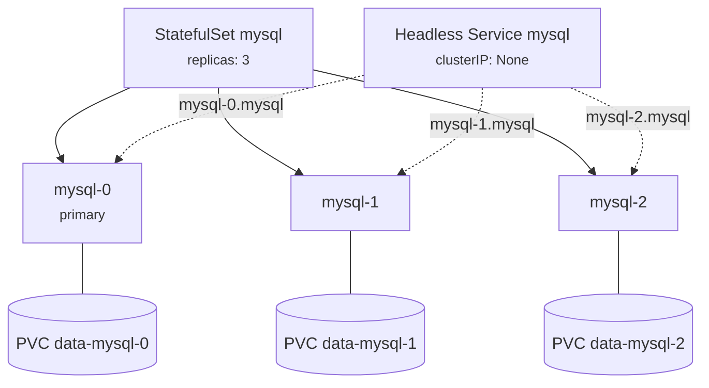

# 06 - StatefulSet

> **One-liner:** A StatefulSet runs **stateful** applications. Each Pod gets a **stable name**, a **stable network identity** and **its own persistent volume**, and Pods are created, updated and deleted **in order**.

---

## What it guarantees

| Guarantee | Detail |
| --- | --- |
| **Stable name** | `<sts>-0`, `<sts>-1`, `<sts>-2`. A rescheduled Pod keeps the same name. |
| **Stable DNS** | `<pod>.<headless-svc>.<ns>.svc.cluster.local`, e.g. `mysql-0.mysql.db.svc.cluster.local` |
| **Stable storage** | `volumeClaimTemplates` create one PVC per Pod (`data-mysql-0`), which reattaches to the same Pod name |
| **Ordered operations** | Pods are created 0 → N, and scaled down or deleted N → 0. Each Pod waits for the previous one to be Running and Ready. |

Typical uses are databases (MySQL, PostgreSQL, MongoDB), Kafka, ZooKeeper, Elasticsearch, Redis Cluster and etcd.



## Key settings

| Field | Meaning |
| --- | --- |
| `serviceName` | The **headless** Service that provides the per-Pod DNS records. It must exist. |
| `podManagementPolicy` | `OrderedReady` (default, one at a time) or `Parallel` (start or stop all at once) |
| `updateStrategy` | `RollingUpdate` (default; updates from the highest ordinal down) or `OnDelete` |
| `rollingUpdate.partition` | Only Pods with an ordinal ≥ partition are updated. This gives you **canary / staged** rollouts. |
| `persistentVolumeClaimRetentionPolicy` | `whenDeleted` / `whenScaled`: `Retain` (default) or `Delete` |

**PVCs are not deleted** by default when you scale down or delete the StatefulSet. This protects your data, but you must clean them up yourself.

## Example YAML

```yaml
apiVersion: v1
kind: Service
metadata:
  name: mysql
  namespace: db
spec:
  clusterIP: None            # headless
  selector:
    app: mysql
  ports:
    - port: 3306
      name: mysql
---
apiVersion: apps/v1
kind: StatefulSet
metadata:
  name: mysql
  namespace: db
spec:
  serviceName: mysql
  replicas: 3
  podManagementPolicy: OrderedReady
  selector:
    matchLabels:
      app: mysql
  updateStrategy:
    type: RollingUpdate
    rollingUpdate:
      partition: 0
  persistentVolumeClaimRetentionPolicy:
    whenDeleted: Retain
    whenScaled: Retain
  template:
    metadata:
      labels:
        app: mysql
    spec:
      terminationGracePeriodSeconds: 60
      containers:
        - name: mysql
          image: mysql:8.4
          ports:
            - containerPort: 3306
          env:
            - name: MYSQL_ROOT_PASSWORD
              valueFrom:
                secretKeyRef:
                  name: mysql-secret
                  key: root-password
          readinessProbe:
            exec:
              command: ["sh", "-c", "mysqladmin ping -uroot -p$MYSQL_ROOT_PASSWORD"]
            periodSeconds: 10
          volumeMounts:
            - name: data
              mountPath: /var/lib/mysql
  volumeClaimTemplates:
    - metadata:
        name: data
      spec:
        accessModes: ["ReadWriteOnce"]
        storageClassName: gp3            # EBS gp3 on EKS / managed-csi on AKS
        resources:
          requests:
            storage: 20Gi
```

## Common commands

```bash
kubectl apply -f statefulset.yaml
kubectl get sts,pods,pvc -n db
kubectl describe sts mysql -n db

# Scale (ordered: adds mysql-3, removes highest ordinal first)
kubectl scale sts mysql --replicas=5 -n db

# Rollout
kubectl set image sts/mysql mysql=mysql:8.4.3 -n db
kubectl rollout status sts/mysql -n db
kubectl rollout history sts/mysql -n db
kubectl rollout undo sts/mysql -n db

# Staged rollout: only update ordinals >= 2
kubectl patch sts mysql -n db -p '{"spec":{"updateStrategy":{"rollingUpdate":{"partition":2}}}}'

# DNS check of per-pod identity
kubectl run dns --image=busybox:1.36 -it --rm -n db -- nslookup mysql-0.mysql.db.svc.cluster.local

# Clean up PVCs after deleting the StatefulSet (data loss!)
kubectl delete pvc -n db -l app=mysql
```

## Troubleshooting

| Symptom | Likely cause | What to check |
| --- | --- | --- |
| Only `mysql-0` exists; `mysql-1` never appears | `mysql-0` is not Ready, and `OrderedReady` blocks the next Pod | `describe pod mysql-0`; its readiness probe; `logs` |
| Pod `Pending` with `unbound PersistentVolumeClaim` | No StorageClass or default class, or the provisioner failed | `kubectl get pvc,sc -n db`; `describe pvc`; CSI controller logs |
| `volume node affinity conflict` | The PV is in AZ-a but the Pod was scheduled in AZ-b | StorageClass `volumeBindingMode: WaitForFirstConsumer`; check node zones |
| Pod stuck `ContainerCreating` with `Multi-Attach error` | The old Pod's RWO volume is still attached to a dead node | `describe pod`; the VolumeAttachment; wait or detach, and confirm the old node is truly gone |
| Pod stuck `Terminating` after a node failure | The StatefulSet won't create a duplicate identity until the old Pod is confirmed gone | Confirm the node is dead, then `kubectl delete pod mysql-1 --grace-period=0 --force` |
| Rollout stuck | Updated Pod not Ready, or `partition` set too high | `rollout status`; `get sts -o yaml` → `partition` |
| Peer DNS `mysql-1.mysql` doesn't resolve | Headless Service missing, its name ≠ `serviceName`, or the Pod isn't Ready | `get svc mysql`; `get endpointslices -n db` |
| Disk full | The PVC is too small | Expand if the StorageClass has `allowVolumeExpansion: true`: patch the PVC size |
| Pods `Pending` after a scale-down then scale-up | The old PVC is pinned to an AZ that has no capacity | `describe pvc`/`pv` → nodeAffinity |

```bash
# PVC ↔ PV ↔ zone mapping
kubectl get pvc -n db -o custom-columns=PVC:.metadata.name,STATUS:.status.phase,PV:.spec.volumeName,SC:.spec.storageClassName
kubectl get pv -o custom-columns=PV:.metadata.name,CLAIM:.spec.claimRef.name,ZONE:.spec.nodeAffinity.required.nodeSelectorTerms[*].matchExpressions[*].values

# Which node is each pod on (and its zone)
kubectl get pods -n db -o wide
kubectl get nodes -L topology.kubernetes.io/zone

# Volume attachments (multi-attach issues)
kubectl get volumeattachments | grep <pv-name>

# Expand a PVC (StorageClass must allow it)
kubectl patch pvc data-mysql-0 -n db -p '{"spec":{"resources":{"requests":{"storage":"50Gi"}}}}'
```

## Interview questions

<details>
<summary><b>Deployment vs StatefulSet?</b></summary>

| | Deployment | StatefulSet |
| --- | --- | --- |
| Pod names | Random (`web-5c6b-xk2p`) | Ordinal (`db-0`) |
| Identity | Interchangeable | Stable name + DNS |
| Storage | Shared or none | One PVC per Pod |
| Order | Parallel | Ordered (default) |
| Service | Normal | **Headless** required |
</details>

<details>
<summary><b>Why does a StatefulSet need a headless Service?</b></summary>

A headless Service (`clusterIP: None`) creates DNS A records for **each Pod** instead of one virtual IP. This lets peers address specific members, such as `mysql-0.mysql`, for replication, leader election and cluster membership.
</details>

<details>
<summary><b>What happens to the PVCs when you scale down or delete a StatefulSet?</b></summary>

By default they are **retained**, to protect data. Scaling back up reattaches `data-mysql-2` to the new `mysql-2`. You can change this with `persistentVolumeClaimRetentionPolicy`, and clean them up manually otherwise.
</details>

<details>
<summary><b>A node with `db-1` dies. Why isn't `db-1` recreated immediately?</b></summary>

A StatefulSet guarantees **at most one** Pod per identity. Until Kubernetes can confirm the old `db-1` has stopped, it won't create another one, because two writers on the same data would corrupt it. That confirmation comes from the node coming back, the Node object being deleted, or a force delete.
</details>

<details>
<summary><b>Should you run databases on Kubernetes?</b></summary>

You can, with operators (CloudNativePG, Percona, Strimzi for Kafka) that handle failover, backups and upgrades.

Many teams prefer managed databases (RDS, Azure Database), which offload operations. The trade-off is operational burden versus portability and cost.
</details>

## Quick revision

| Topic | Remember |
| --- | --- |
| Identity | `name-0..N`, stable DNS via a headless Service |
| Storage | `volumeClaimTemplates` → one PVC per Pod, retained |
| Order | Create 0 → N, delete N → 0 (`OrderedReady`) |
| Staged rollout | `partition` |
| AZ issues | `WaitForFirstConsumer` StorageClass |
| Node death | No duplicate identity until the old Pod is confirmed gone |
