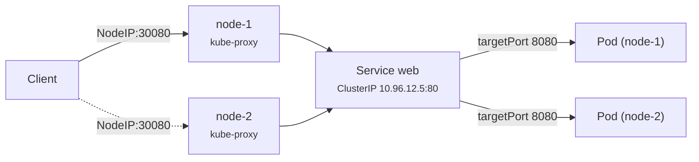

# 07 - Service: NodePort

> **One-liner:** A NodePort Service exposes Pods on a **static port (30000–32767) on every node's IP**. External clients reach `<NodeIP>:<NodePort>`, and kube-proxy forwards the traffic to a backend Pod.

---

## What it is

- A NodePort Service is a **ClusterIP Service plus a port opened on every node**. You still get a ClusterIP for in-cluster traffic.
- The port is open on **all** nodes, including nodes that run none of the target Pods. kube-proxy forwards the traffic onward, possibly to another node.
- A `LoadBalancer` Service is built on top of NodePort. In many setups the cloud load balancer targets the NodePorts.



## The three ports (a classic interview question)

| Field | Where it lives | Example |
| --- | --- | --- |
| `nodePort` | On every node's IP; external entry | `30080` |
| `port` | On the Service's ClusterIP | `80` |
| `targetPort` | On the container | `8080` |

The flow is `NodeIP:30080 → ClusterIP:80 → PodIP:8080`.

## externalTrafficPolicy

| Value | Behaviour | Source IP | Trade-off |
| --- | --- | --- | --- |
| `Cluster` (default) | Any node forwards to any Pod | **SNATed**, so the client IP is lost | Even spread, but an extra hop |
| `Local` | A node only forwards to Pods **on itself** | **Preserved** | Nodes with no Pod drop the traffic, and the spread can be uneven |

## When to use it

- **Good for:** dev and test clusters, bare metal without a load balancer, and as the target of an external or hardware load balancer.
- **Avoid for production internet traffic.** Clients would need node IPs, which change, and the ports are non-standard. Use a LoadBalancer or Ingress instead.
- **Remember the firewall:** you must open the NodePort range in security groups or NSGs.

## Example YAML

```yaml
apiVersion: v1
kind: Service
metadata:
  name: web-nodeport
  namespace: demo
spec:
  type: NodePort
  selector:
    app: web
  externalTrafficPolicy: Cluster
  ports:
    - name: http
      protocol: TCP
      port: 80            # ClusterIP port
      targetPort: 8080    # container port (can also be a named port)
      nodePort: 30080     # optional; auto-assigned from 30000-32767 if omitted
```

## Common commands

```bash
kubectl apply -f svc-nodeport.yaml
kubectl expose deployment web --type=NodePort --port=80 --target-port=8080 -n demo
kubectl get svc web-nodeport -n demo                 # PORT(S) shows 80:30080/TCP
kubectl describe svc web-nodeport -n demo            # Endpoints, NodePort
kubectl get endpointslices -n demo -l kubernetes.io/service-name=web-nodeport

# Get node IPs
kubectl get nodes -o wide                            # INTERNAL-IP / EXTERNAL-IP

# Test
curl http://<node-ip>:30080
# On minikube / kind
minikube service web-nodeport -n demo --url
```

## Troubleshooting

| Symptom | Likely cause | What to check |
| --- | --- | --- |
| Connection timeout on `NodeIP:30080` | A security group, NSG or host firewall blocks the port | Cloud SG/NSG inbound rules; `iptables -L` / `nft list ruleset` on the node |
| Connection refused | No endpoints, or the wrong `targetPort` | `describe svc` → Endpoints; compare with `containerPort` |
| `Endpoints: <none>` | The selector doesn't match the Pod labels, or the Pods aren't Ready | `get pods --show-labels`; readiness |
| Works on some nodes only | `externalTrafficPolicy: Local` and no Pod on that node | Pod placement (`-o wide`) |
| Client IP shows as a node IP in logs | `externalTrafficPolicy: Cluster` SNATs the source | Switch to `Local` |
| `provided port is already allocated` | Another Service uses that nodePort | `kubectl get svc -A | grep 30080` |
| `provided port is not in the valid range` | The port is outside 30000–32767 | Use a port in range, or change `--service-node-port-range` |
| Works from a node but not from outside | The node has no public IP, or routing is missing | Use the external IP; check subnet routing |

```bash
# Test inside the cluster first (isolates firewall vs Service problems)
kubectl run curl --image=curlimages/curl:8.10.1 -it --rm -n demo -- curl -sv http://web-nodeport.demo.svc:80
kubectl run curl --image=curlimages/curl:8.10.1 -it --rm -n demo -- curl -sv http://<node-ip>:30080

# Does the pod itself answer on targetPort?
kubectl port-forward pod/<pod> 8080:8080 -n demo   # then curl localhost:8080

# kube-proxy rules on a node (iptables mode)
sudo iptables-save | grep 30080
# IPVS mode
sudo ipvsadm -Ln | grep -A3 30080

# kube-proxy health/logs
kubectl get pods -n kube-system -l k8s-app=kube-proxy -o wide
kubectl logs -n kube-system -l k8s-app=kube-proxy --tail=50
```

## Interview questions

<details>
<summary><b>Explain port, targetPort and nodePort.</b></summary>

- `nodePort` is opened on every node, for external access.
- `port` is the Service's ClusterIP port, for in-cluster access.
- `targetPort` is where the container listens.

The flow is `NodeIP:nodePort → ClusterIP:port → PodIP:targetPort`.
</details>

<details>
<summary><b>Why not use NodePort in production?</b></summary>

- Clients must know node IPs, and nodes are replaced.
- The ports are non-standard (30000+).
- There is no TLS termination and no health-aware load balancing.
- Every node is exposed.

Use a LoadBalancer Service or an Ingress or Gateway instead. NodePort remains useful as the backend for an external load balancer.
</details>

<details>
<summary><b>How do you preserve the client source IP?</b></summary>

Set `externalTrafficPolicy: Local`. The trade-off is that traffic only goes to Pods on the receiving node, so the spread can be uneven, and nodes without Pods must fail health checks.
</details>

## Quick revision

| Topic | Remember |
| --- | --- |
| Range | 30000–32767 |
| Opens on | Every node |
| Includes | A ClusterIP |
| Ports | nodePort → port → targetPort |
| Source IP | `externalTrafficPolicy: Local` |
| Firewall | Open the range in SG/NSG |
