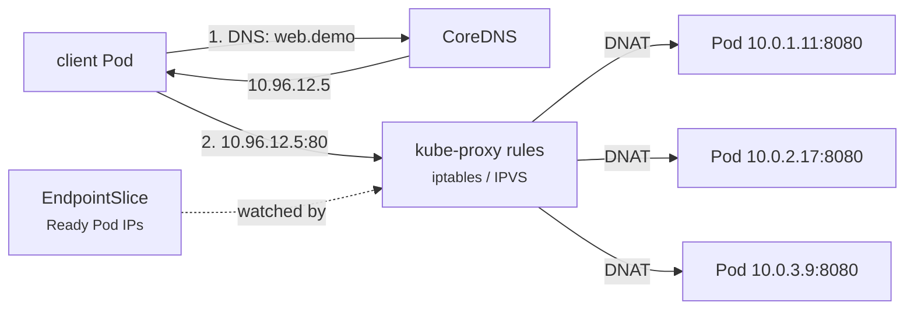

# 08 - Service: ClusterIP

> **One-liner:** ClusterIP is the **default** Service type. It gives a set of Pods a **stable virtual IP and DNS name that are reachable only inside the cluster**, and load-balances across the Ready Pods.

---

## What it is

- Pods are ephemeral and their IPs change. A Service gives clients **one stable address**, e.g. `web.demo.svc.cluster.local`.
- The **selector** picks the Pods. The EndpointSlice controller keeps an up-to-date list of **Ready** Pod IPs.
- **kube-proxy** (iptables or IPVS) or an eBPF data plane such as Cilium turns traffic to `ClusterIP:port` into traffic to a Pod IP.
- **CoreDNS** resolves the Service name to the ClusterIP.
- The ClusterIP is **virtual**: nothing listens on it, so it **can't be pinged**.



## DNS names

| Form | Works from |
| --- | --- |
| `web` | Same namespace |
| `web.demo` | Any namespace |
| `web.demo.svc.cluster.local` | Anywhere in the cluster (FQDN) |
| `_http._tcp.web.demo.svc.cluster.local` | SRV record for a named port |

## Useful options

| Field | Purpose |
| --- | --- |
| `sessionAffinity: ClientIP` | Sticky sessions per client IP (`timeoutSeconds` defaults to 3 hours) |
| `internalTrafficPolicy: Local` | Only route to Pods on the same node (node-local caches, agents) |
| `trafficDistribution: PreferClose` | Prefer endpoints in the same zone, which cuts cross-AZ cost |
| Named `targetPort` | `targetPort: http` follows the container's port name, even if the number changes |
| Service **without a selector** | You manage the EndpointSlices yourself to point at external IPs |

## Example YAML

```yaml
apiVersion: v1
kind: Service
metadata:
  name: web
  namespace: demo
spec:
  type: ClusterIP            # default, can be omitted
  selector:
    app: web
  ports:
    - name: http
      port: 80
      targetPort: http       # named port from the container spec
      protocol: TCP
  sessionAffinity: None
---
# matching container port in the Deployment
# ports:
#   - name: http
#     containerPort: 8080
```

## Common commands

```bash
kubectl apply -f svc-clusterip.yaml
kubectl expose deployment web --port=80 --target-port=8080 -n demo
kubectl get svc -n demo
kubectl describe svc web -n demo                 # Selector, TargetPort, Endpoints
kubectl get endpointslices -n demo -l kubernetes.io/service-name=web -o wide

# Test from inside the cluster
kubectl run curl --image=curlimages/curl:8.10.1 -it --rm -n demo -- curl -sv http://web
kubectl run dns --image=busybox:1.36 -it --rm -n demo -- nslookup web.demo.svc.cluster.local

# Reach it from your laptop
kubectl port-forward svc/web 8080:80 -n demo
```

## Troubleshooting

Debug in layers: **DNS → Service → endpoints → Pod → app**.

| Symptom | Likely cause | What to check |
| --- | --- | --- |
| `Could not resolve host: web` | Wrong namespace, CoreDNS down, NetworkPolicy blocks port 53 | Use `web.<ns>`; `get pods -n kube-system -l k8s-app=kube-dns`; egress policy |
| Resolves, but times out | No endpoints, or a NetworkPolicy blocks it | `get endpointslices`; `get networkpolicy -n demo` |
| `Endpoints: <none>` | The selector doesn't match the Pod labels | `describe svc` selector vs `get pods --show-labels` |
| Endpoints listed as not ready | Readiness probe failing | `describe pod` |
| Connection refused | Wrong `targetPort`, or the app listens on `127.0.0.1` instead of `0.0.0.0` | `kubectl exec POD -- netstat -tlnp` (or `ss -tlnp`) |
| `ping` to the ClusterIP fails | Expected: the IP is virtual and only proxies TCP/UDP/SCTP ports | Use `curl` or `nc` |
| Works by Pod IP but not by Service | kube-proxy or the CNI isn't programming rules | kube-proxy logs; `iptables-save | grep <svc>` |
| Intermittent failures | Some Pods are unhealthy but still Ready, or conntrack is exhausted | Check each endpoint individually; node `dmesg` for conntrack |
| Slow DNS (about 5 seconds) | The `ndots:5` search-path expansion, or conntrack races | Use FQDNs with a trailing dot; tune `dnsConfig`; NodeLocal DNSCache |

```bash
# 1. DNS
kubectl exec -it <client-pod> -n demo -- nslookup web
kubectl exec -it <client-pod> -n demo -- cat /etc/resolv.conf
kubectl logs -n kube-system -l k8s-app=kube-dns --tail=50

# 2. Service + endpoints
kubectl get svc web -n demo -o wide
kubectl get endpointslices -n demo -l kubernetes.io/service-name=web -o yaml | grep -A3 conditions

# 3. Hit each endpoint directly
for ip in $(kubectl get endpointslices -n demo -l kubernetes.io/service-name=web -o jsonpath='{.items[*].endpoints[*].addresses[*]}'); do
  kubectl run t-$RANDOM --image=curlimages/curl:8.10.1 --rm -i -n demo --restart=Never -- curl -s -o /dev/null -w "$ip %{http_code}\n" http://$ip:8080
done

# 4. Is the app listening on 0.0.0.0?
kubectl exec -it <pod> -n demo -- sh -c 'ss -tlnp || netstat -tlnp'

# 5. NetworkPolicies in play
kubectl get networkpolicy -n demo
```

## Interview questions

<details>
<summary><b>How does a ClusterIP Service actually route traffic?</b></summary>

1. CoreDNS resolves the name to the ClusterIP.
2. The client connects to `ClusterIP:port`.
3. kube-proxy's iptables or IPVS rules on the client's node **DNAT** the traffic to one Ready Pod IP taken from the EndpointSlices.
4. The CNI routes the packet to that Pod.

No proxy process sits in the data path in iptables or IPVS mode.
</details>

<details>
<summary><b>Why can't you ping a ClusterIP?</b></summary>

It's a virtual IP that exists only as NAT rules for the defined ports and protocols. No interface owns it, so ICMP isn't answered.
</details>

<details>
<summary><b>iptables vs IPVS mode?</b></summary>

- **iptables** applies rules sequentially, which is O(n). It gets slow to update with thousands of Services, and it only does random load balancing.
- **IPVS** uses hash tables, which is O(1), and offers more algorithms (rr, lc, sh).
- **nftables** mode (GA in v1.33) and **eBPF** data planes (Cilium) are the modern replacements.
</details>

<details>
<summary><b>What is an EndpointSlice?</b></summary>

It is the scalable replacement for the Endpoints object. It splits a Service's backends into slices of up to 100 by default, so an update to one Pod doesn't rewrite one huge object. It also carries readiness, serving and terminating conditions, plus zone hints.
</details>

## Quick revision

| Topic | Remember |
| --- | --- |
| Reachable | Inside the cluster only |
| Default | Yes |
| DNS | `svc.ns.svc.cluster.local` |
| Backends | Ready Pods only (EndpointSlices) |
| Data path | kube-proxy DNAT (iptables / IPVS / nftables) or eBPF |
| Debug order | DNS → Service → endpoints → Pod → app |
