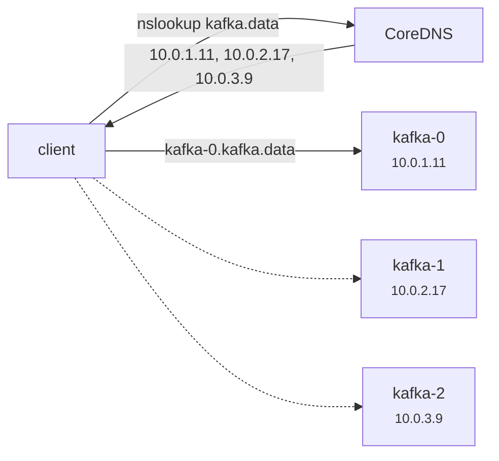

# 09 - Service: Headless

> **One-liner:** A headless Service (`clusterIP: None`) has **no virtual IP and no load balancing**. DNS returns the **individual Pod IPs**, so clients can discover and connect to specific Pods. StatefulSets rely on it.

---

## What it is

| | ClusterIP Service | Headless Service |
| --- | --- | --- |
| `clusterIP` | Assigned, e.g. `10.96.12.5` | `None` |
| DNS A record for the Service name | One record, the ClusterIP | **One record per Ready Pod** |
| Load balancing | kube-proxy | None; the client decides |
| Per-Pod DNS | No | Yes, with a StatefulSet (`pod-0.svc`) |
| kube-proxy rules | Yes | **No** |

**Used for:**
- **StatefulSets**, which need stable per-Pod DNS for replication and peer discovery (Kafka, ZooKeeper, MongoDB, Cassandra, etcd);
- **client-side load balancing**, e.g. gRPC clients that keep long-lived connections;
- **service discovery** where the app wants to see every member.



## DNS records it creates

| Query | Returns |
| --- | --- |
| `kafka.data.svc.cluster.local` | A records for every Ready Pod IP |
| `kafka-0.kafka.data.svc.cluster.local` | The IP of `kafka-0` (when the Pods belong to a StatefulSet whose `serviceName: kafka`) |
| `_client._tcp.kafka.data.svc.cluster.local` | SRV records (port + per-Pod hostnames) |

| Setting | Effect |
| --- | --- |
| `publishNotReadyAddresses: true` | Includes Pods that aren't Ready yet. This is needed for clusters whose members must find each other **before** they become Ready (ZooKeeper, Cassandra bootstrap). |
| No selector | You can create EndpointSlices manually to get DNS for arbitrary IPs |

## Example YAML

```yaml
apiVersion: v1
kind: Service
metadata:
  name: kafka
  namespace: data
spec:
  clusterIP: None                  # <-- headless
  publishNotReadyAddresses: true   # peers discover each other during bootstrap
  selector:
    app: kafka
  ports:
    - name: client
      port: 9092
    - name: controller
      port: 9093
---
apiVersion: apps/v1
kind: StatefulSet
metadata:
  name: kafka
  namespace: data
spec:
  serviceName: kafka               # <-- must equal the headless Service name
  replicas: 3
  selector:
    matchLabels: { app: kafka }
  template:
    metadata:
      labels: { app: kafka }
    spec:
      containers:
        - name: kafka
          image: apache/kafka:3.9.0
          ports:
            - { name: client, containerPort: 9092 }
            - { name: controller, containerPort: 9093 }
```

Clients usually also get a **normal ClusterIP Service** (e.g. `kafka-bootstrap`) for their first connection, while the headless one is used for peer identity.

## Common commands

```bash
kubectl apply -f headless.yaml
kubectl get svc kafka -n data                      # CLUSTER-IP shows "None"
kubectl get endpointslices -n data -l kubernetes.io/service-name=kafka -o wide

# DNS: all pods
kubectl run dns --image=busybox:1.36 -it --rm -n data -- nslookup kafka.data.svc.cluster.local
# DNS: one pod
kubectl run dns --image=busybox:1.36 -it --rm -n data -- nslookup kafka-0.kafka.data.svc.cluster.local
# SRV records
kubectl run dig --image=registry.k8s.io/e2e-test-images/jessie-dnsutils:1.3 -it --rm -n data -- \
  dig +short SRV _client._tcp.kafka.data.svc.cluster.local
```

## Troubleshooting

| Symptom | Likely cause | What to check |
| --- | --- | --- |
| `kafka-0.kafka` doesn't resolve | The StatefulSet's `serviceName` ≠ the Service name, or the Pod isn't Ready | `get sts kafka -o jsonpath='{.spec.serviceName}'`; Pod readiness |
| Name resolves to nothing | No Ready Pods match the selector | `get endpointslices`; `get pods --show-labels` |
| Cluster can't form (members can't find each other) | Pods aren't Ready until they join, but DNS only lists Ready Pods | Set `publishNotReadyAddresses: true` |
| Clients keep hitting a dead Pod | Clients cache DNS (e.g. the JVM DNS TTL) | Lower the app's DNS cache TTL; use a client with re-resolve |
| Traffic all goes to one Pod | Expected: there's no load balancing, so the client picks | Use client-side LB (e.g. gRPC `round_robin`) or a ClusterIP Service |
| Can't convert an existing Service to headless | `clusterIP` is immutable | Delete and recreate the Service |
| Service has a ClusterIP | You omitted `clusterIP: None` | Recreate it |

```bash
# Confirm it is truly headless
kubectl get svc kafka -n data -o jsonpath='{.spec.clusterIP}{"\n"}'     # → None

# Pod hostname/subdomain wiring (set automatically by the StatefulSet)
kubectl get pod kafka-0 -n data -o jsonpath='{.spec.hostname}.{.spec.subdomain}{"\n"}'

# Ready vs not-ready endpoints
kubectl get endpointslices -n data -l kubernetes.io/service-name=kafka \
  -o jsonpath='{range .items[*].endpoints[*]}{.addresses[0]} ready={.conditions.ready}{"\n"}{end}'

# CoreDNS logs
kubectl logs -n kube-system -l k8s-app=kube-dns --tail=50
```

## Interview questions

<details>
<summary><b>What is a headless Service and when do you use one?</b></summary>

It's a Service with `clusterIP: None`. DNS returns Pod IPs directly instead of a virtual IP, and there's no kube-proxy load balancing. Use it for StatefulSets (stable per-Pod DNS), peer discovery, and client-side load balancing such as gRPC.
</details>

<details>
<summary><b>Why does a StatefulSet require a headless Service?</b></summary>

The StatefulSet sets each Pod's `hostname` and `subdomain`, and the headless Service named in `serviceName` makes CoreDNS publish `pod-N.service.ns.svc.cluster.local`. Members use those stable names to find each other for replication and leader election, even after rescheduling changes their IPs.
</details>

<details>
<summary><b>Why do gRPC apps often need headless Services?</b></summary>

gRPC multiplexes requests over **one long-lived HTTP/2 connection**. With a ClusterIP Service, kube-proxy balances *connections*, not requests, so one Pod can receive all the traffic.

A headless Service lets the gRPC client resolve all Pod IPs and balance per request. A service mesh or L7 proxy also solves this.
</details>

## Quick revision

| Topic | Remember |
| --- | --- |
| Key field | `clusterIP: None` |
| DNS returns | Pod IPs (not a VIP) |
| Load balancing | None (client-side) |
| StatefulSet | `serviceName` must match → `pod-N.svc.ns` |
| Bootstrap | `publishNotReadyAddresses: true` |
| gRPC | Use headless or a mesh for per-request LB |
