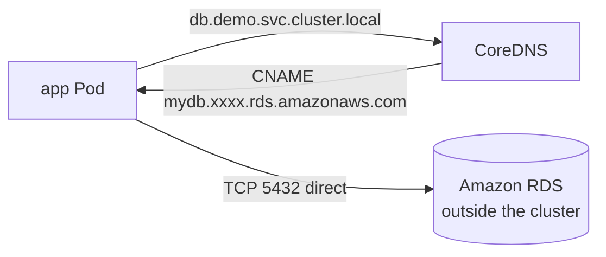

# 10 - Service: ExternalName (and external endpoints)

> **One-liner:** An `ExternalName` Service is a **DNS alias** (a CNAME) from an in-cluster Service name to an **external hostname**, such as a managed database. It has no proxying, no ClusterIP and no ports mapping.

---

## What it is

- Pods call `db.demo.svc.cluster.local`, and CoreDNS answers with a **CNAME** to `mydb.abc123.ap-south-1.rds.amazonaws.com`.
- **Benefit:** apps use a stable in-cluster name. You can move the backend (RDS → in-cluster → another region) by changing one Service, with no app config change.
- It is purely DNS. **kube-proxy is not involved**, there is no load balancing, and `port` is informational only.



## The two ways to point at something external

| Option | Use when | How it works |
| --- | --- | --- |
| **`ExternalName`** | The target has a **DNS name** (RDS, Azure SQL, an external API) | A CNAME in CoreDNS |
| **Service without a selector + manual EndpointSlice** | The target only has **IP addresses** (an on-prem DB, a VM) | A normal ClusterIP, with kube-proxy routing to the IPs you list |

## Limitations and gotchas

- `externalName` must be a **DNS name, not an IP**. Use the selectorless pattern for IPs.
- **TLS:** the client connects using the Service name, but the certificate is for the external hostname. Hostname verification can fail unless the client uses the real host for SNI or verification.
- **HTTP `Host` header:** the client sends `Host: db.demo...`, and some external endpoints (CDNs, virtual hosts) reject it.
- Pods still need **network egress** to the target: NetworkPolicy, NAT gateway, security groups, and the RDS SG allowing the node or Pod CIDR.

## Example YAML

```yaml
# 1) ExternalName → managed DB by DNS
apiVersion: v1
kind: Service
metadata:
  name: db
  namespace: demo
spec:
  type: ExternalName
  externalName: mydb.abc123xyz.ap-south-1.rds.amazonaws.com
---
# 2) Selectorless Service → external IPs
apiVersion: v1
kind: Service
metadata:
  name: legacy-db
  namespace: demo
spec:
  ports:
    - name: pg
      port: 5432
      targetPort: 5432
---
apiVersion: discovery.k8s.io/v1
kind: EndpointSlice
metadata:
  name: legacy-db-1
  namespace: demo
  labels:
    kubernetes.io/service-name: legacy-db     # links the slice to the Service
addressType: IPv4
ports:
  - name: pg
    port: 5432
    protocol: TCP
endpoints:
  - addresses: ["10.20.30.40"]
  - addresses: ["10.20.30.41"]
```

## Common commands

```bash
kubectl apply -f external.yaml
kubectl get svc db -n demo                  # TYPE ExternalName, EXTERNAL-IP shows the hostname
kubectl describe svc db -n demo

# Verify the CNAME
kubectl run dns --image=busybox:1.36 -it --rm -n demo -- nslookup db.demo.svc.cluster.local

# Test connectivity to the real target from inside the cluster
kubectl run pg --image=postgres:17 -it --rm -n demo -- \
  psql "host=db.demo.svc.cluster.local port=5432 user=app dbname=app sslmode=require"

kubectl run nc --image=busybox:1.36 -it --rm -n demo -- nc -zv -w 3 db 5432

# Selectorless variant
kubectl get endpointslices -n demo -l kubernetes.io/service-name=legacy-db
```

## Troubleshooting

| Symptom | Likely cause | What to check |
| --- | --- | --- |
| Name doesn't resolve | Typo in `externalName`, CoreDNS can't resolve external names (upstream forwarder), or egress to DNS is blocked | `nslookup` inside a Pod; CoreDNS `forward` config (`kubectl get cm coredns -n kube-system -o yaml`) |
| Resolves but times out | A security group, NACL or firewall blocks the node/Pod CIDR, there's no NAT, or NetworkPolicy blocks egress | The target DB's SG inbound rules; route tables; `get networkpolicy` |
| TLS error: hostname mismatch | The certificate is for `*.rds.amazonaws.com`, not `db.demo.svc` | Connect using the real host for TLS, or set `sslmode=require` without verify-full (weaker) |
| HTTP 403/404 from an external API | The `Host` header is the Service name | Call the real hostname, or use an egress proxy that rewrites the header |
| Put an IP in `externalName` | Not supported (it's treated as a hostname) | Use a selectorless Service plus an EndpointSlice |
| Selectorless Service has no endpoints | The EndpointSlice is missing the `kubernetes.io/service-name` label, or the port names don't match | `get endpointslices --show-labels` |
| `ports` don't change the destination port | Expected: ExternalName does no port mapping | Connect using the real port |

```bash
# What CoreDNS actually returns (expect a CNAME)
kubectl run dig --image=registry.k8s.io/e2e-test-images/jessie-dnsutils:1.3 -it --rm -n demo -- \
  dig db.demo.svc.cluster.local

# Can the pod reach the external host at all? (bypasses the Service)
kubectl run nc --image=busybox:1.36 -it --rm -n demo -- nc -zv -w 3 mydb.abc123xyz.ap-south-1.rds.amazonaws.com 5432

# Egress policies in the namespace
kubectl get networkpolicy -n demo -o yaml | grep -A10 egress

# CoreDNS upstream config
kubectl get configmap coredns -n kube-system -o yaml
```

## Interview questions

<details>
<summary><b>What is an ExternalName Service?</b></summary>

It is a Service that returns a DNS **CNAME** to an external hostname. There's no ClusterIP, no proxying and no endpoints. It gives workloads a stable in-cluster name for an external dependency, so you can swap the backend without changing app config.
</details>

<details>
<summary><b>How do you point a Service at an external IP address?</b></summary>

Create a Service **without a selector**, and create an EndpointSlice labelled `kubernetes.io/service-name: <svc>` that lists the IPs and ports. kube-proxy then routes `ClusterIP:port` to those IPs.
</details>

<details>
<summary><b>What are the pitfalls of ExternalName?</b></summary>

- TLS hostname verification and HTTP `Host` headers carry the alias, not the real host.
- It can't take IPs.
- There's no health checking or load balancing.
- It still needs network egress, and the caching behaviour is the client's own DNS caching.
</details>

## Quick revision

| Topic | Remember |
| --- | --- |
| Mechanism | DNS CNAME only |
| ClusterIP / kube-proxy | None |
| Target | Hostname, never an IP |
| For IPs | Selectorless Service + EndpointSlice |
| Gotchas | TLS SNI/verification, `Host` header, egress rules |
