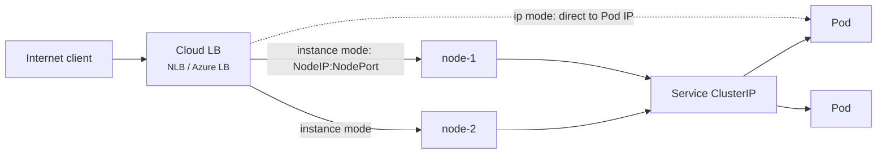

# 11 - Service: LoadBalancer

> **One-liner:** A `LoadBalancer` Service asks the cloud to provision an **external load balancer** that forwards traffic into the cluster. It builds on NodePort and ClusterIP, and is the standard way to expose **L4 (TCP/UDP)** traffic.

---

## What it is

- When you create the Service, a controller calls the cloud API to create a load balancer and writes its address back to `status.loadBalancer.ingress`. The controller is either the **cloud-controller-manager** or a dedicated controller such as the **AWS Load Balancer Controller**.

| Platform | What gets created |
| --- | --- |
| **EKS** | NLB, via the AWS Load Balancer Controller (`instance` or `ip` target mode) |
| **AKS** | Azure Standard Load Balancer (public or internal) |
| **GKE** | Network Load Balancer |
| **Bare metal** | Nothing, unless you run **MetalLB**, kube-vip or Cilium LB-IPAM. Without one, the EXTERNAL-IP stays `<pending>`. |



## Target modes (EKS with the AWS Load Balancer Controller)

| Mode | Load balancer targets | Pros | Cons |
| --- | --- | --- | --- |
| `instance` | Nodes on the NodePort | Works with any CNI | Extra hop; source IP needs `externalTrafficPolicy: Local` |
| `ip` | **Pod IPs** directly (VPC CNI) | No extra hop, source IP preserved, works with Fargate | Needs routable Pod IPs |

## Common annotations

```yaml
# ---- EKS (AWS Load Balancer Controller) ----
service.beta.kubernetes.io/aws-load-balancer-type: external
service.beta.kubernetes.io/aws-load-balancer-nlb-target-type: ip
service.beta.kubernetes.io/aws-load-balancer-scheme: internet-facing      # or internal
service.beta.kubernetes.io/aws-load-balancer-ssl-cert: arn:aws:acm:ap-south-1:111122223333:certificate/xxxx
service.beta.kubernetes.io/aws-load-balancer-ssl-ports: "443"
service.beta.kubernetes.io/aws-load-balancer-healthcheck-path: /healthz

# ---- AKS ----
service.beta.kubernetes.io/azure-load-balancer-internal: "true"
service.beta.kubernetes.io/azure-load-balancer-health-probe-request-path: /healthz
service.beta.kubernetes.io/azure-pip-name: my-static-pip
```

**Cost tip:** each LoadBalancer Service gets its **own** load balancer. For many HTTP services, use **one Ingress controller or Gateway** behind a single load balancer instead.

## Example YAML

```yaml
apiVersion: v1
kind: Service
metadata:
  name: web-lb
  namespace: demo
  annotations:
    service.beta.kubernetes.io/aws-load-balancer-type: external
    service.beta.kubernetes.io/aws-load-balancer-nlb-target-type: ip
    service.beta.kubernetes.io/aws-load-balancer-scheme: internet-facing
    service.beta.kubernetes.io/aws-load-balancer-healthcheck-path: /
spec:
  type: LoadBalancer
  selector:
    app: web
  externalTrafficPolicy: Local          # preserve client IP (instance mode)
  loadBalancerSourceRanges:             # allow-list at the LB / SG level
    - 203.0.113.0/24
  ports:
    - name: http
      port: 80
      targetPort: 8080
      protocol: TCP
```

## Common commands

```bash
kubectl apply -f svc-lb.yaml
kubectl get svc web-lb -n demo -w                    # wait for EXTERNAL-IP / hostname
kubectl describe svc web-lb -n demo                  # Events: EnsuringLoadBalancer / SyncLoadBalancerFailed

LB=$(kubectl get svc web-lb -n demo -o jsonpath='{.status.loadBalancer.ingress[0].hostname}')
curl -v http://$LB

# AWS side
aws elbv2 describe-load-balancers --query "LoadBalancers[?contains(DNSName,'$(echo $LB | cut -d- -f1)')]"
aws elbv2 describe-target-health --target-group-arn <tg-arn>

# AKS side
az network lb list -g <node-resource-group> -o table
```

## Troubleshooting

| Symptom | Likely cause | What to check |
| --- | --- | --- |
| `EXTERNAL-IP <pending>` forever | No LB provider (bare metal or kind), the controller isn't installed, or IAM permissions are missing | `describe svc` events; `kubectl logs -n kube-system deploy/aws-load-balancer-controller` |
| `SyncLoadBalancerFailed` | Subnets not tagged, quota exceeded, a bad annotation, or the static IP is in the wrong resource group | Events; EKS subnet tags `kubernetes.io/role/elb=1` (public) / `kubernetes.io/role/internal-elb=1` (internal) |
| LB created but targets are **unhealthy** | Wrong health-check path or port, the node SG blocks the LB, or no Ready Pods | `aws elbv2 describe-target-health`; the SG rules; the Service endpoints |
| Some targets unhealthy with `externalTrafficPolicy: Local` | Expected: nodes without Pods fail the health check on purpose | Only nodes running Pods should be healthy |
| Times out from the internet | The scheme is `internal`, `loadBalancerSourceRanges` blocks you, or there are NACLs | Annotations; your IP; NACLs |
| Client IP missing in app logs | `instance` mode with `externalTrafficPolicy: Cluster` | `Local`, `ip` target mode, or proxy protocol |
| A new LB was created after edits and the DNS changed | The Service was deleted and recreated | Use a stable DNS record (Route 53 / external-dns) or a static IP |
| Orphaned LB after deleting the cluster | The Service was deleted after the controller was gone | Delete LoadBalancer Services **before** the cluster or controller |
| TLS not working | Missing cert annotation or `ssl-ports` | Check the ACM ARN and region |

```bash
# Service status and events
kubectl get svc web-lb -n demo -o jsonpath='{.status.loadBalancer}{"\n"}'
kubectl get events -n demo --field-selector involvedObject.name=web-lb

# Backends behind the LB
kubectl get endpointslices -n demo -l kubernetes.io/service-name=web-lb -o wide

# EKS: controller health + logs
kubectl get deploy -n kube-system aws-load-balancer-controller
kubectl logs -n kube-system deploy/aws-load-balancer-controller --tail=100

# EKS: subnet discovery tags
aws ec2 describe-subnets --filters "Name=tag:kubernetes.io/role/elb,Values=1" \
  --query 'Subnets[].{id:SubnetId,az:AvailabilityZone}' --output table

# Find all LoadBalancer Services (cost check)
kubectl get svc -A --field-selector spec.type=LoadBalancer
```

## Interview questions

<details>
<summary><b>LoadBalancer vs NodePort vs Ingress?</b></summary>

- **NodePort** opens a port on every node. It is basic and non-standard.
- **LoadBalancer** gives one cloud L4 load balancer per Service. It is simple, but costs grow with each Service.
- **Ingress / Gateway** is one L7 entry point (behind a single load balancer) with host- and path-based routing and TLS termination for many HTTP Services.
</details>

<details>
<summary><b>Why does EXTERNAL-IP stay pending?</b></summary>

Nothing is fulfilling the request. Common reasons:
- no cloud provider or LB controller (bare metal, kind, minikube): install MetalLB or use `minikube tunnel`;
- missing IAM permissions;
- untagged subnets on EKS;
- an exhausted quota.

`kubectl describe svc` events usually say which one.
</details>

<details>
<summary><b>How do you preserve the client source IP?</b></summary>

- `externalTrafficPolicy: Local`, so traffic isn't SNATed; or
- NLB `ip` target mode, which goes direct to Pods; or
- proxy protocol, which the app or ingress must parse.

For HTTP behind L7 load balancers, use `X-Forwarded-For`.
</details>

<details>
<summary><b>Instance vs IP target mode on EKS?</b></summary>

- **Instance** mode targets NodePorts. It works with any CNI, but adds a hop.
- **IP** mode registers Pod IPs directly in the target group. It needs the VPC CNI and gives lower latency, true source IP, and Fargate support.
</details>

## Quick revision

| Topic | Remember |
| --- | --- |
| Layers | LoadBalancer ⊃ NodePort ⊃ ClusterIP |
| Provisioned by | cloud-controller-manager / AWS LB Controller |
| `<pending>` | No provider/controller, IAM, subnet tags |
| Cost | One LB per Service; use Ingress for HTTP |
| Source IP | `Local` policy, `ip` mode, or proxy protocol |
| Cleanup | Delete LB Services before the cluster |
