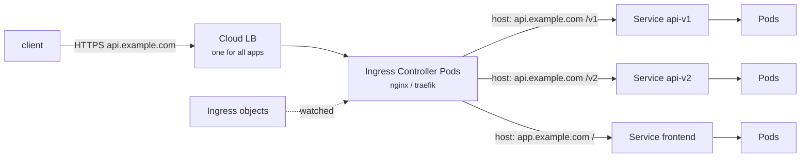

# 12 - Ingress and Ingress Controller

> **One-liner:** An **Ingress** is a set of **L7 (HTTP/HTTPS) routing rules**: host and path to Service, plus TLS. An **Ingress Controller** is the proxy that actually implements them. Without a controller, an Ingress object does nothing.

---

## What it is

| Piece | What it is |
| --- | --- |
| **Ingress** (API object) | Rules: `api.example.com/v1 → svc-a:80`, TLS certificates and annotations |
| **IngressClass** | Names which controller handles an Ingress (`spec.ingressClassName`) |
| **Ingress Controller** (Pods) | A reverse proxy or cloud integration that watches Ingresses and configures itself |

**Common controllers:**

| Controller | Data plane | Notes |
| --- | --- | --- |
| ingress-nginx | NGINX inside the cluster, behind one LoadBalancer Service | Community project; **retired in March 2026**, so plan a migration |
| AWS Load Balancer Controller | Provisions an **ALB** per Ingress or IngressGroup | Pod IPs as targets in `ip` mode |
| AGIC / Application Gateway for Containers | Azure Application Gateway | AKS |
| Traefik, HAProxy, Kong, Contour, Istio gateway | Various | |

**Gateway API** (`Gateway`, `HTTPRoute`) is the successor to Ingress. It is role-oriented, more expressive, and natively supports traffic splitting and headers. Prefer it for new platforms.



## pathType

| Value | Matching |
| --- | --- |
| `Prefix` | Element-wise prefix: `/api` matches `/api` and `/api/x`, but **not** `/apix` |
| `Exact` | Exact match only |
| `ImplementationSpecific` | Up to the controller (e.g. regex in nginx) |

## Example YAML

```yaml
apiVersion: networking.k8s.io/v1
kind: Ingress
metadata:
  name: shop
  namespace: demo
  annotations:
    cert-manager.io/cluster-issuer: letsencrypt-prod      # auto TLS via cert-manager
    nginx.ingress.kubernetes.io/proxy-body-size: "10m"
spec:
  ingressClassName: nginx
  tls:
    - hosts: ["shop.example.com"]
      secretName: shop-tls                                # created by cert-manager
  rules:
    - host: shop.example.com
      http:
        paths:
          - path: /api
            pathType: Prefix
            backend:
              service:
                name: api
                port:
                  number: 80
          - path: /
            pathType: Prefix
            backend:
              service:
                name: frontend
                port:
                  number: 80
---
# EKS ALB variant (AWS Load Balancer Controller)
apiVersion: networking.k8s.io/v1
kind: Ingress
metadata:
  name: shop-alb
  namespace: demo
  annotations:
    alb.ingress.kubernetes.io/scheme: internet-facing
    alb.ingress.kubernetes.io/target-type: ip
    alb.ingress.kubernetes.io/listen-ports: '[{"HTTP":80},{"HTTPS":443}]'
    alb.ingress.kubernetes.io/ssl-redirect: "443"
    alb.ingress.kubernetes.io/certificate-arn: arn:aws:acm:ap-south-1:111122223333:certificate/xxxx
    alb.ingress.kubernetes.io/healthcheck-path: /healthz
    alb.ingress.kubernetes.io/group.name: shared-public     # share one ALB across Ingresses
spec:
  ingressClassName: alb
  rules:
    - host: shop.example.com
      http:
        paths:
          - path: /
            pathType: Prefix
            backend:
              service:
                name: frontend
                port:
                  number: 80
```

## Gateway API equivalent

```yaml
# Platform team: one shared Gateway
apiVersion: gateway.networking.k8s.io/v1
kind: Gateway
metadata:
  name: public-gw
  namespace: infra
spec:
  gatewayClassName: envoy            # or: istio, cilium, nginx, aws-application-load-balancer, azure-alb-external
  listeners:
    - name: https
      protocol: HTTPS
      port: 443
      hostname: "*.example.com"
      tls:
        mode: Terminate
        certificateRefs:
          - name: wildcard-example-tls
      allowedRoutes:
        namespaces:
          from: Selector
          selector:
            matchLabels:
              gateway-access: "true"
---
# App team: routes in their own namespace, with a 90/10 canary split
apiVersion: gateway.networking.k8s.io/v1
kind: HTTPRoute
metadata:
  name: shop
  namespace: demo                    # namespace must carry label gateway-access=true
spec:
  parentRefs:
    - name: public-gw
      namespace: infra
  hostnames: ["shop.example.com"]
  rules:
    - matches:
        - path: { type: PathPrefix, value: /api }
      backendRefs:
        - { name: api,        port: 80, weight: 90 }
        - { name: api-canary, port: 80, weight: 10 }
    - matches:
        - path: { type: PathPrefix, value: / }
      backendRefs:
        - { name: frontend, port: 80 }
```

```bash
kubectl get gatewayclass
kubectl get gateway -A                       # PROGRAMMED=True, ADDRESS
kubectl get httproute -A
kubectl describe httproute shop -n demo      # status.parents[].conditions: Accepted / ResolvedRefs
```

| Gateway symptom | Check |
| --- | --- |
| Gateway not `Programmed` | The GatewayClass controller isn't installed or is unhealthy; check its logs |
| HTTPRoute `Accepted=False, NotAllowedByListeners` | The listener's `allowedRoutes` excludes the route's namespace or hostname |
| `ResolvedRefs=False, RefNotPermitted` | A cross-namespace backend needs a **ReferenceGrant** in the backend's namespace |
| `ResolvedRefs=False, BackendNotFound` | Wrong Service name or port |

## Common commands

```bash
# Install a controller (example: Traefik via Helm)
helm repo add traefik https://traefik.github.io/charts
helm install traefik traefik/traefik -n ingress --create-namespace

kubectl get ingressclass
kubectl apply -f ingress.yaml
kubectl get ingress -A                         # ADDRESS column = LB hostname/IP
kubectl describe ingress shop -n demo          # rules, backends, events

# Test before DNS exists
curl -v -H "Host: shop.example.com" http://<lb-address>/api
curl -vk --resolve shop.example.com:443:<lb-ip> https://shop.example.com/

# Controller logs
kubectl logs -n ingress-nginx deploy/ingress-nginx-controller --tail=100
kubectl logs -n kube-system deploy/aws-load-balancer-controller --tail=100

# TLS (cert-manager)
kubectl get certificate,certificaterequest,order,challenge -n demo
kubectl describe certificate shop-tls -n demo
```

## Troubleshooting

| Symptom | Likely cause | What to check |
| --- | --- | --- |
| `ADDRESS` empty | No controller, the wrong `ingressClassName`, or the controller's own LoadBalancer is `<pending>` | `get ingressclass`; controller Pods and Service; controller logs |
| **404** from the controller | No rule matches the host or path: the `Host` header is wrong, there's a `pathType` mismatch, or a different IngressClass handles it | `describe ingress`; `curl -H "Host: ..."` |
| **503** Service Unavailable | The backend Service has no Ready endpoints | `get endpointslices` for the backend; Pod readiness |
| **502** Bad Gateway | The backend refuses or resets: wrong `targetPort`, the app crashes, or the app expects HTTPS | Service port/targetPort; app logs; `backend-protocol` annotation |
| **504** Gateway Timeout | The app is slow, or the proxy timeout is too low | Timeout annotations; app performance |
| **413** Request Entity Too Large | Body size limit | `nginx.ingress.kubernetes.io/proxy-body-size` |
| Fake or self-signed cert ("Kubernetes Ingress Controller Fake Certificate") | The TLS Secret is missing, in the wrong namespace, or doesn't match the host | `get secret shop-tls -n demo`; cert-manager `Certificate` status |
| cert-manager stuck on a `Challenge` | The HTTP-01 path is unreachable or DNS-01 permissions are missing | `describe challenge`; DNS points at the LB |
| ALB not created (EKS) | Subnet tags, IAM/IRSA for the controller, a bad annotation | Controller logs; subnet tags |
| ALB targets unhealthy | Health-check path or port, security groups | `alb.ingress.kubernetes.io/healthcheck-path`; target health |
| Redirect loop | TLS terminates at the LB but the app or controller forces HTTPS | `X-Forwarded-Proto` handling; `ssl-redirect` settings |

```bash
# Full picture for one host
kubectl get ingress -A -o wide | grep shop.example.com
kubectl describe ingress shop -n demo
kubectl get svc,endpointslices -n demo

# What the controller actually rendered (ingress-nginx)
kubectl exec -n ingress-nginx deploy/ingress-nginx-controller -- cat /etc/nginx/nginx.conf | grep -A20 "shop.example.com"

# Bypass the ingress: does the Service work?
kubectl port-forward svc/api 8080:80 -n demo     # curl localhost:8080

# Check the cert being served
openssl s_client -connect <lb-ip>:443 -servername shop.example.com </dev/null 2>/dev/null | openssl x509 -noout -subject -dates
```

## Interview questions

<details>
<summary><b>Ingress vs Ingress Controller?</b></summary>

An **Ingress** is just configuration: the routing rules stored in etcd. An **Ingress Controller** is the running software (NGINX, Traefik, ALB controller) that watches those objects and implements them. Without a controller, Ingresses have no effect.
</details>

<details>
<summary><b>Ingress vs LoadBalancer Service?</b></summary>

A LoadBalancer Service gives you **L4**, with one cloud load balancer per Service. Ingress gives you **L7**, where one entry point routes many hostnames and paths to many Services and terminates TLS. Ingress is cheaper and more flexible for HTTP; L4 is for TCP/UDP or non-HTTP protocols.
</details>

<details>
<summary><b>Ingress vs Gateway API?</b></summary>

Gateway API splits responsibilities by role:
- **GatewayClass** is owned by the infrastructure provider;
- **Gateway** is owned by the platform team;
- **HTTPRoute** is owned by app teams.

It natively supports traffic weighting, header matching and mirroring, plus TCP, UDP and gRPC routes, without vendor annotations. It is the recommended direction for new clusters.
</details>

<details>
<summary><b>How do you automate TLS?</b></summary>

Use **cert-manager** with a `ClusterIssuer` (Let's Encrypt, ACME HTTP-01 or DNS-01). The Ingress annotation `cert-manager.io/cluster-issuer` makes it create and renew the TLS Secret automatically.

On AWS you can instead terminate TLS at the ALB using an ACM certificate ARN.
</details>

<details>
<summary><b>How do you debug a 502/503/504 from the ingress?</b></summary>

- **503:** the backend has no Ready endpoints. Check the Service selector and Pod readiness.
- **502:** the backend refused or reset the connection. Check `targetPort`, the protocol (HTTP vs HTTPS), and app crashes.
- **504:** the backend is too slow. Check timeouts and app latency.

Always check the controller logs and bypass the ingress with `port-forward`.
</details>

## Quick revision

| Topic | Remember |
| --- | --- |
| Ingress | L7 rules (host/path → Service, TLS) |
| Controller | Required; it implements the rules |
| Selection | `ingressClassName` |
| 404 / 502 / 503 / 504 | No rule / backend refused / no endpoints / too slow |
| TLS | cert-manager or a cloud cert (ACM) |
| Future | Gateway API (`Gateway` + `HTTPRoute`) |
