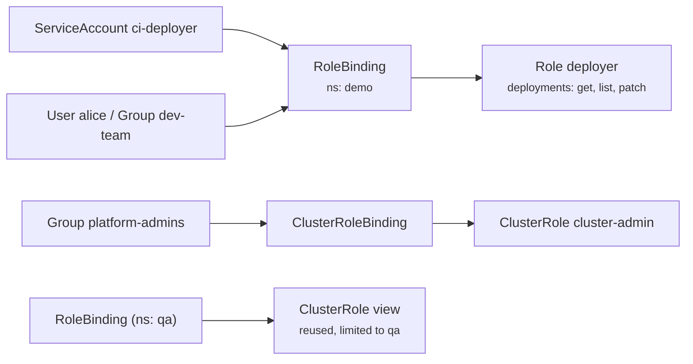

# 13 - RBAC (Role-Based Access Control)

> **One-liner:** RBAC controls **who** (a user, group or ServiceAccount) can perform **which verbs** (`get`, `create`, `delete`, ...) on **which resources** (Pods, Secrets, ...) in **which scope** (one namespace, or the whole cluster). It is **additive only**: there are no deny rules.

---

## The four objects

| Object | Scope | Purpose |
| --- | --- | --- |
| **Role** | Namespace | A set of permissions within one namespace |
| **ClusterRole** | Cluster | Permissions cluster-wide, for cluster-scoped resources (nodes, PVs, namespaces), or as a reusable template |
| **RoleBinding** | Namespace | Grants a Role **or a ClusterRole** to subjects, **within one namespace** |
| **ClusterRoleBinding** | Cluster | Grants a ClusterRole to subjects **across all namespaces** |

**Subjects** are a `User`, a `Group` or a `ServiceAccount`.

Kubernetes has **no User objects**. Users come from the authentication layer:
- client certificate CN/O
- OIDC claims
- EKS access entries or IAM mapping
- Microsoft Entra ID on AKS



## Rule anatomy

```yaml
rules:
  - apiGroups: ["apps"]                 # "" = core group (pods, services, secrets, configmaps)
    resources: ["deployments", "deployments/scale"]   # subresources: pods/log, pods/exec
    verbs: ["get", "list", "watch", "patch", "update"]
    resourceNames: ["web"]              # optional: restrict to specific objects
```

| Verbs | Meaning |
| --- | --- |
| `get`, `list`, `watch` | Read |
| `create`, `update`, `patch`, `delete`, `deletecollection` | Write |
| `escalate`, `bind`, `impersonate` | Dangerous: they allow privilege escalation |

## Built-in ClusterRoles

| ClusterRole | Grants |
| --- | --- |
| `cluster-admin` | Everything |
| `admin` | Full access within a namespace, including Roles and RoleBindings |
| `edit` | Read/write most objects, but no RBAC |
| `view` | Read-only, but **not Secrets** |

## Security best practices

- **Least privilege.** Avoid `*` verbs and resources, and avoid granting `cluster-admin` to CI.
- **Treat `list` and `watch` on Secrets as reading them.** `list` returns the values.
- **`pods/exec`, `create pods` and `create` on workloads can escalate.** A user who can create a Pod can mount any ServiceAccount or Secret in that namespace.
- **One ServiceAccount per app.** Set `automountServiceAccountToken: false` when the app doesn't call the API.
- **Bind to groups, not individual users.**
- **Audit regularly** with `kubectl auth can-i --list`, rbac-tool or kubectl-who-can.
- **Cloud identity is separate from RBAC.** On EKS, use IRSA or Pod Identity; on AKS, Workload Identity.

## Example YAML

```yaml
# ServiceAccount for a CI pipeline that deploys into "demo"
apiVersion: v1
kind: ServiceAccount
metadata:
  name: ci-deployer
  namespace: demo
automountServiceAccountToken: false
---
apiVersion: rbac.authorization.k8s.io/v1
kind: Role
metadata:
  name: deployer
  namespace: demo
rules:
  - apiGroups: ["apps"]
    resources: ["deployments"]
    verbs: ["get", "list", "watch", "create", "update", "patch"]
  - apiGroups: [""]
    resources: ["services", "configmaps"]
    verbs: ["get", "list", "watch", "create", "update", "patch"]
  - apiGroups: [""]
    resources: ["pods", "pods/log"]
    verbs: ["get", "list", "watch"]
---
apiVersion: rbac.authorization.k8s.io/v1
kind: RoleBinding
metadata:
  name: ci-deployer-binding
  namespace: demo
subjects:
  - kind: ServiceAccount
    name: ci-deployer
    namespace: demo
  - kind: Group
    name: dev-team              # from OIDC / EKS access entry / Entra ID
    apiGroup: rbac.authorization.k8s.io
roleRef:
  kind: Role
  name: deployer
  apiGroup: rbac.authorization.k8s.io
---
# Reuse built-in "view" ClusterRole, but only inside namespace qa
apiVersion: rbac.authorization.k8s.io/v1
kind: RoleBinding
metadata:
  name: qa-readonly
  namespace: qa
subjects:
  - kind: Group
    name: qa-team
    apiGroup: rbac.authorization.k8s.io
roleRef:
  kind: ClusterRole
  name: view
  apiGroup: rbac.authorization.k8s.io
```

## Common commands

```bash
kubectl apply -f rbac.yaml
kubectl get roles,rolebindings -n demo
kubectl get clusterroles,clusterrolebindings
kubectl describe role deployer -n demo
kubectl describe rolebinding ci-deployer-binding -n demo

# Who am I? (authentication result)
kubectl auth whoami

# Can I / can they?
kubectl auth can-i create deployments -n demo
kubectl auth can-i delete pods -n demo --as=alice
kubectl auth can-i get secrets -n demo --as=system:serviceaccount:demo:ci-deployer
kubectl auth can-i --list -n demo --as=system:serviceaccount:demo:ci-deployer

# Short-lived token for a ServiceAccount (e.g. for testing)
kubectl create token ci-deployer -n demo --duration=1h

# Imperative creation
kubectl create role pod-reader --verb=get,list,watch --resource=pods -n demo
kubectl create rolebinding pod-reader-alice --role=pod-reader --user=alice -n demo

# EKS: map IAM principals (access entries)
aws eks list-access-entries --cluster-name my-cluster
```

## Troubleshooting

| Error / symptom | Meaning | What to check |
| --- | --- | --- |
| `Error from server (Forbidden): ... is forbidden: User "X" cannot list resource "pods" in API group "" in the namespace "demo"` | Authenticated, but **not authorized** | The message names the user, verb, resource, group and namespace. Find or create the matching Role and binding. |
| `error: You must be logged in to the server (Unauthorized)` | **Authentication** failed, not RBAC | Expired token or kubeconfig; on EKS, `aws eks update-kubeconfig` and the access entries |
| Binding exists, still forbidden | Wrong namespace, wrong subject name or kind, the SA namespace is missing, or the wrong `apiGroups` (e.g. `apps` vs `""`) | `describe rolebinding`; compare the exact names |
| RoleBinding with a ClusterRole still can't see other namespaces | Expected: a RoleBinding limits it to its own namespace | Use a ClusterRoleBinding if cluster-wide access is really needed |
| Can't read logs or exec | Subresources need explicit rules | Add `pods/log` and `pods/exec` |
| Pod's app gets 403 calling the API | Its ServiceAccount lacks permissions, or the token isn't mounted | `spec.serviceAccountName`; `automountServiceAccountToken` |
| `attempting to grant RBAC permissions not currently held` | You can't grant more than you have (escalation protection) | Needs an admin, or the `escalate`/`bind` verbs |
| Can't change `roleRef` on a binding | `roleRef` is immutable | Delete and recreate the binding |

```bash
# Everything a subject can do in a namespace
kubectl auth can-i --list -n demo --as=system:serviceaccount:demo:ci-deployer

# Which bindings mention a given subject
kubectl get rolebindings,clusterrolebindings -A -o json | \
  jq -r '.items[] | select(.subjects[]? | .name=="ci-deployer") | "\(.kind) \(.metadata.namespace // "-") \(.metadata.name) -> \(.roleRef.name)"'

# Who has cluster-admin?
kubectl get clusterrolebindings -o json | \
  jq -r '.items[] | select(.roleRef.name=="cluster-admin") | .metadata.name + ": " + ([.subjects[]? | .kind + "/" + .name] | join(", "))'

# Which ServiceAccount does a pod run as?
kubectl get pod <pod> -n demo -o jsonpath='{.spec.serviceAccountName}{"\n"}'

# API group of a resource (for apiGroups field)
kubectl api-resources | grep -i deployment
```

## Interview questions

<details>
<summary><b>Role vs ClusterRole, RoleBinding vs ClusterRoleBinding?</b></summary>

- **Role**: namespace-scoped permissions.
- **ClusterRole**: cluster-scoped, or reusable.
- **RoleBinding**: grants a Role or ClusterRole **within one namespace**.
- **ClusterRoleBinding**: grants a ClusterRole across **all** namespaces.

A common pattern is to bind a built-in ClusterRole such as `view` or `edit` using a RoleBinding, so it applies to a single namespace.
</details>

<details>
<summary><b>Does RBAC support deny rules?</b></summary>

No. RBAC is purely additive: anything not explicitly allowed is denied. For deny-style policies, use **admission control** (ValidatingAdmissionPolicy, OPA Gatekeeper or Kyverno).
</details>

<details>
<summary><b>Authentication vs authorization in Kubernetes?</b></summary>

- **Authentication (401)** answers *who are you?* using certs, tokens, OIDC or cloud IAM.
- **Authorization (403)** answers *what can you do?* using RBAC, the Node authorizer or webhooks.
- **Admission** comes next: *is this request acceptable?*

Kubernetes stores no user accounts. ServiceAccounts are the only identity objects it manages.
</details>

<details>
<summary><b>How do you give a CI pipeline least-privilege access?</b></summary>

1. Create a dedicated ServiceAccount, or an OIDC/IAM identity mapped to a group.
2. Grant a namespace-scoped Role with only the needed verbs and resources, through a RoleBinding.
3. Use short-lived tokens (`kubectl create token`, or OIDC federation from GitHub Actions or GitLab).
4. Never use `cluster-admin`, and audit with `auth can-i --list`.
</details>

<details>
<summary><b>How can RBAC be bypassed or escalated?</b></summary>

- `create pods` in a namespace lets you run as any ServiceAccount there and mount its Secrets.
- `pods/exec` gives a shell in existing Pods.
- `escalate`, `bind` and `impersonate` grant more power.
- Wildcard rules grant everything.
- A `list` on Secrets reveals their values.

Restrict these, and add Pod Security Admission.
</details>

## Quick revision

| Topic | Remember |
| --- | --- |
| Model | Subjects → bindings → roles → rules |
| Scope | Role/RoleBinding = namespace; Cluster* = cluster |
| Deny | Not supported (additive only) |
| 401 vs 403 | Authentication vs authorization |
| Test | `kubectl auth can-i ... --as=` |
| Danger | `*`, Secrets `list`, `pods/exec`, `create pods`, `escalate`/`bind`/`impersonate` |
