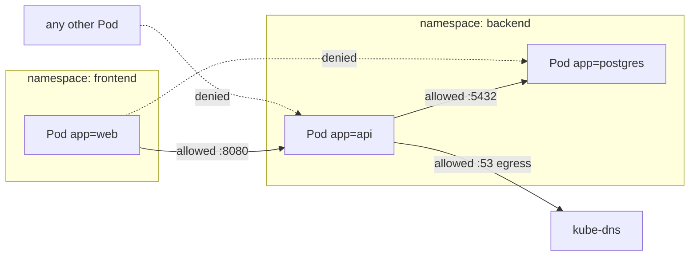

# 14 - NetworkPolicy

> **One-liner:** A NetworkPolicy is a **Pod-level firewall** at L3/L4. It allow-lists which traffic may enter (**ingress**) and leave (**egress**) selected Pods, by Pod labels, namespace labels, IP blocks and ports. It only works if the **CNI enforces it**.

---

## How it works

- **Default:** with no policies, **all traffic is allowed** between all Pods.
- When **any** policy selects a Pod for a direction (Ingress or Egress), that Pod becomes **isolated** in that direction. Only traffic that some policy explicitly allows gets through.
- Policies are **additive allow rules**. There is no deny and no ordering; the result is the union of all matching policies.
- Policies are **stateful**: reply traffic for an allowed connection is allowed automatically.
- **Enforcement comes from the CNI:**

| CNI | Enforces NetworkPolicy? |
| --- | --- |
| Calico, Cilium, Antrea | Yes |
| Amazon VPC CNI (EKS) | Yes, once network policy support is enabled |
| AKS (Azure NPM, Cilium, Calico) | Yes |
| Flannel (alone) | **No** |



## Selector semantics (the most common trap)

```yaml
# ONE element with BOTH selectors = AND
# (pods labelled app=web IN namespaces labelled team=frontend)
from:
  - namespaceSelector:
      matchLabels: { team: frontend }
    podSelector:
      matchLabels: { app: web }

# TWO elements = OR
# (ANY pod in team=frontend namespaces, OR pods app=web in THIS namespace)
from:
  - namespaceSelector:
      matchLabels: { team: frontend }
  - podSelector:
      matchLabels: { app: web }
```

| Selector | Meaning |
| --- | --- |
| `podSelector: {}` (at the top level) | All Pods in the policy's namespace |
| `namespaceSelector: {}` | All namespaces |
| `ipBlock` | CIDR ranges with `except`. Use it for external IPs, not Pod IPs. |
| Namespace by name | Every namespace has the label `kubernetes.io/metadata.name: <ns>` |

## Example YAML

```yaml
# 1) Default deny all ingress + egress in namespace backend
apiVersion: networking.k8s.io/v1
kind: NetworkPolicy
metadata:
  name: default-deny-all
  namespace: backend
spec:
  podSelector: {}
  policyTypes: ["Ingress", "Egress"]
---
# 2) Allow DNS egress for every pod in backend (otherwise name resolution breaks)
apiVersion: networking.k8s.io/v1
kind: NetworkPolicy
metadata:
  name: allow-dns
  namespace: backend
spec:
  podSelector: {}
  policyTypes: ["Egress"]
  egress:
    - to:
        - namespaceSelector:
            matchLabels:
              kubernetes.io/metadata.name: kube-system
          podSelector:
            matchLabels:
              k8s-app: kube-dns
      ports:
        - { protocol: UDP, port: 53 }
        - { protocol: TCP, port: 53 }
---
# 3) api accepts traffic only from web pods in the frontend namespace
apiVersion: networking.k8s.io/v1
kind: NetworkPolicy
metadata:
  name: api-allow-from-web
  namespace: backend
spec:
  podSelector:
    matchLabels: { app: api }
  policyTypes: ["Ingress", "Egress"]
  ingress:
    - from:
        - namespaceSelector:
            matchLabels:
              kubernetes.io/metadata.name: frontend
          podSelector:
            matchLabels: { app: web }
      ports:
        - { protocol: TCP, port: 8080 }
  egress:
    - to:
        - podSelector:
            matchLabels: { app: postgres }
      ports:
        - { protocol: TCP, port: 5432 }
    - to:                                     # external managed service (e.g. payment API)
        - ipBlock:
            cidr: 203.0.113.0/24
      ports:
        - { protocol: TCP, port: 443 }
---
# 4) postgres accepts only from api
apiVersion: networking.k8s.io/v1
kind: NetworkPolicy
metadata:
  name: postgres-allow-from-api
  namespace: backend
spec:
  podSelector:
    matchLabels: { app: postgres }
  policyTypes: ["Ingress"]
  ingress:
    - from:
        - podSelector:
            matchLabels: { app: api }
      ports:
        - { protocol: TCP, port: 5432 }
```

## Common commands

```bash
kubectl apply -f netpol.yaml
kubectl get networkpolicy -A
kubectl describe networkpolicy api-allow-from-web -n backend

# Which pods does a policy select?
kubectl get pods -n backend -l app=api --show-labels

# Namespace labels (needed for namespaceSelector)
kubectl get ns --show-labels
kubectl label ns frontend team=frontend

# Connectivity tests
kubectl run t --image=busybox:1.36 -it --rm -n frontend -l app=web -- wget -qO- -T 3 http://api.backend:8080
kubectl run t --image=busybox:1.36 -it --rm -n frontend -- wget -qO- -T 3 http://api.backend:8080   # should fail
kubectl run t --image=busybox:1.36 -it --rm -n backend -l app=api -- nc -zv -w 3 postgres 5432
```

## Troubleshooting

| Symptom | Likely cause | What to check |
| --- | --- | --- |
| Policy applied but **nothing is blocked** | The CNI doesn't enforce NetworkPolicy (e.g. Flannel, or VPC CNI without network policy enabled) | Check the CNI; on EKS, enable network policy in the VPC CNI add-on config |
| **Everything breaks** after default-deny | You also blocked **DNS egress** | Add an allow-DNS egress policy to kube-dns on UDP/TCP 53 |
| `namespaceSelector` matches nothing | The namespace lacks that label | `get ns --show-labels`; use `kubectl.kubernetes.io/metadata.name` |
| Too much allowed | You wrote two list items (**OR**) instead of one item with both selectors (**AND**) | Re-read the `from:`/`to:` structure |
| Ingress controller can't reach the app | Default-deny blocks traffic from the ingress controller's namespace | Allow from `kubernetes.io/metadata.name: ingress-nginx` (or your controller's namespace) |
| Probes fail after a policy | kubelet probes come from the node; most CNIs allow them, some don't | Check CNI docs; allow the node CIDR via `ipBlock` if needed |
| Egress to an external DB blocked | No egress rule, or the `ipBlock` is wrong, or traffic is SNATed through a NAT/proxy | Add `ipBlock` for the DB CIDR plus the port |
| `ipBlock` for Pod IPs behaves oddly | Pod IPs are ephemeral and may be SNATed | Use `podSelector` for in-cluster traffic |
| Need FQDN-based or L7 rules | Not supported by the core API | Use Cilium `CiliumNetworkPolicy` or Calico `GlobalNetworkPolicy` |

```bash
# All policies selecting a given pod (manual check: compare labels)
kubectl get pod <pod> -n backend --show-labels
kubectl get networkpolicy -n backend -o yaml | grep -A5 podSelector

# Check the CNI in use
kubectl get pods -n kube-system -o wide | grep -Ei 'calico|cilium|aws-node|azure|antrea|flannel'

# EKS VPC CNI: is network policy enforcement on?
kubectl get ds aws-node -n kube-system -o yaml | grep -i -A2 network-policy

# Cilium: live drops and verdicts
cilium monitor --type drop
hubble observe --namespace backend --verdict DROPPED

# Calico: policy view
calicoctl get networkpolicy -n backend -o wide
```

## Interview questions

<details>
<summary><b>What is the default behaviour without NetworkPolicies?</b></summary>

All Pods can talk to all Pods in every namespace, and to any egress destination. A Pod becomes isolated only for the directions that some policy selects it for.
</details>

<details>
<summary><b>How do you implement zero-trust networking between namespaces?</b></summary>

1. Apply **default-deny** (ingress and egress) in each namespace.
2. Allow **DNS egress**.
3. Add narrow allow policies per app: source by namespace plus Pod labels, with specific ports.
4. Allow ingress from the ingress controller's namespace and monitoring scrapers.
5. Add egress `ipBlock`s for external dependencies.
6. Manage all of it as code, and test with connectivity checks.
</details>

<details>
<summary><b>Explain AND vs OR in the `from` selectors.</b></summary>

`namespaceSelector` and `podSelector` in the **same list element** are ANDed: the Pods must match within the matching namespaces.

**Separate list elements** are ORed. Getting this wrong is the most common way to accidentally open access.
</details>

<details>
<summary><b>NetworkPolicy vs security groups vs a service mesh?</b></summary>

- **Security groups or NSGs** work at the node or VPC level. On EKS they can apply per Pod with Security Groups for Pods.
- **NetworkPolicy** is an L3/L4, label-based Pod firewall enforced by the CNI.
- **A service mesh** (Istio, Linkerd) adds mTLS identity and **L7** authorization, e.g. allowing only `GET /api`.

They are complementary layers.
</details>

<details>
<summary><b>Can NetworkPolicy deny specific traffic or filter by domain?</b></summary>

Not in the core API. It is allow-only, at L3/L4, using IPs and labels. Explicit deny, ordering, cluster-wide policies and FQDN or L7 rules need CNI-specific CRDs (Cilium, Calico) or the newer `AdminNetworkPolicy` API.
</details>

## Quick revision

| Topic | Remember |
| --- | --- |
| Default | Allow all |
| Isolation | Starts when any policy selects the Pod for that direction |
| Model | Additive allow-list, stateful, no deny |
| Requires | A CNI that enforces it (Calico, Cilium, VPC CNI with policy enabled) |
| First policies | default-deny + allow DNS |
| Trap | Same element = AND, separate elements = OR |
