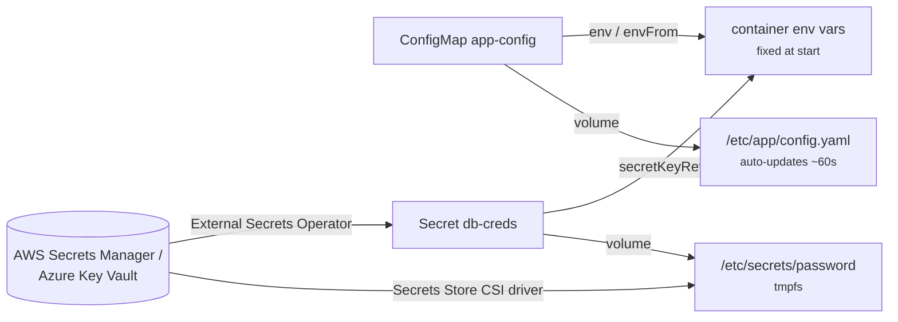

# 15 - ConfigMap and Secret

> **One-liner:** ConfigMaps hold **non-sensitive configuration** and Secrets hold **sensitive data**: passwords, tokens and TLS keys. Both decouple config from the image and are injected into Pods as **environment variables** or **mounted files**.

---

## What it is

| | ConfigMap | Secret |
| --- | --- | --- |
| Data | Plain text | base64-encoded (**encoding, not encryption**) |
| Size limit | 1 MiB | 1 MiB |
| Types | — | `Opaque`, `kubernetes.io/tls`, `kubernetes.io/dockerconfigjson`, `kubernetes.io/basic-auth`, `kubernetes.io/service-account-token` |
| Mounted on | Node disk | **tmpfs** (in memory) |
| Protection | RBAC | RBAC + **encryption at rest** (KMS) + an external store |



## Env vars vs volumes (a key interview point)

| | Env vars | Volume mount | Volume with `subPath` |
| --- | --- | --- | --- |
| Updates when the object changes? | **No**, a Pod restart is needed | **Yes**, eventually (kubelet sync, roughly 1 minute) | **No** |
| Good for | Simple flags | Config files, certificates, rotating secrets | Placing one file into an existing directory |

To make Pods pick up changes:
- run `kubectl rollout restart`;
- add a checksum annotation in Helm (`checksum/config: {{ include ... | sha256sum }}`); or
- use **Reloader** (stakater/Reloader).

**Immutable** ConfigMaps and Secrets (`immutable: true`) can't be changed by accident, and they reduce load on the API server. To change one, you create a new one.

## Securing Secrets

1. Enable **encryption at rest**. EKS uses a KMS envelope; AKS uses KMS with Key Vault.
2. Use **least-privilege RBAC**: `get`, `list` and `watch` on Secrets all reveal the values.
3. Prefer an **external source of truth**:
   - **External Secrets Operator**, which syncs Secrets Manager, Parameter Store or Key Vault into K8s Secrets;
   - **Secrets Store CSI Driver**, which mounts secrets directly as files and can optionally sync them to a Secret.
4. **Never commit plain Secret YAML to Git.** Use **Sealed Secrets** or **SOPS** for GitOps.
5. Prefer **volume mounts over env vars**. Env vars leak into crash dumps, `kubectl describe` output and child processes.

## Example YAML

```yaml
apiVersion: v1
kind: ConfigMap
metadata:
  name: app-config
  namespace: demo
data:
  LOG_LEVEL: "info"
  FEATURE_X: "true"
  config.yaml: |
    server:
      port: 8080
    cache:
      ttl: 300
---
apiVersion: v1
kind: Secret
metadata:
  name: db-creds
  namespace: demo
type: Opaque
stringData:                     # plain text here; stored base64-encoded
  username: app
  password: S3cr3t!
---
apiVersion: apps/v1
kind: Deployment
metadata:
  name: app
  namespace: demo
spec:
  replicas: 2
  selector: { matchLabels: { app: app } }
  template:
    metadata:
      labels: { app: app }
    spec:
      containers:
        - name: app
          image: nginx:1.28
          envFrom:
            - configMapRef:
                name: app-config          # every key becomes an env var
          env:
            - name: DB_USER
              valueFrom:
                secretKeyRef: { name: db-creds, key: username }
            - name: DB_PASSWORD
              valueFrom:
                secretKeyRef: { name: db-creds, key: password, optional: false }
          volumeMounts:
            - name: config
              mountPath: /etc/app         # config.yaml appears here, live-updated
              readOnly: true
            - name: secrets
              mountPath: /etc/secrets
              readOnly: true
      volumes:
        - name: config
          configMap:
            name: app-config
            items:
              - key: config.yaml
                path: config.yaml
        - name: secrets
          secret:
            secretName: db-creds
            defaultMode: 0400
---
# External Secrets Operator: pull from AWS Secrets Manager
apiVersion: external-secrets.io/v1
kind: ExternalSecret
metadata:
  name: db-creds
  namespace: demo
spec:
  refreshInterval: 1h
  secretStoreRef:
    name: aws-secrets-manager
    kind: ClusterSecretStore
  target:
    name: db-creds
  data:
    - secretKey: password
      remoteRef:
        key: prod/app/db
        property: password
```

## Common commands

```bash
# Create
kubectl create configmap app-config --from-literal=LOG_LEVEL=info --from-file=config.yaml -n demo
kubectl create secret generic db-creds --from-literal=username=app --from-literal=password='S3cr3t!' -n demo
kubectl create secret tls web-tls --cert=tls.crt --key=tls.key -n demo
kubectl create secret docker-registry regcred --docker-server=<registry> \
  --docker-username=<user> --docker-password=<pass> -n demo

# Generate YAML without applying
kubectl create cm app-config --from-env-file=.env --dry-run=client -o yaml

# Inspect
kubectl get cm,secret -n demo
kubectl describe cm app-config -n demo
kubectl get secret db-creds -n demo -o jsonpath='{.data.password}' | base64 -d; echo
kubectl get secret db-creds -n demo -o go-template='{{range $k,$v := .data}}{{$k}}={{$v|base64decode}}{{"\n"}}{{end}}'

# What does the running pod actually see?
kubectl exec -it deploy/app -n demo -- env | grep -E 'LOG_LEVEL|DB_'
kubectl exec -it deploy/app -n demo -- cat /etc/app/config.yaml

# Apply a config change to pods that use env vars
kubectl rollout restart deploy/app -n demo
```

## Troubleshooting

| Symptom | Likely cause | What to check |
| --- | --- | --- |
| `CreateContainerConfigError` | The referenced ConfigMap, Secret or **key** doesn't exist | `describe pod` → the message names the missing key; `get cm,secret -n NS` |
| Pod `ContainerCreating` with `MountVolume.SetUp failed ... not found` | A volume references a missing ConfigMap or Secret | Create it, or mark it `optional: true` |
| Updated a ConfigMap but the app still sees old values | It's consumed as env vars or a `subPath` mount | `rollout restart`, or switch to a full volume mount |
| A file mount updated but the app didn't notice | The app reads config only at startup | Have the app watch the file, or use Reloader or restart |
| Secret value has a trailing newline or bad characters | Created from a file with `echo` (newline), or base64'd by hand incorrectly | Use `stringData` or `echo -n`; decode and compare |
| `ImagePullBackOff` with a private registry | Wrong `imagePullSecrets` name or namespace, or bad credentials | The Secret type must be `kubernetes.io/dockerconfigjson`, in the **same namespace** as the Pod |
| `Forbidden: cannot get secrets` | The app's ServiceAccount lacks RBAC | `auth can-i get secrets --as=system:serviceaccount:NS:SA` |
| ExternalSecret `SecretSyncedError` | IAM/IRSA permissions, a wrong key path, or the store isn't ready | `describe externalsecret`; `describe clustersecretstore`; ESO logs |
| `cannot be updated: field is immutable` | `immutable: true` | Create a new name and update the reference |
| Object too large | Over 1 MiB | Split it, or use a volume or external storage |

```bash
# Find pods referencing a missing configmap/secret
kubectl get events -n demo --field-selector reason=Failed --sort-by=.lastTimestamp

# Which pods use a given ConfigMap?
kubectl get pods -n demo -o json | jq -r '.items[] | select(.spec | tostring | contains("app-config")) | .metadata.name'

# Compare the stored value with what the pod has
kubectl get cm app-config -n demo -o jsonpath='{.data.LOG_LEVEL}{"\n"}'
kubectl exec deploy/app -n demo -- printenv LOG_LEVEL

# External Secrets
kubectl get externalsecret,secretstore,clustersecretstore -A
kubectl describe externalsecret db-creds -n demo

# Is encryption at rest on? (EKS)
aws eks describe-cluster --name <cluster> --query 'cluster.encryptionConfig'
```

## Interview questions

<details>
<summary><b>Are Kubernetes Secrets secure?</b></summary>

Not by default. They are only base64-encoded, and anyone with `get` on Secrets or access to etcd can read them. To harden them:
- enable encryption at rest with KMS;
- apply tight RBAC;
- use an external manager (Secrets Manager or Key Vault) via ESO or the CSI driver;
- keep plain Secrets out of Git (use SOPS or Sealed Secrets);
- use workload identity instead of static cloud keys.
</details>

<details>
<summary><b>How do Pods pick up ConfigMap changes?</b></summary>

- **Volume mounts** update automatically after the kubelet sync, roughly a minute.
- **Env vars** and **`subPath`** mounts never update.

To roll out a change, use `kubectl rollout restart`, a Helm checksum annotation, or Reloader.
</details>

<details>
<summary><b>ConfigMap vs Secret: why have both?</b></summary>

They have different security handling: separate RBAC, tmpfs mounts, encryption-at-rest scope, and not being shown in `describe`. They also signal intent. A Secret's base64 encoding exists to allow binary data, not to hide it.
</details>

<details>
<summary><b>External Secrets Operator vs Secrets Store CSI Driver?</b></summary>

- **ESO** syncs external secrets **into Kubernetes Secrets**, so it works with env vars and any existing chart.
- **The CSI driver** mounts secrets **directly as files**, so nothing is stored in etcd unless you enable sync. It is better for compliance, but needs volume mounts.
</details>

## Quick revision

| Topic | Remember |
| --- | --- |
| Secret encoding | base64 ≠ encryption |
| Updates | Volume: auto; env / `subPath`: restart needed |
| Missing key | `CreateContainerConfigError` |
| Hardening | KMS at rest + RBAC + ESO/CSI + SOPS/Sealed Secrets |
| Pull secret | `dockerconfigjson`, same namespace |
| Size | 1 MiB max |
