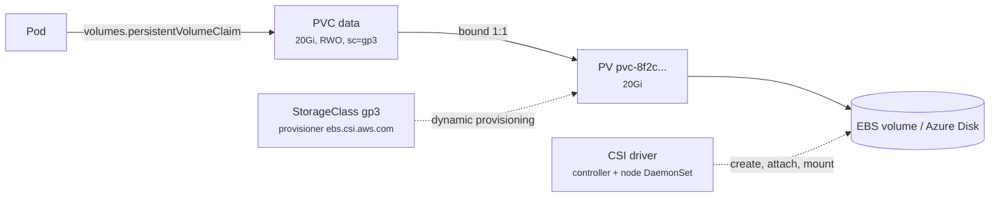

# 16 - PersistentVolume, PersistentVolumeClaim and StorageClass

> **One-liner:** A **PV** is a piece of storage, a **PVC** is a Pod's request for storage, and a **StorageClass** tells a **CSI driver** how to create PVs on demand (**dynamic provisioning**). Data outlives the Pod.

---

## How it fits together



1. A Pod references a PVC.
2. If a StorageClass is set, the **CSI controller** creates the disk and a matching PV.
3. The PV is **bound** to the PVC, one to one.
4. The disk is **attached** to the node, and the **CSI node plugin** mounts it into the Pod.

## Access modes

| Mode | Short | Meaning | Examples |
| --- | --- | --- | --- |
| ReadWriteOnce | RWO | Read-write by **one node** | EBS, Azure Disk |
| ReadWriteOncePod | RWOP | Read-write by **one Pod** | CSI disks |
| ReadOnlyMany | ROX | Read-only by many nodes | — |
| ReadWriteMany | RWX | Read-write by many nodes | **EFS**, Azure Files, NFS |

## Key StorageClass settings

| Field | Values | Why it matters |
| --- | --- | --- |
| `provisioner` | `ebs.csi.aws.com`, `efs.csi.aws.com`, `disk.csi.azure.com`, `file.csi.azure.com` | Which CSI driver creates the volume |
| `reclaimPolicy` | `Delete` (default for dynamic PVs) or `Retain` | What happens to the disk when the PVC is deleted |
| `volumeBindingMode` | `Immediate` or **`WaitForFirstConsumer`** | **WaitForFirstConsumer** creates the disk in the **same AZ as the Pod**. Always use it for zonal disks. |
| `allowVolumeExpansion` | `true` / `false` | Lets you grow PVCs online |
| `parameters` | e.g. `type: gp3`, `iops`, `encrypted: "true"` | Driver-specific options |

**Lifecycle phases:**
- PVC: `Pending` → `Bound`
- PV: `Available` → `Bound` → `Released` (after the PVC is deleted, with `Retain`) → `Failed`

## Example YAML

```yaml
apiVersion: storage.k8s.io/v1
kind: StorageClass
metadata:
  name: gp3
  annotations:
    storageclass.kubernetes.io/is-default-class: "true"
provisioner: ebs.csi.aws.com
parameters:
  type: gp3
  encrypted: "true"
reclaimPolicy: Delete
volumeBindingMode: WaitForFirstConsumer
allowVolumeExpansion: true
---
apiVersion: v1
kind: PersistentVolumeClaim
metadata:
  name: data
  namespace: demo
spec:
  accessModes: ["ReadWriteOnce"]
  storageClassName: gp3
  resources:
    requests:
      storage: 20Gi
---
apiVersion: v1
kind: Pod
metadata:
  name: app
  namespace: demo
spec:
  containers:
    - name: app
      image: busybox:1.36
      command: ["sh", "-c", "echo hello > /data/hello.txt; sleep 3600"]
      volumeMounts:
        - name: data
          mountPath: /data
  volumes:
    - name: data
      persistentVolumeClaim:
        claimName: data
---
# Static provisioning: pre-existing EFS (RWX) bound explicitly
apiVersion: v1
kind: PersistentVolume
metadata:
  name: shared-efs
spec:
  capacity: { storage: 100Gi }
  accessModes: ["ReadWriteMany"]
  persistentVolumeReclaimPolicy: Retain
  storageClassName: ""            # no dynamic provisioning
  csi:
    driver: efs.csi.aws.com
    volumeHandle: fs-0123456789abcdef0
```

**AKS equivalents:**
- `managed-csi` (Azure Disk, RWO)
- `azurefile-csi` (Azure Files, RWX)
- `managed-csi-premium`

## Common commands

```bash
kubectl get sc                                   # default class marked "(default)"
kubectl get pvc -n demo
kubectl get pv
kubectl describe pvc data -n demo                # events: ProvisioningSucceeded / WaitForFirstConsumer
kubectl describe pv <pv-name>                    # source volume ID, node affinity (zone)

# Expand a volume (SC must allow it)
kubectl patch pvc data -n demo -p '{"spec":{"resources":{"requests":{"storage":"50Gi"}}}}'
kubectl get pvc data -n demo -o jsonpath='{.status.capacity.storage}{"\n"}'

# Which pod uses which PVC
kubectl get pods -n demo -o json | jq -r '.items[] | .metadata.name as $p | .spec.volumes[]? | select(.persistentVolumeClaim) | "\($p) -> \(.persistentVolumeClaim.claimName)"'

# Attachments
kubectl get volumeattachments

# CSI driver health (EKS EBS example)
kubectl get pods -n kube-system -l app.kubernetes.io/name=aws-ebs-csi-driver
kubectl get csidrivers
```

## Troubleshooting

| Symptom | Likely cause | What to check |
| --- | --- | --- |
| PVC `Pending`: `waiting for first consumer` | Normal with `WaitForFirstConsumer` until a Pod uses it | Create the Pod; it should bind |
| PVC `Pending`: `no persistent volumes available` and no class | No default StorageClass and no `storageClassName` set | `kubectl get sc`; set a default |
| PVC `Pending`: provisioning failed | The CSI driver isn't installed, its IAM/IRSA lacks EC2 permissions, quota, or a bad parameter | `describe pvc` events; CSI controller logs |
| Pod `Pending`: `volume node affinity conflict` | The PV is in AZ-a and no node there can take the Pod | `describe pv` → nodeAffinity; node zones; use `WaitForFirstConsumer` |
| `Multi-Attach error for volume` | An RWO disk is still attached to another node (old Pod or dead node) | `get volumeattachments`; wait about 6 minutes for force-detach, or confirm the node is gone |
| Pod `ContainerCreating`: `MountVolume.MountDevice failed` / timeout | Node plugin issue, filesystem error, or (EFS) a security group blocking NFS 2049 | `describe pod`; CSI node DaemonSet logs on that node; SGs |
| `permission denied` writing the volume | The app runs as non-root and the volume is owned by root | `securityContext.fsGroup`; `fsGroupChangePolicy: OnRootMismatch` |
| Disk full | The PVC is too small | Expand it (if `allowVolumeExpansion`); `kubectl exec -- df -h` |
| Expansion stuck on `FileSystemResizePending` | Needs a Pod restart for drivers without online expansion | Restart the Pod |
| PVC stuck `Terminating` | The `kubernetes.io/pvc-protection` finalizer: a Pod still uses it | Delete the Pod first |
| Deleted the PVC and lost the data | `reclaimPolicy: Delete` | Use `Retain` for important data, plus snapshots or backups (Velero) |
| PV `Released`, can't be reused | Still holds the old `claimRef` | Back up the data, then clear `spec.claimRef` to make it `Available` |

```bash
# Full chain for one PVC
kubectl describe pvc data -n demo | sed -n '/Events/,$p'
PV=$(kubectl get pvc data -n demo -o jsonpath='{.spec.volumeName}')
kubectl get pv $PV -o jsonpath='{.spec.csi.volumeHandle}{"  zone: "}{.spec.nodeAffinity.required.nodeSelectorTerms[0].matchExpressions[0].values}{"\n"}'

# Pod's node and its zone
kubectl get pod app -n demo -o wide
kubectl get nodes -L topology.kubernetes.io/zone

# CSI logs (EBS)
kubectl logs -n kube-system deploy/ebs-csi-controller -c ebs-plugin --tail=50
kubectl logs -n kube-system -l app=ebs-csi-node -c ebs-plugin --tail=50

# Disk usage inside the pod
kubectl exec -it app -n demo -- df -h /data

# Make a Released PV available again (after backing up!)
kubectl patch pv $PV -p '{"spec":{"claimRef":null}}'

# AWS side
aws ec2 describe-volumes --volume-ids <vol-id> --query 'Volumes[].{state:State,az:AvailabilityZone,attach:Attachments}'
```

## Interview questions

<details>
<summary><b>PV vs PVC vs StorageClass?</b></summary>

- A **PV** is the actual storage resource, cluster-scoped.
- A **PVC** is a namespaced request for an amount of storage and an access mode.
- A **StorageClass** is a template a CSI driver uses to create PVs dynamically.

The Pod only knows the PVC, which decouples the app from the storage implementation.
</details>

<details>
<summary><b>Why use `WaitForFirstConsumer`?</b></summary>

Zonal disks such as EBS and Azure Disk can only attach to nodes in the same AZ. With `Immediate` binding, the disk may be created in AZ-a before the scheduler places the Pod in AZ-b, and the Pod then gets stuck. `WaitForFirstConsumer` delays provisioning until the Pod is scheduled, so the disk is created in the Pod's zone.
</details>

<details>
<summary><b>RWO vs RWX: what do you use on AWS and Azure?</b></summary>

- **RWO** (single node): EBS or Azure Disk, for databases and single-writer apps.
- **RWX** (many nodes): EFS or Azure Files (or FSx, NetApp), for shared content and multi-replica apps that need the same files.

RWX is usually slower and costs more per GB.
</details>

<details>
<summary><b>Retain vs Delete reclaim policy?</b></summary>

With **Delete**, removing the PVC deletes the PV **and the cloud disk**. With **Retain**, the disk stays and the PV becomes `Released`, so an admin must reclaim it manually.

Use Retain, plus backups such as VolumeSnapshots or Velero, for important data.
</details>

<details>
<summary><b>How do you back up persistent volumes?</b></summary>

- CSI **VolumeSnapshots** (`VolumeSnapshotClass`, `VolumeSnapshot`)
- **Velero** for cluster resources plus volumes
- cloud-native backups (AWS Backup, Azure Backup for AKS)
- app-level dumps for databases, for consistency
</details>

## Quick revision

| Topic | Remember |
| --- | --- |
| Chain | Pod → PVC → PV → disk (via CSI) |
| Zonal disks | `WaitForFirstConsumer` |
| RWX on cloud | EFS / Azure Files |
| Multi-Attach | An RWO disk still on another node |
| Permissions | `fsGroup` |
| Data safety | `Retain` + snapshots / Velero |
