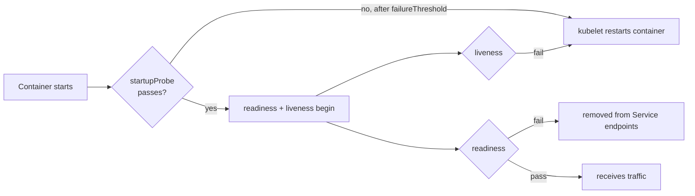

# 17 - Probes (Startup, Readiness, Liveness)

> **One-liner:** The kubelet runs probes to decide **whether a container has started** (startup), **whether it should receive traffic** (readiness) and **whether it should be restarted** (liveness). Getting them wrong is one of the most common causes of outages and restart loops.

---

## The three probes

| Probe | Question | On failure | Runs |
| --- | --- | --- | --- |
| **Startup** | Has the app finished booting? | Container **restarted** once `failureThreshold` is reached | First; the other two are disabled until it succeeds |
| **Readiness** | Can it serve traffic **right now**? | Removed from Service **endpoints** (**not** restarted) | The whole lifetime |
| **Liveness** | Is it **stuck or deadlocked** beyond recovery? | Container **restarted** | The whole lifetime |



## Probe mechanisms

| Type | Success when |
| --- | --- |
| `httpGet` | HTTP 200–399 |
| `tcpSocket` | The TCP connection opens |
| `exec` | The command exits 0 |
| `grpc` | gRPC health check returns `SERVING` |

## Timing fields

| Field | Default | Meaning |
| --- | --- | --- |
| `initialDelaySeconds` | 0 | Wait before the first probe (prefer a startupProbe for slow starts) |
| `periodSeconds` | 10 | How often to probe |
| `timeoutSeconds` | 1 | Per-probe timeout. **1 second is often too short under load.** |
| `failureThreshold` | 3 | Consecutive failures before acting |
| `successThreshold` | 1 | Consecutive successes to recover (must be 1 for liveness and startup) |

The maximum time allowed for startup is `failureThreshold × periodSeconds`. For example, 30 × 10s = 5 minutes.

## Best practices

- **Liveness must be cheap and local.** Never check the database or downstream services in liveness. If the database blips, every Pod restarts at once and you get a cascading failure.
- **Readiness can check critical dependencies**, carefully. A Pod that can't reach its DB shouldn't get traffic, but if *all* Pods go unready, the Service has **zero endpoints**.
- **Use a startupProbe for slow starters** (JVM, model loading) instead of a huge `initialDelaySeconds` on liveness.
- **Set a sensible `timeoutSeconds`** (2–5s). GC pauses and CPU throttling cause false liveness failures.
- **Use separate endpoints**, `/healthz` for liveness and `/ready` for readiness.
- **Remember shutdown:** on SIGTERM, start failing readiness or rely on endpoint removal, and add a `preStop` sleep so in-flight requests drain.

## Example YAML

```yaml
apiVersion: apps/v1
kind: Deployment
metadata:
  name: api
  namespace: demo
spec:
  replicas: 3
  selector: { matchLabels: { app: api } }
  template:
    metadata:
      labels: { app: api }
    spec:
      containers:
        - name: api
          image: ghcr.io/example/api:1.4.0
          ports:
            - { name: http, containerPort: 8080 }
          startupProbe:                    # up to 30 x 5s = 150s to boot
            httpGet: { path: /healthz, port: http }
            periodSeconds: 5
            failureThreshold: 30
          readinessProbe:                  # traffic gate
            httpGet: { path: /ready, port: http }
            periodSeconds: 5
            timeoutSeconds: 2
            failureThreshold: 3
          livenessProbe:                   # restart only if truly stuck
            httpGet: { path: /healthz, port: http }
            periodSeconds: 10
            timeoutSeconds: 3
            failureThreshold: 3
          lifecycle:
            preStop:
              exec: { command: ["sh", "-c", "sleep 10"] }
      terminationGracePeriodSeconds: 40
---
# Other probe types
# tcpSocket:
#   tcpSocket: { port: 5432 }
# exec:
#   exec: { command: ["pg_isready", "-U", "postgres"] }
# grpc:
#   grpc: { port: 9090 }
```

## Common commands

```bash
kubectl describe pod <pod> -n demo | grep -E 'Liveness|Readiness|Startup'   # configured probes
kubectl describe pod <pod> -n demo | sed -n '/Events/,$p'                   # "Readiness probe failed: ..."
kubectl get pods -n demo                                                    # READY 0/1, RESTARTS count

# Run the probe yourself, from inside the pod
kubectl exec -it <pod> -n demo -- wget -qO- -T 2 http://localhost:8080/ready
kubectl exec -it <pod> -n demo -- sh -c 'time wget -qO- http://localhost:8080/healthz'   # check latency vs timeoutSeconds

# Probe-related events across the namespace
kubectl get events -n demo --field-selector reason=Unhealthy --sort-by=.lastTimestamp

# Is the pod in the Service endpoints?
kubectl get endpointslices -n demo -l kubernetes.io/service-name=api \
  -o jsonpath='{range .items[*].endpoints[*]}{.targetRef.name} ready={.conditions.ready}{"\n"}{end}'
```

## Troubleshooting

| Symptom | Likely cause | What to check |
| --- | --- | --- |
| `Running` but `READY 0/1` forever | Readiness failing: wrong path or port, the app isn't ready, or a dependency is down | `describe pod` → `Readiness probe failed: HTTP probe failed with statuscode: 404`; curl it from inside |
| `CrashLoopBackOff`, restart count climbing, the app looks fine | Liveness kills a slow-starting app | Add a startupProbe; check `Liveness probe failed` events |
| Restarts under load or during GC | `timeoutSeconds: 1` is too short | Increase the timeout and failureThreshold; check CPU throttling |
| All Pods restarted at once | Liveness checks a shared dependency (DB) that blipped | Make liveness local-only |
| Service has zero endpoints during an incident | All Pods unready because readiness depends on a down dependency | Rethink the readiness scope; alert on endpoint count |
| `connection refused` in probe events | The app listens on another port or on `127.0.0.1` only | The named port matches `containerPort`; bind to `0.0.0.0` |
| HTTPS app: probe fails with a bad request | The probe uses HTTP | Set `scheme: HTTPS` in `httpGet` |
| `exec` probe fails | Command not in the image, or it takes too long | `kubectl exec` the same command and time it |
| 5xx errors during rollouts | Readiness passes before the app is warm, or there's no graceful shutdown | Stricter readiness, `minReadySeconds`, `preStop` sleep |
| Exit code 137, no OOM | Killed by a liveness failure (SIGKILL after grace) | Events show `Container ... failed liveness probe, will be restarted` |

```bash
# Last termination reason (OOMKilled vs Error vs liveness kill)
kubectl get pod <pod> -n demo -o jsonpath='{.status.containerStatuses[0].lastState.terminated.reason}{" exit="}{.status.containerStatuses[0].lastState.terminated.exitCode}{"\n"}'

# CPU throttling (can cause probe timeouts) - with metrics/Prometheus
kubectl top pod <pod> -n demo --containers

# Logs from the instance that liveness killed
kubectl logs <pod> -n demo --previous
```

## Interview questions

<details>
<summary><b>Readiness vs liveness: what happens on failure?</b></summary>

When **readiness** fails, the Pod is removed from Service endpoints and gets no traffic, but **it keeps running**. When **liveness** fails, the kubelet **restarts the container**.

Readiness handles temporary unavailability; liveness handles unrecoverable hangs.
</details>

<details>
<summary><b>Why do you need a startup probe?</b></summary>

Slow-starting apps would otherwise be killed by liveness before they finish booting, and a long `initialDelaySeconds` delays detection for the Pod's whole life. A startupProbe gives a generous one-time boot window, then hands over to a tight liveness probe.
</details>

<details>
<summary><b>Should liveness probes check the database?</b></summary>

No. If the database has a hiccup, every replica fails liveness at the same moment and restarts, which turns a minor dependency issue into a full outage. Liveness should only check whether *this process* is healthy.
</details>

<details>
<summary><b>How do probes relate to zero-downtime deployments?</b></summary>

In a rolling update, old Pods are removed only as new Pods become **Ready**. An accurate readiness probe prevents traffic from reaching unready Pods. Combine it with `maxUnavailable: 0`, `minReadySeconds` and a `preStop` drain.
</details>

## Quick revision

| Topic | Remember |
| --- | --- |
| Startup | Boot window; gates the others |
| Readiness fail | Out of endpoints, **no** restart |
| Liveness fail | **Restart** |
| Liveness rule | Local only, never dependencies |
| Timeout | Default 1s is often too low |
| Exit 137 without OOM | Liveness kill |
