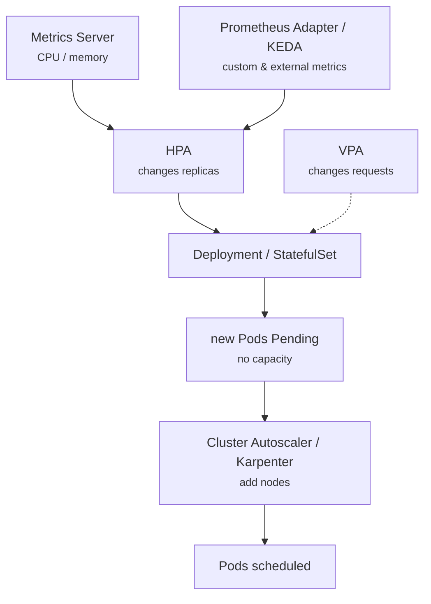

# 18 - Autoscaling: HPA, VPA, Cluster Autoscaler, Karpenter, KEDA

> **One-liner:** Kubernetes scales on two levels. **Pods** scale out with **HPA** (more replicas), scale up with **VPA** (bigger requests) or scale on events with **KEDA**. **Nodes** scale with **Cluster Autoscaler** or **Karpenter**, which add capacity when Pods can't be scheduled.

---

## The layers



| Tool | Scales | Based on |
| --- | --- | --- |
| **HPA** | Replica count | CPU or memory utilization (% of **requests**), custom metrics (RPS), external metrics (queue depth) |
| **VPA** | CPU and memory **requests and limits** | Historical usage. Modes: `Off` (recommend only), `Initial`, `Recreate`, `InPlaceOrRecreate` |
| **KEDA** | Replicas, including **to zero** | Event sources: SQS, Kafka lag, Prometheus, cron, Azure Service Bus. It creates and manages an HPA. |
| **Cluster Autoscaler** | Node groups (ASG / VMSS) | Pending Pods; removes underused nodes |
| **Karpenter** | Individual nodes, picking the instance type itself | Pending Pods; consolidates to cheaper or fewer nodes |

## HPA formula

```
desiredReplicas = ceil( currentReplicas × currentMetricValue / targetValue )
```

For example, 4 replicas at 90% CPU against a 60% target gives ceil(4 × 90 / 60) = **6**.

**Requirements:**
- Metrics Server is installed.
- Containers have **CPU or memory requests**, because utilization is calculated against requests.

The `behavior` field controls stabilization windows. The default scale-down window is 300 seconds.

## Cluster Autoscaler vs Karpenter

| | Cluster Autoscaler | Karpenter |
| --- | --- | --- |
| Unit | Node groups (ASG/VMSS) with fixed instance types | Individual EC2 instances, choosing the type at launch |
| Speed | Slower (works through the ASG) | Faster (direct EC2 Fleet API) |
| Bin-packing and cost | Limited | Consolidation, Spot, many instance types |
| Platforms | All clouds (AKS has it built in) | EKS-native; **AKS Node Auto Provisioning** is based on Karpenter |

## Example YAML

```yaml
apiVersion: autoscaling/v2
kind: HorizontalPodAutoscaler
metadata:
  name: web
  namespace: demo
spec:
  scaleTargetRef:
    apiVersion: apps/v1
    kind: Deployment
    name: web
  minReplicas: 3
  maxReplicas: 20
  metrics:
    - type: Resource
      resource:
        name: cpu
        target:
          type: Utilization
          averageUtilization: 60
    - type: Resource
      resource:
        name: memory
        target:
          type: Utilization
          averageUtilization: 75
  behavior:
    scaleUp:
      stabilizationWindowSeconds: 0
      policies:
        - { type: Percent, value: 100, periodSeconds: 30 }
    scaleDown:
      stabilizationWindowSeconds: 300
      policies:
        - { type: Pods, value: 2, periodSeconds: 60 }
---
# VPA in recommendation-only mode (safe alongside HPA on other metrics)
apiVersion: autoscaling.k8s.io/v1
kind: VerticalPodAutoscaler
metadata:
  name: web
  namespace: demo
spec:
  targetRef:
    apiVersion: apps/v1
    kind: Deployment
    name: web
  updatePolicy:
    updateMode: "Off"
---
# KEDA: scale a worker on SQS queue depth, down to zero
apiVersion: keda.sh/v1alpha1
kind: ScaledObject
metadata:
  name: worker
  namespace: demo
spec:
  scaleTargetRef:
    name: worker
  minReplicaCount: 0
  maxReplicaCount: 50
  triggers:
    - type: aws-sqs-queue
      metadata:
        queueURL: https://sqs.ap-south-1.amazonaws.com/111122223333/jobs
        queueLength: "20"
        awsRegion: ap-south-1
      authenticationRef:
        name: keda-aws
---
# Karpenter NodePool (EKS)
apiVersion: karpenter.sh/v1
kind: NodePool
metadata:
  name: general
spec:
  template:
    spec:
      requirements:
        - { key: karpenter.sh/capacity-type, operator: In, values: ["spot", "on-demand"] }
        - { key: kubernetes.io/arch, operator: In, values: ["amd64", "arm64"] }
        - { key: karpenter.k8s.aws/instance-category, operator: In, values: ["c", "m", "r"] }
      nodeClassRef:
        group: karpenter.k8s.aws
        kind: EC2NodeClass
        name: default
  limits:
    cpu: "200"
  disruption:
    consolidationPolicy: WhenEmptyOrUnderutilized
    consolidateAfter: 1m
```

## Common commands

```bash
# HPA
kubectl autoscale deploy web --cpu-percent=60 --min=3 --max=20 -n demo
kubectl get hpa -n demo -w                       # TARGETS column, e.g. 45%/60%
kubectl describe hpa web -n demo                 # conditions + scaling events

# Metrics pipeline
kubectl top nodes
kubectl top pods -n demo
kubectl get apiservice v1beta1.metrics.k8s.io    # must be Available=True
kubectl get --raw "/apis/metrics.k8s.io/v1beta1/namespaces/demo/pods" | jq '.items[].metadata.name'

# VPA recommendations
kubectl describe vpa web -n demo | sed -n '/Recommendation/,$p'

# KEDA
kubectl get scaledobject -n demo
kubectl describe scaledobject worker -n demo

# Cluster Autoscaler
kubectl logs -n kube-system deploy/cluster-autoscaler --tail=100
kubectl get cm cluster-autoscaler-status -n kube-system -o yaml

# Karpenter
kubectl get nodepools,nodeclaims
kubectl logs -n kube-system -l app.kubernetes.io/name=karpenter --tail=100

# Load test to watch scaling
kubectl run load --image=busybox:1.36 -n demo --restart=Never -- sh -c 'while true; do wget -qO- http://web; done'
```

## Troubleshooting

| Symptom | Likely cause | What to check |
| --- | --- | --- |
| HPA `TARGETS <unknown>/60%` | Metrics Server missing or unhealthy, or the **Pods have no CPU requests** | `kubectl top pods`; `get apiservice v1beta1.metrics.k8s.io`; the requests in the spec |
| `FailedGetResourceMetric` | Metrics Server can't scrape the kubelet (TLS, network) | Metrics Server logs (`--kubelet-insecure-tls` only in labs) |
| HPA doesn't scale up | Already at `maxReplicas`, the target is high, or the stabilization window | `describe hpa` → conditions `ScalingLimited`, `AbleToScale` |
| Scales up, but new Pods are `Pending` | No node capacity, and the node autoscaler isn't adding nodes | `describe pod` (`FailedScheduling`); CA/Karpenter logs |
| HPA flaps up and down | No stabilization, or a noisy metric | Tune `behavior`, `stabilizationWindowSeconds` |
| Never scales down | The scale-down window (5 min default), or the metric never drops | `describe hpa` events; current metric value |
| Replicas reset after deploy | The Deployment YAML sets `replicas` and fights the HPA | Remove `replicas` from the manifest (or ignore it in Argo CD) |
| HPA and VPA fight | Both act on CPU/memory for the same workload | Use VPA in `Off` mode, or HPA on custom metrics only |
| CA won't add nodes: `pod didn't trigger scale-up` | The Pod can't fit any node group (affinity, taints, too large), or the group is at max | `cluster-autoscaler-status`; node group min/max; ASG |
| CA won't remove a node | A Pod blocks it: local storage, a PDB, a bare Pod, `safe-to-evict: false`, a kube-system Pod | CA logs `scale-down ... blocked by` |
| Karpenter NodeClaim not launching | IAM, subnet/SG discovery tags, insufficient capacity for the instance types, NodePool `limits` reached | `describe nodeclaim`; Karpenter logs |
| KEDA not scaling from zero | Trigger auth or IAM fails, or the metric isn't reachable | `describe scaledobject`; keda-operator logs |

```bash
# Is HPA seeing metrics? (current vs target per metric)
kubectl get hpa web -n demo -o jsonpath='{.status.currentMetrics}{"\n"}'

# Pods without CPU requests (break HPA)
kubectl get pods -n demo -o json | jq -r '.items[] | select(any(.spec.containers[]; .resources.requests.cpu == null)) | .metadata.name'

# Pending pods and why
kubectl get pods -A --field-selector=status.phase=Pending
kubectl get events -A --field-selector reason=FailedScheduling --sort-by=.lastTimestamp | tail -20

# Node utilisation vs allocatable
kubectl describe nodes | grep -A5 "Allocated resources"
```

## Interview questions

<details>
<summary><b>How does HPA work?</b></summary>

1. Every 15 seconds the HPA controller reads metrics from the metrics API (Metrics Server, or an adapter for custom metrics).
2. It computes `ceil(current × actual / target)`.
3. It clamps the result to `minReplicas`/`maxReplicas`, applies the `behavior` policies, and updates the scale subresource.

For resource metrics, utilization is a percentage of **requests**.
</details>

<details>
<summary><b>HPA scaled up but nothing happened. Why?</b></summary>

The new Pods were probably `Pending` for lack of capacity. HPA only creates Pods; **node** scaling needs Cluster Autoscaler or Karpenter, which react to Pending Pods. Check the `FailedScheduling` events and the autoscaler logs, including node group max size and instance availability.
</details>

<details>
<summary><b>Cluster Autoscaler vs Karpenter?</b></summary>

- **CA** resizes predefined node groups (ASG/VMSS). It is simple and multi-cloud, but slower and less cost-optimal.
- **Karpenter** provisions nodes directly, chooses the best instance type for the pending Pods, uses Spot well, and continuously consolidates.

On EKS, Karpenter is generally preferred.
</details>

<details>
<summary><b>Can you use HPA and VPA together?</b></summary>

Not on the same CPU or memory metric, because they would fight. Common patterns are:
- VPA in `Off` mode, used only for right-sizing recommendations, with HPA on CPU; or
- HPA on custom metrics (RPS, queue depth) with VPA managing resources.
</details>

<details>
<summary><b>How do you scale to zero?</b></summary>

Native HPA's minimum is 1 by default. **KEDA** scales Deployments to and from zero based on event sources such as queue depth or Kafka lag. Knative is an alternative for HTTP workloads.
</details>

## Quick revision

| Topic | Remember |
| --- | --- |
| HPA needs | Metrics Server + **requests** |
| `<unknown>` | Metrics pipeline or missing requests |
| Pod scale ≠ node scale | Pending Pods → CA / Karpenter |
| HPA + VPA | Not on the same metric |
| Scale to zero | KEDA |
| Don't set `replicas` | In manifests managed by HPA |
