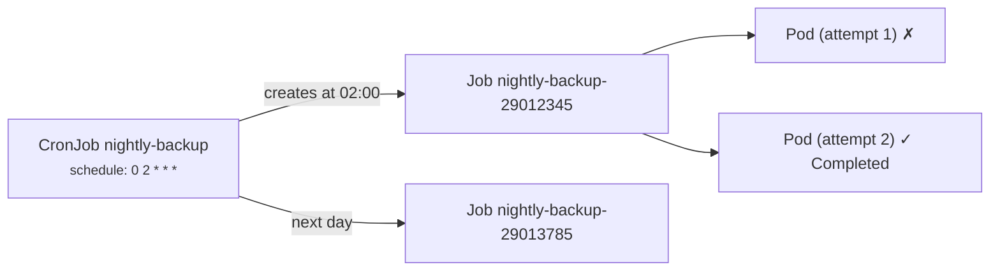

# 19 - Job and CronJob

> **One-liner:** A **Job** runs Pods **until they complete successfully** (batch work, migrations). A **CronJob** creates Jobs **on a schedule** (backups, reports, cleanups).

---

## What it is



## Job settings

| Field | Default | Meaning |
| --- | --- | --- |
| `completions` | 1 | Successful Pods needed |
| `parallelism` | 1 | Pods running at the same time |
| `completionMode` | `NonIndexed` | `Indexed` gives each Pod `JOB_COMPLETION_INDEX` (for sharded work) |
| `backoffLimit` | 6 | Retries before the Job is marked `Failed` (exponential backoff: 10s, 20s, 40s… up to 6m) |
| `activeDeadlineSeconds` | — | Hard time limit for the whole Job |
| `ttlSecondsAfterFinished` | — | Auto-delete the Job and its Pods after it finishes |
| `podFailurePolicy` | — | Fail fast on specific exit codes, or ignore disruptions |
| `restartPolicy` (Pod) | **must be** `OnFailure` or `Never` | `OnFailure` restarts in the same Pod; `Never` creates a new Pod for each retry, keeping the logs |

## CronJob settings

| Field | Meaning |
| --- | --- |
| `schedule` | Cron syntax `min hour dom month dow`, e.g. `*/15 * * * *` |
| `timeZone` | e.g. `Asia/Kolkata`. **Without it, the controller's time zone (usually UTC) is used.** |
| `concurrencyPolicy` | `Allow` (default), `Forbid` (skip the run if the previous one is still going) or `Replace` (kill the previous one) |
| `startingDeadlineSeconds` | How late a missed run can still start. Without it, more than **100 missed schedules** stops the CronJob. |
| `successfulJobsHistoryLimit` / `failedJobsHistoryLimit` | Jobs kept (defaults 3 / 1) |
| `suspend` | Pause future runs |

Jobs should be **idempotent**. A CronJob can occasionally create two Jobs, or none, for one schedule.

## Example YAML

```yaml
apiVersion: batch/v1
kind: Job
metadata:
  name: db-migrate
  namespace: demo
spec:
  backoffLimit: 3
  activeDeadlineSeconds: 900
  ttlSecondsAfterFinished: 3600
  podFailurePolicy:
    rules:
      - action: FailJob                 # exit 42 = bad migration, don't retry
        onExitCodes:
          containerName: migrate
          operator: In
          values: [42]
      - action: Ignore                  # node drain/preemption doesn't count as a failure
        onPodConditions:
          - type: DisruptionTarget
  template:
    spec:
      restartPolicy: Never
      containers:
        - name: migrate
          image: ghcr.io/example/api:1.4.0
          command: ["./migrate", "up"]
          envFrom:
            - secretRef: { name: db-creds }
---
apiVersion: batch/v1
kind: CronJob
metadata:
  name: nightly-backup
  namespace: demo
spec:
  schedule: "0 2 * * *"
  timeZone: "Asia/Kolkata"
  concurrencyPolicy: Forbid
  startingDeadlineSeconds: 600
  successfulJobsHistoryLimit: 3
  failedJobsHistoryLimit: 3
  jobTemplate:
    spec:
      backoffLimit: 2
      activeDeadlineSeconds: 3600
      template:
        spec:
          restartPolicy: OnFailure
          serviceAccountName: backup        # IRSA / Workload Identity for S3/Blob access
          containers:
            - name: backup
              image: postgres:17
              command: ["sh", "-c", "pg_dump -h postgres -U app app | gzip > /backup/app-$(date +%F).sql.gz"]
              envFrom:
                - secretRef: { name: db-creds }
              volumeMounts:
                - { name: backup, mountPath: /backup }
          volumes:
            - name: backup
              persistentVolumeClaim: { claimName: backups }
---
# Parallel, indexed job: 10 shards, 3 at a time
apiVersion: batch/v1
kind: Job
metadata:
  name: process-shards
  namespace: demo
spec:
  completions: 10
  parallelism: 3
  completionMode: Indexed
  template:
    spec:
      restartPolicy: Never
      containers:
        - name: worker
          image: busybox:1.36
          command: ["sh", "-c", "echo processing shard $JOB_COMPLETION_INDEX"]
```

## Common commands

```bash
kubectl apply -f job.yaml
kubectl get jobs -n demo                          # COMPLETIONS 1/1, DURATION
kubectl describe job db-migrate -n demo
kubectl logs job/db-migrate -n demo
kubectl wait --for=condition=complete job/db-migrate -n demo --timeout=10m

kubectl get cronjobs -n demo                      # SCHEDULE, SUSPEND, ACTIVE, LAST SCHEDULE
kubectl describe cronjob nightly-backup -n demo

# Run a CronJob now (manual trigger)
kubectl create job manual-backup-$(date +%s) --from=cronjob/nightly-backup -n demo

# Suspend / resume
kubectl patch cronjob nightly-backup -n demo -p '{"spec":{"suspend":true}}'
kubectl patch cronjob nightly-backup -n demo -p '{"spec":{"suspend":false}}'

# Jobs + pods created by a CronJob
kubectl get jobs -n demo -l batch.kubernetes.io/cronjob-name=nightly-backup 2>/dev/null || kubectl get jobs -n demo | grep nightly-backup
kubectl get pods -n demo -l job-name=db-migrate

# Clean up finished jobs
kubectl delete jobs -n demo --field-selector status.successful=1
```

## Troubleshooting

| Symptom | Likely cause | What to check |
| --- | --- | --- |
| Job `Failed`: `BackoffLimitExceeded` | Every retry failed | `kubectl logs` on the failed Pods (`restartPolicy: Never` keeps them); exit codes |
| Job `Failed`: `DeadlineExceeded` | Ran longer than `activeDeadlineSeconds` | Increase it, or speed the work up |
| Job never finishes | The process doesn't exit, or a **sidecar** keeps the Pod running | Use native sidecars (`initContainers` with `restartPolicy: Always`) so they stop |
| Pods pile up as `Error` | `restartPolicy: Never` plus retries; no TTL | `ttlSecondsAfterFinished`; history limits |
| Logs gone after failure | `restartPolicy: OnFailure` restarts in place; the Pod was deleted by TTL | Use `Never` while debugging; `logs --previous` |
| CronJob didn't run | Suspended, wrong schedule or time zone, `Forbid` while the previous run is still active | `describe cronjob` → Last Schedule; `timeZone`; active Jobs |
| `Cannot determine if job needs to be started: too many missed start times` | More than 100 missed schedules (controller was down or the CronJob suspended long) | Set `startingDeadlineSeconds`; recreate it |
| Runs overlap, causing duplicates | `concurrencyPolicy: Allow` | Use `Forbid` and make the job idempotent |
| Runs at the wrong hour | UTC default | Set `timeZone: Asia/Kolkata` |
| Job Pod `Pending` | Resources, quota, PVC | `describe pod` |

```bash
# Why did the job fail? (conditions)
kubectl get job db-migrate -n demo -o jsonpath='{range .status.conditions[*]}{.type}: {.reason} - {.message}{"\n"}{end}'

# Logs of every pod the job created (incl. failed attempts)
for p in $(kubectl get pods -n demo -l job-name=db-migrate -o name); do echo "== $p"; kubectl logs $p -n demo --tail=20; done

# Exit codes of attempts
kubectl get pods -n demo -l job-name=db-migrate -o jsonpath='{range .items[*]}{.metadata.name}{" "}{.status.containerStatuses[0].state.terminated.exitCode}{"\n"}{end}'

# CronJob last/next activity
kubectl get cronjob nightly-backup -n demo -o jsonpath='last={.status.lastScheduleTime} lastSuccess={.status.lastSuccessfulTime}{"\n"}'
```

## Interview questions

<details>
<summary><b>Job vs Deployment?</b></summary>

A Deployment keeps Pods running forever and restarts them when they exit. A Job runs Pods **to completion** and is done once enough of them succeed. That's why Jobs require `restartPolicy` `OnFailure` or `Never`.
</details>

<details>
<summary><b>`restartPolicy: OnFailure` vs `Never` in a Job?</b></summary>

- **`OnFailure`** restarts the container inside the same Pod, so you get fewer Pods but lose the earlier logs.
- **`Never`** creates a new Pod for each retry, keeping every failed Pod for inspection.

Both count toward `backoffLimit`.
</details>

<details>
<summary><b>How do you prevent overlapping CronJob runs?</b></summary>

Set `concurrencyPolicy: Forbid` to skip a run while the previous one is still active, or `Replace` to kill the old run. Add `activeDeadlineSeconds` so a hung run can't block future runs forever, and make the job idempotent.
</details>

<details>
<summary><b>How do you run a CronJob immediately?</b></summary>

`kubectl create job <name> --from=cronjob/<cronjob>` creates a one-off Job from the CronJob's template.
</details>

<details>
<summary><b>How do you run database migrations safely in Kubernetes?</b></summary>

- Run a Job before the app rollout: a Helm pre-upgrade hook, an Argo CD PreSync hook, or an init step in the pipeline.
- Set `backoffLimit` low and add an `activeDeadlineSeconds`.
- Make migrations backward-compatible (expand, then contract), so old and new app versions both work during the rolling update.
</details>

## Quick revision

| Topic | Remember |
| --- | --- |
| Job restartPolicy | `OnFailure` / `Never` only |
| Retries | `backoffLimit` (default 6) |
| Timeout | `activeDeadlineSeconds` |
| Cleanup | `ttlSecondsAfterFinished` |
| Overlap | `concurrencyPolicy: Forbid` |
| Time zone | Set `timeZone`, default UTC |
| Manual run | `create job --from=cronjob/...` |
