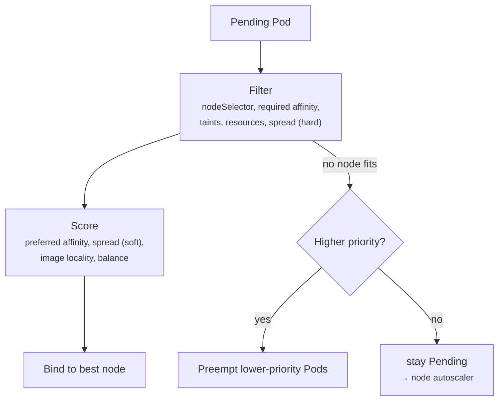

# 20 - Scheduling: nodeSelector, Affinity, Taints, Topology Spread, Priority

> **One-liner:** You control **where** Pods run in two ways. You **attract** Pods to nodes with nodeSelector and node affinity, and you **repel** Pods from nodes with taints and tolerations. You place Pods relative to each other with **pod (anti-)affinity** and **topology spread constraints**, and you decide **who wins** under pressure with **PriorityClass**.

---

## The tools

| Tool | Direction | Hard / soft | Typical use |
| --- | --- | --- | --- |
| `nodeSelector` | Pod → node | Hard | Simple label match (`disktype=ssd`) |
| **Node affinity** | Pod → node | `required…` (hard) or `preferred…` (soft) | Zones, instance types, OS/arch, expressions (`In`, `NotIn`, `Exists`, `Gt`) |
| **Taints + tolerations** | Node repels Pods | `NoSchedule`, `PreferNoSchedule`, `NoExecute` | Dedicated nodes (GPU, system), evicting from bad nodes |
| **Pod affinity** | Pod ↔ Pod | hard / soft | Co-locate, e.g. a cache next to its app |
| **Pod anti-affinity** | Pod ↔ Pod | hard / soft | Spread replicas across nodes or zones |
| **Topology spread constraints** | Pod ↔ Pod | `DoNotSchedule` / `ScheduleAnyway` | Even spread across zones and nodes with a `maxSkew` |
| **PriorityClass** | Pod vs Pod | — | Higher priority **preempts** lower when the cluster is full |



## Taint effects

| Effect | New Pods without a toleration | Running Pods without a toleration |
| --- | --- | --- |
| `NoSchedule` | Not scheduled | Stay |
| `PreferNoSchedule` | Avoided if possible | Stay |
| `NoExecute` | Not scheduled | **Evicted** (after `tolerationSeconds`, if set) |

A toleration only **allows** a Pod onto a tainted node. It does not **force** it there. For dedicated nodes, combine a **taint** with **node affinity** or a nodeSelector.

**Built-in taints:**
- `node.kubernetes.io/not-ready` and `unreachable` (NoExecute, with the 300s default toleration)
- `memory-pressure`, `disk-pressure`, `pid-pressure`
- `unschedulable` (set by a cordon)
- `node-role.kubernetes.io/control-plane`

## Example YAML

```yaml
# Dedicated GPU nodes:
#   kubectl taint nodes gpu-node-1 nvidia.com/gpu=true:NoSchedule
#   kubectl label nodes gpu-node-1 workload=gpu
apiVersion: apps/v1
kind: Deployment
metadata:
  name: inference
  namespace: ml
spec:
  replicas: 2
  selector: { matchLabels: { app: inference } }
  template:
    metadata:
      labels: { app: inference }
    spec:
      priorityClassName: high-priority
      tolerations:
        - key: nvidia.com/gpu
          operator: Equal
          value: "true"
          effect: NoSchedule
      affinity:
        nodeAffinity:
          requiredDuringSchedulingIgnoredDuringExecution:
            nodeSelectorTerms:
              - matchExpressions:
                  - { key: workload, operator: In, values: ["gpu"] }
          preferredDuringSchedulingIgnoredDuringExecution:
            - weight: 50
              preference:
                matchExpressions:
                  - { key: karpenter.sh/capacity-type, operator: In, values: ["on-demand"] }
        podAntiAffinity:                     # never two replicas on one node
          requiredDuringSchedulingIgnoredDuringExecution:
            - topologyKey: kubernetes.io/hostname
              labelSelector:
                matchLabels: { app: inference }
      topologySpreadConstraints:             # even across zones
        - maxSkew: 1
          topologyKey: topology.kubernetes.io/zone
          whenUnsatisfiable: DoNotSchedule
          labelSelector:
            matchLabels: { app: inference }
      containers:
        - name: model
          image: vllm/vllm-openai:latest
          resources:
            limits:
              nvidia.com/gpu: 1
---
apiVersion: scheduling.k8s.io/v1
kind: PriorityClass
metadata:
  name: high-priority
value: 100000
globalDefault: false
preemptionPolicy: PreemptLowerPriority
description: "Business-critical workloads"
```

## Common commands

```bash
# Labels and taints
kubectl get nodes --show-labels
kubectl get nodes -L topology.kubernetes.io/zone,node.kubernetes.io/instance-type
kubectl get nodes -o custom-columns=NAME:.metadata.name,TAINTS:.spec.taints
kubectl label node node-1 disktype=ssd
kubectl label node node-1 disktype-                     # remove label
kubectl taint node node-1 dedicated=db:NoSchedule
kubectl taint node node-1 dedicated=db:NoSchedule-      # remove taint

# Cordon / drain
kubectl cordon node-1                                   # no new pods
kubectl drain node-1 --ignore-daemonsets --delete-emptydir-data
kubectl uncordon node-1

# Where did pods land?
kubectl get pods -n ml -o wide
kubectl get pods -A -o wide --field-selector spec.nodeName=node-1

# Priority classes
kubectl get priorityclass
```

## Troubleshooting

Almost every scheduling problem shows up in **one event**: `FailedScheduling`. Read it carefully, because it lists **why each node was rejected**.

```
0/6 nodes are available: 2 Insufficient memory, 2 node(s) had untolerated taint {nvidia.com/gpu: true},
2 node(s) didn't match Pod's node affinity/selector. preemption: 0/6 nodes are available: ...
```

| Message fragment | Meaning | Fix |
| --- | --- | --- |
| `Insufficient cpu` / `Insufficient memory` | **Requests** exceed allocatable on every candidate | Lower requests, add nodes, check what's using requests (`describe node`) |
| `had untolerated taint {k: v}` | Missing toleration | Add the toleration, or remove the taint |
| `didn't match Pod's node affinity/selector` | No node has that label | `get nodes --show-labels`; fix the label or selector |
| `didn't match pod anti-affinity rules` | Hard anti-affinity with more replicas than nodes or zones | Switch to `preferred…` or topology spread `ScheduleAnyway`; add nodes |
| `didn't match pod topology spread constraints` | `DoNotSchedule` can't keep `maxSkew` (e.g. one zone has no capacity) | `ScheduleAnyway`, or add capacity in that zone |
| `volume node affinity conflict` | The PV is pinned to another zone | Storage section; `WaitForFirstConsumer` |
| `node(s) were unschedulable` | Cordoned nodes | `uncordon` |
| `Too many pods` | The node's max Pods reached (VPC CNI ENI/IP limit on EKS) | Prefix delegation, bigger instances, more nodes |
| Pod evicted from a node | `NoExecute` taint added, or node pressure | `describe pod` → reason; `describe node` → Conditions |
| Low-priority Pods disappear | **Preemption** by a higher-priority Pod | `kubectl get events --field-selector reason=Preempted` |
| Pods all land on one node | Only soft preferences set | Use topology spread constraints |

```bash
# The one command that explains Pending pods
kubectl describe pod <pod> -n ml | sed -n '/Events/,$p'

# All scheduling failures cluster-wide
kubectl get events -A --field-selector reason=FailedScheduling --sort-by=.lastTimestamp | tail

# Requested vs allocatable per node (requests matter, not real usage)
kubectl describe nodes | grep -A8 "Allocated resources"
kubectl get nodes -o custom-columns=NAME:.metadata.name,CPU:.status.allocatable.cpu,MEM:.status.allocatable.memory,PODS:.status.allocatable.pods

# Pods per node (max-pods issues on EKS)
kubectl get pods -A -o jsonpath='{range .items[*]}{.spec.nodeName}{"\n"}{end}' | sort | uniq -c

# Replica distribution across zones
for p in $(kubectl get pods -n ml -l app=inference -o jsonpath='{.items[*].spec.nodeName}'); do kubectl get node $p -L topology.kubernetes.io/zone --no-headers; done
```

## Interview questions

<details>
<summary><b>Taints/tolerations vs node affinity?</b></summary>

- **Node affinity** is the Pod saying "I want to run *there*". It attracts the Pod.
- **Taints** are the node saying "keep away unless you tolerate me". They repel Pods.

A toleration permits but doesn't attract. For **dedicated** nodes you need both: a taint keeps others off, and affinity keeps the workload on.
</details>

<details>
<summary><b>How do you make replicas highly available across zones?</b></summary>

Use `topologySpreadConstraints` with `topologyKey: topology.kubernetes.io/zone` and `maxSkew: 1`, or pod anti-affinity on the zone key. Add a PodDisruptionBudget, and make sure every zone has capacity, i.e. node groups or Karpenter NodePools in each AZ.
</details>

<details>
<summary><b>What does `IgnoredDuringExecution` mean?</b></summary>

The rule is only checked **at scheduling time**. If a node's labels later change, Pods that are already running are **not** evicted. Only `NoExecute` taints evict running Pods.
</details>

<details>
<summary><b>What is preemption?</b></summary>

When a high-priority Pod can't be scheduled, the scheduler may evict lower-priority Pods (respecting PDBs on a best-effort basis) to make room. Use PriorityClasses for critical system and business workloads. `preemptionPolicy: Never` gives a Pod queue priority without letting it evict others.
</details>

<details>
<summary><b>Why does the scheduler say Insufficient CPU when nodes are idle?</b></summary>

The scheduler uses **requests**, not actual usage. Nodes can be "full" of requested-but-unused CPU. Right-size requests (VPA recommendations, Prometheus data) and avoid inflated defaults.
</details>

## Quick revision

| Topic | Remember |
| --- | --- |
| Attract | nodeSelector / node affinity |
| Repel | Taints (+ tolerations to allow) |
| Dedicated nodes | Taint **and** affinity |
| Spread | Topology spread constraints (zone, then hostname) |
| `NoExecute` | Evicts running Pods |
| Scheduler uses | Requests, not usage |
| Debug | `FailedScheduling` event text |
