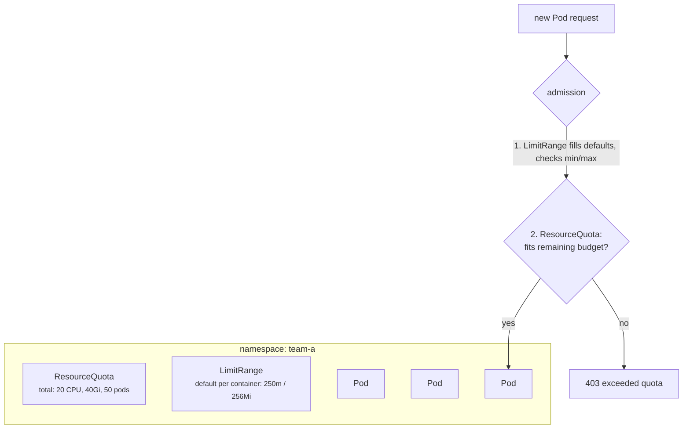

# 21 - Namespace, ResourceQuota and LimitRange

> **One-liner:** A **Namespace** is a virtual partition for names, RBAC, policies and quotas. A **ResourceQuota** caps a namespace's **total** consumption. A **LimitRange** sets **per-container defaults and min/max** values. Together they make multi-tenant clusters fair and safe.

---

## Namespaces

- They scope **names**, **RBAC**, **NetworkPolicies**, **quotas** and **Pod Security labels**.
- They are **not a hard security boundary.** Nodes, the kernel, cluster-scoped resources and (by default) the network are shared.
- **Cluster-scoped** resources have no namespace: Nodes, PVs, StorageClasses, ClusterRoles, CRDs, Namespaces themselves.

| Built-in namespace | Purpose |
| --- | --- |
| `default` | Where things go if you don't specify one. Avoid it in production. |
| `kube-system` | Control plane add-ons: CoreDNS, kube-proxy, CNI, CSI |
| `kube-public` | Publicly readable data (cluster-info) |
| `kube-node-lease` | Node heartbeat Lease objects |



## ResourceQuota vs LimitRange

| | ResourceQuota | LimitRange |
| --- | --- | --- |
| Scope | **Sum** across the namespace | **Each** container, Pod or PVC |
| Controls | `requests.cpu`, `limits.memory`, `pods`, `services.loadbalancers`, `persistentvolumeclaims`, `requests.storage`, `count/deployments.apps`, ... | `default` (limits), `defaultRequest`, `min`, `max`, `maxLimitRequestRatio` |
| When it acts | Admission: rejects anything over budget | Admission: **injects defaults** and rejects anything out of range |

**Important interaction:** if a quota covers `requests.cpu` or `limits.memory`, **every Pod must specify them**, or it is **rejected**. A LimitRange with defaults solves this.

## Example YAML

```yaml
apiVersion: v1
kind: Namespace
metadata:
  name: team-a
  labels:
    team: a
    pod-security.kubernetes.io/enforce: restricted
---
apiVersion: v1
kind: ResourceQuota
metadata:
  name: team-a-quota
  namespace: team-a
spec:
  hard:
    requests.cpu: "20"
    requests.memory: 40Gi
    limits.cpu: "40"
    limits.memory: 80Gi
    pods: "50"
    services.loadbalancers: "1"
    services.nodeports: "0"
    persistentvolumeclaims: "10"
    requests.storage: 500Gi
    count/deployments.apps: "20"
---
apiVersion: v1
kind: LimitRange
metadata:
  name: team-a-limits
  namespace: team-a
spec:
  limits:
    - type: Container
      defaultRequest:            # injected when requests are missing
        cpu: 250m
        memory: 256Mi
      default:                   # injected when limits are missing
        cpu: "1"
        memory: 512Mi
      min:
        cpu: 50m
        memory: 64Mi
      max:
        cpu: "4"
        memory: 8Gi
    - type: PersistentVolumeClaim
      max:
        storage: 100Gi
```

## Common commands

```bash
kubectl create namespace team-a
kubectl get ns --show-labels
kubectl config set-context --current --namespace=team-a     # default ns for your kubectl

kubectl get resourcequota,limitrange -n team-a
kubectl describe resourcequota team-a-quota -n team-a       # Used vs Hard
kubectl describe limitrange team-a-limits -n team-a

# What does everything in the namespace look like?
kubectl get all -n team-a
kubectl api-resources --namespaced=true -o name | xargs -n1 kubectl get -n team-a --ignore-not-found --show-kind 2>/dev/null

# Which resources are cluster-scoped?
kubectl api-resources --namespaced=false
```

## Troubleshooting

| Symptom | Likely cause | What to check |
| --- | --- | --- |
| `forbidden: exceeded quota: team-a-quota, requested: requests.cpu=500m, used: 19800m, limited: 20` | The quota is exhausted | `describe quota`; scale something down, or raise the quota |
| `forbidden: failed quota: must specify limits.memory` | The quota covers that resource and the Pod doesn't set it | Add requests/limits, or a LimitRange with defaults |
| Deployment shows `0/3` with no Pods and no Pod errors | The ReplicaSet's Pod creation is rejected (quota/LimitRange) | `kubectl describe rs` → `FailedCreate` events (the Deployment itself looks fine) |
| `maximum cpu usage per Container is 4, but limit is 8` | LimitRange `max` exceeded | Lower the limit, or adjust the LimitRange |
| Pods got requests nobody asked for | LimitRange `defaultRequest` injected them | `kubectl get pod -o yaml` → resources |
| Namespace stuck `Terminating` | Leftover objects with **finalizers**, or an unavailable **APIService** (e.g. a broken metrics-server) | `get ns X -o json` → `status.conditions`; `kubectl get apiservice` (look for `False`) |
| Resources "missing" | Wrong namespace (kubectl defaults to `default`) | `-n` / `-A`; check your current context's namespace |

```bash
# Quota usage at a glance
kubectl get resourcequota -n team-a -o custom-columns=NAME:.metadata.name,USED:.status.used,HARD:.status.hard

# Find FailedCreate due to quota
kubectl get events -n team-a --field-selector reason=FailedCreate --sort-by=.lastTimestamp

# Why is the namespace stuck Terminating?
kubectl get ns team-a -o jsonpath='{range .status.conditions[*]}{.type}: {.message}{"\n"}{end}'
kubectl get apiservice | grep False
# List anything still inside it
kubectl api-resources --verbs=list --namespaced -o name | xargs -n1 kubectl get --show-kind --ignore-not-found -n team-a

# Last resort: remove finalizers from a stuck object (understand why first!)
kubectl patch <kind>/<name> -n team-a -p '{"metadata":{"finalizers":[]}}' --type=merge
```

## Interview questions

<details>
<summary><b>ResourceQuota vs LimitRange?</b></summary>

A **ResourceQuota** limits the namespace's **total** usage: CPU, memory, storage and object counts. A **LimitRange** sets **per-object defaults and min/max** values.

They are commonly used together. LimitRange defaults ensure every Pod has requests and limits, which the quota then counts.
</details>

<details>
<summary><b>Is a namespace a security boundary?</b></summary>

Only partially. It scopes RBAC, quotas, NetworkPolicies and Pod Security levels, but Pods still share nodes and the kernel. Network traffic is open by default.

For strong isolation, use separate node pools (taints and affinity), sandboxed runtimes (gVisor, Kata), or separate clusters. Many organizations use one cluster per environment or trust level.
</details>

<details>
<summary><b>A namespace is stuck in Terminating. How do you fix it?</b></summary>

1. Check `status.conditions` on the namespace. It usually names the blocker.
2. Common causes are objects with finalizers whose controller is gone, or an unavailable aggregated APIService that makes discovery fail.
3. Fix the APIService, or remove finalizers from the specific stuck objects **after** understanding what they protect.
4. Force-removing the namespace finalizer itself is a last resort.
</details>

<details>
<summary><b>How do you design multi-tenancy for teams on one cluster?</b></summary>

Give each team or environment a namespace with:
- RBAC (RoleBindings to team groups);
- ResourceQuota plus LimitRange;
- default-deny NetworkPolicies;
- the Pod Security `restricted` level;
- dedicated node pools where needed;
- policy enforcement (Kyverno or Gatekeeper);
- cost allocation by namespace labels.

Tools like Capsule or Hierarchical Namespaces help at scale.
</details>

## Quick revision

| Topic | Remember |
| --- | --- |
| Namespace | Soft isolation; scopes RBAC, quota, policy |
| Quota | Namespace totals; rejects at admission |
| LimitRange | Per-container defaults + min/max |
| Quota on CPU/memory | Pods **must** declare them (use LimitRange defaults) |
| Quota errors | `describe rs` → `FailedCreate` |
| Stuck Terminating | Finalizers / broken APIService |
