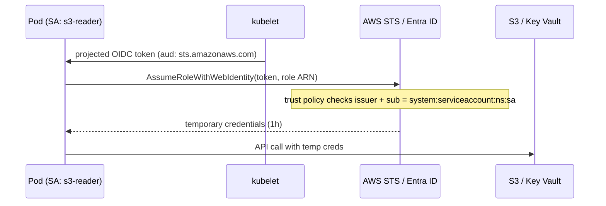

# 22 - ServiceAccount, IRSA / EKS Pod Identity and AKS Workload Identity

> **One-liner:** A **ServiceAccount** is a Pod's identity **inside Kubernetes**: it authenticates to the API server and gets permissions from RBAC. **IRSA / EKS Pod Identity** (AWS) and **Workload Identity** (Azure) map that ServiceAccount to a **cloud IAM identity**, so Pods call S3, Secrets Manager or Key Vault **without static keys**.

---

## ServiceAccounts

- Every namespace has a `default` SA. Pods use it unless `spec.serviceAccountName` says otherwise.
- The kubelet mounts a **short-lived, audience-bound projected token** at `/var/run/secrets/kubernetes.io/serviceaccount/token`. It rotates automatically, roughly every hour.
- Since v1.24, **long-lived token Secrets are no longer created automatically**. Use `kubectl create token` or the TokenRequest API.
- The SA's identity in RBAC is `system:serviceaccount:<ns>:<name>`.
- If the app never calls the Kubernetes API, set `automountServiceAccountToken: false`.

## Cloud identity: how it works



| | **IRSA** (EKS) | **EKS Pod Identity** (EKS, newer) | **AKS Workload Identity** |
| --- | --- | --- | --- |
| Mechanism | OIDC provider + `AssumeRoleWithWebIdentity` | Pod Identity Agent DaemonSet + association API | OIDC issuer + federated identity credential on a managed identity |
| Link SA to identity | SA annotation `eks.amazonaws.com/role-arn` | `aws eks create-pod-identity-association` (no annotation) | SA annotation `azure.workload.identity/client-id` + Pod label `azure.workload.identity/use: "true"` |
| Trust setup | Role trust policy per cluster OIDC issuer | Trust principal `pods.eks.amazonaws.com` (reusable across clusters) | Federated credential: issuer + subject `system:serviceaccount:ns:sa` |
| Env injected | `AWS_ROLE_ARN`, `AWS_WEB_IDENTITY_TOKEN_FILE` | `AWS_CONTAINER_CREDENTIALS_FULL_URI` | `AZURE_CLIENT_ID`, `AZURE_TENANT_ID`, `AZURE_FEDERATED_TOKEN_FILE` |

**Why not node IAM roles or static keys?** Every Pod on a node would share the node role's permissions, and static keys leak and never rotate. Per-Pod identity gives **least privilege per workload** and auditable access.

## Example YAML

```yaml
# ---------- EKS: IRSA ----------
apiVersion: v1
kind: ServiceAccount
metadata:
  name: s3-reader
  namespace: demo
  annotations:
    eks.amazonaws.com/role-arn: arn:aws:iam::111122223333:role/demo-s3-reader
---
apiVersion: apps/v1
kind: Deployment
metadata:
  name: reports
  namespace: demo
spec:
  replicas: 1
  selector: { matchLabels: { app: reports } }
  template:
    metadata:
      labels: { app: reports }
    spec:
      serviceAccountName: s3-reader
      containers:
        - name: app
          image: amazon/aws-cli:2.17.0
          command: ["sh", "-c", "aws sts get-caller-identity && aws s3 ls s3://my-bucket && sleep 3600"]
---
# ---------- AKS: Workload Identity ----------
apiVersion: v1
kind: ServiceAccount
metadata:
  name: kv-reader
  namespace: demo
  annotations:
    azure.workload.identity/client-id: 00000000-0000-0000-0000-000000000000
---
apiVersion: v1
kind: Pod
metadata:
  name: kv-test
  namespace: demo
  labels:
    azure.workload.identity/use: "true"     # required for the webhook to inject env + token
spec:
  serviceAccountName: kv-reader
  containers:
    - name: az
      image: mcr.microsoft.com/azure-cli:latest
      command: ["sh", "-c", "sleep 3600"]
```

**IRSA role trust policy** (the `sub` condition is what locks the role to one ServiceAccount):

```json
{
  "Effect": "Allow",
  "Principal": { "Federated": "arn:aws:iam::111122223333:oidc-provider/oidc.eks.ap-south-1.amazonaws.com/id/EXAMPLED539D4633E53DE1B71EXAMPLE" },
  "Action": "sts:AssumeRoleWithWebIdentity",
  "Condition": {
    "StringEquals": {
      "oidc.eks.ap-south-1.amazonaws.com/id/EXAMPLED539D4633E53DE1B71EXAMPLE:sub": "system:serviceaccount:demo:s3-reader",
      "oidc.eks.ap-south-1.amazonaws.com/id/EXAMPLED539D4633E53DE1B71EXAMPLE:aud": "sts.amazonaws.com"
    }
  }
}
```

## Common commands

```bash
# ServiceAccounts
kubectl get sa -n demo
kubectl describe sa s3-reader -n demo
kubectl create token s3-reader -n demo --duration=10m           # short-lived token
kubectl auth can-i --list --as=system:serviceaccount:demo:s3-reader -n demo

# EKS IRSA setup
eksctl utils associate-iam-oidc-provider --cluster my-cluster --approve
eksctl create iamserviceaccount --cluster my-cluster --namespace demo --name s3-reader \
  --attach-policy-arn arn:aws:iam::aws:policy/AmazonS3ReadOnlyAccess --approve
aws eks describe-cluster --name my-cluster --query 'cluster.identity.oidc.issuer' --output text

# EKS Pod Identity setup
aws eks create-addon --cluster-name my-cluster --addon-name eks-pod-identity-agent
aws eks create-pod-identity-association --cluster-name my-cluster --namespace demo \
  --service-account s3-reader --role-arn arn:aws:iam::111122223333:role/demo-s3-reader
aws eks list-pod-identity-associations --cluster-name my-cluster

# AKS Workload Identity setup
az aks update -g rg -n my-aks --enable-oidc-issuer --enable-workload-identity
ISSUER=$(az aks show -g rg -n my-aks --query oidcIssuerProfile.issuerUrl -o tsv)
az identity federated-credential create --name kv-reader-fic --identity-name kv-reader-mi -g rg \
  --issuer $ISSUER --subject system:serviceaccount:demo:kv-reader --audience api://AzureADTokenExchange

# Verify from inside the pod
kubectl exec -it deploy/reports -n demo -- aws sts get-caller-identity
kubectl exec -it deploy/reports -n demo -- env | grep -E 'AWS_|AZURE_'
```

## Troubleshooting

| Symptom | Likely cause | What to check |
| --- | --- | --- |
| `sts get-caller-identity` shows the **node role** | IRSA not applied: no annotation, the Pod was created before the annotation (needs a restart), the SDK is too old, or no OIDC provider | `env | grep AWS_ROLE_ARN` (missing means the webhook didn't inject) → restart the Pod |
| `AccessDenied: Not authorized to perform sts:AssumeRoleWithWebIdentity` | The trust policy's `sub`/`aud` doesn't match the namespace and SA, or the OIDC provider is for a different cluster | Compare `system:serviceaccount:<ns>:<sa>` exactly; the issuer ID |
| Assumed the role but `AccessDenied` on S3 | The role's **permissions** policy is missing the action or resource, or a bucket policy or KMS key policy denies it | IAM policy simulator; the bucket/KMS policy |
| Pod Identity: no credentials | The agent add-on isn't running, there's no association for that ns/SA, or the trust principal is wrong | `aws eks list-pod-identity-associations`; `eks-pod-identity-agent` Pods |
| Pod can still use node role credentials | IMDS is reachable from Pods | Set the IMDSv2 hop limit to 1 on nodes to block Pod access to IMDS |
| AKS: `AADSTS70021: No matching federated identity record found` | The federated credential's issuer or subject doesn't match | `az identity federated-credential list`; subject `system:serviceaccount:ns:sa` |
| AKS: env vars not injected | Missing Pod **label** `azure.workload.identity/use: "true"`, or the webhook isn't installed | Pod labels; the `azure-wi-webhook` Pods |
| App gets 403 from the **Kubernetes** API | RBAC for the SA, not cloud IAM | `kubectl auth can-i ... --as=system:serviceaccount:...` |
| Token file missing | `automountServiceAccountToken: false` | Enable it for that Pod or use a projected volume |

```bash
# What identity did the pod actually get?
kubectl exec -it <pod> -n demo -- aws sts get-caller-identity
kubectl exec -it <pod> -n demo -- sh -c 'ls -l /var/run/secrets/eks.amazonaws.com/serviceaccount/ 2>/dev/null; env | grep AWS_'

# Decode the projected token's claims (iss, sub, aud, exp)
kubectl exec -it <pod> -n demo -- sh -c 'cat $AWS_WEB_IDENTITY_TOKEN_FILE' | cut -d. -f2 | base64 -d 2>/dev/null; echo

# Which SA is the pod using + was it annotated before the pod started?
kubectl get pod <pod> -n demo -o jsonpath='{.spec.serviceAccountName}{"\n"}'
kubectl get sa s3-reader -n demo -o jsonpath='{.metadata.annotations}{"\n"}'

# CloudTrail: look for AssumeRoleWithWebIdentity failures
aws cloudtrail lookup-events --lookup-attributes AttributeKey=EventName,AttributeValue=AssumeRoleWithWebIdentity --max-results 5
```

## Interview questions

<details>
<summary><b>What is a ServiceAccount and how is it different from a user?</b></summary>

A ServiceAccount is a namespaced identity for **workloads**, managed by Kubernetes, with tokens issued by the API server. Users are humans or external systems, authenticated externally (OIDC, IAM, certs), and Kubernetes doesn't store them. Both get permissions through RBAC.
</details>

<details>
<summary><b>How does IRSA work?</b></summary>

1. The EKS cluster has an OIDC issuer, registered as an IAM OIDC provider.
2. A webhook injects a projected SA token plus `AWS_ROLE_ARN` into Pods whose SA is annotated.
3. The AWS SDK calls `sts:AssumeRoleWithWebIdentity` with that token.
4. IAM checks the role's trust policy, matching the issuer, `sub` = `system:serviceaccount:ns:sa` and the audience, then returns temporary credentials.
</details>

<details>
<summary><b>IRSA vs EKS Pod Identity?</b></summary>

**Pod Identity** is newer and simpler. There's no OIDC provider per cluster and no SA annotation. Associations are managed through the EKS API, the trust policy uses one service principal, and roles are easier to reuse across clusters.

**IRSA** works everywhere, including self-managed clusters and Fargate.
</details>

<details>
<summary><b>Why shouldn't Pods use the node's IAM role?</b></summary>

Every Pod on the node would get the node role's permissions, which breaks least privilege. A compromised Pod could reach anything the node can. Use per-workload identity, and block IMDS access from Pods (IMDSv2 with hop limit 1).
</details>

<details>
<summary><b>What changed with ServiceAccount tokens in v1.24?</b></summary>

Kubernetes stopped auto-creating long-lived token Secrets for every SA. Pods get **bound, projected, expiring** tokens through the TokenRequest API. For external use, run `kubectl create token`, or create a `kubernetes.io/service-account-token` Secret explicitly if you really need a long-lived one.
</details>

## Quick revision

| Topic | Remember |
| --- | --- |
| SA identity | `system:serviceaccount:<ns>:<name>` |
| K8s API access | RBAC |
| Cloud access | IRSA / Pod Identity / Azure Workload Identity |
| IRSA key check | Trust policy `sub` matches ns:sa |
| Annotation added later | Restart the Pods |
| Block node role | IMDSv2 hop limit 1 |
| Not calling the API | `automountServiceAccountToken: false` |
