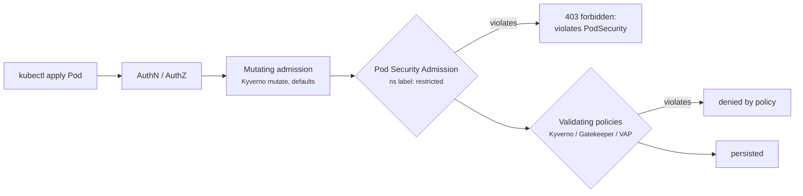

# 23 - Pod Security: securityContext, Pod Security Admission and Policy Engines

> **One-liner:** A **securityContext** hardens how a Pod and its containers run: non-root, read-only filesystem, dropped capabilities, seccomp. **Pod Security Admission (PSA)** enforces a baseline per namespace. **Policy engines** (Kyverno, Gatekeeper, ValidatingAdmissionPolicy) enforce your own custom rules.

---

## securityContext essentials

| Setting | Level | Why |
| --- | --- | --- |
| `runAsNonRoot: true` | Pod / container | Refuse to start if the image runs as UID 0 |
| `runAsUser` / `runAsGroup` | Pod / container | Run as a specific UID/GID |
| `fsGroup` | Pod | Group ownership for mounted volumes, so a non-root user can write |
| `allowPrivilegeEscalation: false` | Container | Blocks setuid binaries and `no_new_privs` escapes |
| `readOnlyRootFilesystem: true` | Container | An attacker can't modify binaries; mount `emptyDir` for `/tmp` |
| `capabilities: { drop: ["ALL"] }` | Container | Remove kernel capabilities; add back only what's needed (e.g. `NET_BIND_SERVICE`) |
| `privileged: false` | Container | `privileged: true` is essentially root on the host |
| `seccompProfile: { type: RuntimeDefault }` | Pod / container | Syscall filtering |
| `hostNetwork`, `hostPID`, `hostIPC`, `hostPath` | Pod | Break isolation; avoid them outside system agents |

## Pod Security Admission (built in, replaced PodSecurityPolicy in v1.25)

| Level | Allows |
| --- | --- |
| `privileged` | Everything (system namespaces, CNI, CSI agents) |
| `baseline` | Blocks known escalations: privileged, host namespaces, hostPath, most capabilities |
| `restricted` | Baseline **plus** non-root, drop ALL capabilities, no privilege escalation, seccomp RuntimeDefault |

| Mode label | Effect |
| --- | --- |
| `enforce` | **Reject** violating Pods |
| `audit` | Record in the audit log |
| `warn` | Show a warning to the user |



**Policy engines** go beyond PSA. Typical custom rules:
- images only from your ECR/ACR, with no `:latest` tags;
- required labels;
- required requests and limits;
- no LoadBalancer Services in some namespaces;
- verified image signatures (cosign).

## Example YAML

```yaml
apiVersion: v1
kind: Namespace
metadata:
  name: payments
  labels:
    pod-security.kubernetes.io/enforce: restricted
    pod-security.kubernetes.io/enforce-version: latest
    pod-security.kubernetes.io/warn: restricted
    pod-security.kubernetes.io/audit: restricted
---
apiVersion: apps/v1
kind: Deployment
metadata:
  name: api
  namespace: payments
spec:
  replicas: 2
  selector: { matchLabels: { app: api } }
  template:
    metadata:
      labels: { app: api }
    spec:
      automountServiceAccountToken: false
      securityContext:
        runAsNonRoot: true
        runAsUser: 10001
        runAsGroup: 10001
        fsGroup: 10001
        seccompProfile:
          type: RuntimeDefault
      containers:
        - name: api
          image: 111122223333.dkr.ecr.ap-south-1.amazonaws.com/api:1.4.0
          ports:
            - containerPort: 8080          # >1024, no NET_BIND_SERVICE needed
          securityContext:
            allowPrivilegeEscalation: false
            readOnlyRootFilesystem: true
            capabilities:
              drop: ["ALL"]
          volumeMounts:
            - { name: tmp, mountPath: /tmp }
      volumes:
        - name: tmp
          emptyDir: {}
---
# Kyverno: only allow images from our registry, no :latest
apiVersion: kyverno.io/v1
kind: ClusterPolicy
metadata:
  name: restrict-images
spec:
  validationFailureAction: Enforce
  rules:
    - name: allowed-registry
      match:
        any:
          - resources: { kinds: ["Pod"] }
      validate:
        message: "Images must come from our ECR and must not use :latest."
        pattern:
          spec:
            containers:
              - image: "111122223333.dkr.ecr.ap-south-1.amazonaws.com/*:!latest"
```

## Common commands

```bash
# Label a namespace (start with warn/audit, then enforce)
kubectl label ns payments pod-security.kubernetes.io/warn=restricted --overwrite
kubectl label ns payments pod-security.kubernetes.io/enforce=restricted --overwrite

# Dry-run: which existing pods would violate "restricted"?
kubectl label --dry-run=server --overwrite ns payments pod-security.kubernetes.io/enforce=restricted

# Inspect what a pod runs as
kubectl get pod <pod> -n payments -o jsonpath='{.spec.securityContext}{"\n"}{.spec.containers[*].securityContext}{"\n"}'
kubectl exec -it <pod> -n payments -- id
kubectl exec -it <pod> -n payments -- sh -c 'grep Cap /proc/1/status'

# Find privileged / root-capable pods cluster-wide
kubectl get pods -A -o json | jq -r '.items[] | select(any(.spec.containers[]; .securityContext.privileged == true)) | "\(.metadata.namespace)/\(.metadata.name)"'

# Kyverno / Gatekeeper
kubectl get clusterpolicy                                   # Kyverno
kubectl get policyreport,clusterpolicyreport -A
kubectl get constrainttemplates,constraints                 # Gatekeeper
```

## Troubleshooting

| Symptom | Likely cause | What to check |
| --- | --- | --- |
| `pods "x" is forbidden: violates PodSecurity "restricted:latest": allowPrivilegeEscalation != false ...` | The Pod doesn't meet the namespace's PSA level | The message lists every violating field; fix the securityContext |
| Deployment `0/2`, no Pods, no obvious error | PSA rejects the **ReplicaSet's** Pod creation | `kubectl describe rs` → `FailedCreate` with the PodSecurity message |
| `container has runAsNonRoot and image will run as root` | The image's USER is root (or unset) | Set `runAsUser`, or rebuild the image with a `USER 10001` |
| `CrashLoopBackOff`: `Read-only file system` | `readOnlyRootFilesystem` and the app writes to `/tmp` or a cache dir | Mount `emptyDir` at those paths |
| `permission denied` on a mounted volume | Non-root user, volume owned by root | `fsGroup`; `fsGroupChangePolicy: OnRootMismatch` |
| `bind: permission denied` on port 80 | Non-root without `NET_BIND_SERVICE` | Listen on a port above 1024 (preferred) or add that capability |
| `admission webhook "validate.kyverno.svc" denied the request` | A custom policy blocked it | The message names the policy and rule; `kubectl get policyreport` |
| All Pod creation fails after installing a policy engine | The webhook is down with `failurePolicy: Fail` | `kubectl get validatingwebhookconfigurations`; the engine Pods' health |
| A system agent (CNI, logging) can't start | It's in a namespace labelled `restricted` | Use `privileged` for those namespaces only |

```bash
# The exact PSA rejection reason
kubectl get events -n payments --field-selector reason=FailedCreate --sort-by=.lastTimestamp
kubectl describe rs -n payments -l app=api | sed -n '/Events/,$p'

# PSA labels across namespaces
kubectl get ns -L pod-security.kubernetes.io/enforce,pod-security.kubernetes.io/warn

# Which user does the image default to?
docker inspect --format '{{.Config.User}}' <image>      # or: crane config <image> | jq .config.User

# Webhooks that could block requests
kubectl get validatingwebhookconfigurations,mutatingwebhookconfigurations
```

## Interview questions

<details>
<summary><b>What replaced PodSecurityPolicy?</b></summary>

**Pod Security Admission**, built in since v1.23 (GA) after PSP was removed in v1.25. It applies `privileged`, `baseline` or `restricted` per namespace through labels, with enforce, audit and warn modes. For custom rules, use Kyverno, OPA Gatekeeper or the built-in **ValidatingAdmissionPolicy** (CEL).
</details>

<details>
<summary><b>How do you harden a container?</b></summary>

- Run as non-root with a fixed UID.
- `readOnlyRootFilesystem`, with `emptyDir` for writable paths.
- Drop ALL capabilities, and set `allowPrivilegeEscalation: false`.
- seccomp `RuntimeDefault`.
- No host namespaces and no hostPath.
- Use a minimal or distroless image, and scan images (Trivy, ECR scanning).
- Disable SA token automount when it isn't needed.
- Apply network policies.
- Enforce all of this with PSA `restricted` plus a policy engine.
</details>

<details>
<summary><b>What does `privileged: true` mean?</b></summary>

The container gets all capabilities and access to host devices, so it is effectively root on the node and can escape the container. Only node-level system agents should need it, and they should be confined to dedicated namespaces.
</details>

<details>
<summary><b>Kyverno vs OPA Gatekeeper vs ValidatingAdmissionPolicy?</b></summary>

- **Kyverno** writes policies as Kubernetes YAML and can validate, **mutate**, generate resources and verify images. It is easy for Kubernetes teams.
- **Gatekeeper** uses **Rego** (OPA). It is very flexible and also used outside Kubernetes.
- **ValidatingAdmissionPolicy** is built in, uses CEL, and needs no webhook to run. It covers simpler validation rules.
</details>

## Quick revision

| Topic | Remember |
| --- | --- |
| PSA levels | privileged / baseline / restricted |
| PSA modes | enforce / audit / warn (namespace labels) |
| Restricted needs | non-root, drop ALL, no escalation, seccomp |
| Writable paths | `emptyDir` with a read-only root |
| Volume permissions | `fsGroup` |
| Rejection hides in | `describe rs` → `FailedCreate` |
| Custom rules | Kyverno / Gatekeeper / VAP |
