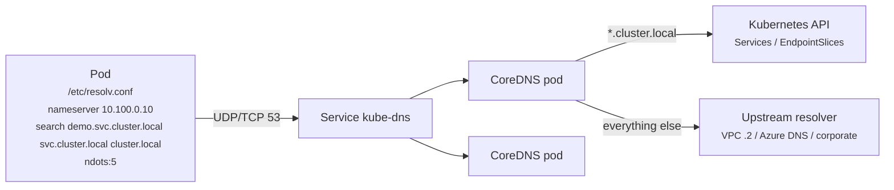

# 24 - CoreDNS (Cluster DNS)

> **One-liner:** CoreDNS is the cluster's DNS server. It resolves **Service and Pod names** (`web.demo.svc.cluster.local`) to IPs and **forwards everything else** upstream (VPC resolver, corporate DNS). When DNS breaks, almost everything breaks, so it is a top troubleshooting topic.

---

## How it works

- CoreDNS runs as a Deployment in `kube-system`, behind a Service usually called **`kube-dns`** (ClusterIP such as `10.100.0.10` or `172.20.0.10`).
- The kubelet writes each Pod's `/etc/resolv.conf` to point at that IP, with search domains and `options ndots:5`.
- The **kubernetes** plugin answers `cluster.local` names from the API (Services, EndpointSlices). The **forward** plugin sends the rest upstream.



## The `ndots:5` behaviour (classic interview point)

Any name with **fewer than 5 dots** is first tried against **every search domain**. A lookup for `api.github.com` (2 dots) therefore tries:

1. `api.github.com.demo.svc.cluster.local`
2. `api.github.com.svc.cluster.local`
3. `api.github.com.cluster.local`
4. (any VPC search domains)
5. `api.github.com`

That's 4–5× more queries, for both A and AAAA records. **Fixes:**
- use FQDNs with a **trailing dot** (`api.github.com.`);
- lower `ndots` through the Pod's `dnsConfig`;
- run **NodeLocal DNSCache**.

## The Corefile

```
.:53 {
    errors
    health { lameduck 5s }
    ready
    kubernetes cluster.local in-addr.arpa ip6.arpa {
       pods insecure
       fallthrough in-addr.arpa ip6.arpa
       ttl 30
    }
    prometheus :9153
    forward . /etc/resolv.conf          # upstream = node's resolver (VPC DNS)
    cache 30
    loop
    reload
    loadbalance
}
# Conditional forwarding for a corporate / on-prem zone
corp.example.com:53 {
    forward . 10.10.0.2 10.10.0.3
    cache 30
}
```

**Platform note:**
- **EKS:** CoreDNS is a managed add-on, and you edit the `coredns` ConfigMap.
- **AKS:** you **must not** edit `coredns`. Put custom config in the **`coredns-custom`** ConfigMap instead.

## Example: Pod-level DNS tuning

```yaml
apiVersion: v1
kind: Pod
metadata:
  name: dns-tuned
  namespace: demo
spec:
  dnsPolicy: ClusterFirst          # default; "Default" = use node's resolv.conf; "None" = only dnsConfig
  dnsConfig:
    options:
      - name: ndots
        value: "2"
      - name: single-request-reopen   # helps the A/AAAA conntrack race on some kernels
  containers:
    - name: app
      image: busybox:1.36
      command: ["sleep", "3600"]
```

## Common commands

```bash
kubectl get deploy coredns -n kube-system
kubectl get pods -n kube-system -l k8s-app=kube-dns -o wide
kubectl get svc kube-dns -n kube-system
kubectl get endpointslices -n kube-system -l kubernetes.io/service-name=kube-dns
kubectl get configmap coredns -n kube-system -o yaml
kubectl logs -n kube-system -l k8s-app=kube-dns --tail=50

# Test resolution from a pod (dnsutils has nslookup + dig)
kubectl run dnsutils --image=registry.k8s.io/e2e-test-images/jessie-dnsutils:1.3 -it --rm -- sh
#   nslookup kubernetes.default
#   nslookup web.demo.svc.cluster.local
#   dig +search web.demo
#   dig @10.100.0.10 google.com
#   cat /etc/resolv.conf

# Turn on query logging temporarily (EKS: add "log" to the Corefile)
kubectl edit configmap coredns -n kube-system          # add 'log' line, 'reload' picks it up

# Scale CoreDNS
kubectl scale deploy coredns -n kube-system --replicas=4
```

## Troubleshooting

Isolate the problem step by step: **the Pod's resolv.conf → can the Pod reach kube-dns → are the CoreDNS Pods healthy → is upstream reachable.**

| Symptom | Likely cause | What to check |
| --- | --- | --- |
| `nslookup kubernetes.default` times out | CoreDNS Pods down or not Ready, kube-dns has no endpoints, or a **NetworkPolicy blocks egress port 53** | `get pods -l k8s-app=kube-dns`; `get endpointslices`; egress policies |
| Cluster names resolve, external names fail | Upstream unreachable: VPC DNS, NAT, or a `forward` misconfiguration | `dig @<coredns-ip> google.com`; CoreDNS logs (`i/o timeout` to upstream) |
| `NXDOMAIN` for a Service | Wrong namespace (`web` only works in the same namespace), or the Service doesn't exist | `web.<ns>`; `kubectl get svc -A | grep web` |
| Intermittent ~5s delays | conntrack race on parallel A/AAAA queries over UDP, or `ndots` expansion | `single-request-reopen`; NodeLocal DNSCache; trailing-dot FQDNs |
| CoreDNS `CrashLoopBackOff` with `Loop ... detected` | `forward . /etc/resolv.conf` points back at itself (node resolv.conf is 127.0.0.53 with systemd-resolved) | Point the kubelet `--resolv-conf` at the real file, or forward to explicit upstream IPs |
| CoreDNS Pods `Pending` on a fresh cluster | No worker nodes yet, or on EKS Fargate the compute type needs patching | `describe pod`; node availability |
| High latency or SERVFAIL under load | Too few CoreDNS replicas, CPU throttling, or AWS VPC DNS limit (**1024 packets/s per ENI**) | Scale CoreDNS or use the proportional autoscaler; NodeLocal DNSCache; `prometheus :9153` metrics |
| Private hosted zone names don't resolve | VPC DNS settings, or no conditional forward to the on-prem/AD resolvers | VPC `enableDnsHostnames/Support`; Route 53 Resolver rules; Corefile stub zones |
| AKS custom DNS change reverted | Edited `coredns` instead of `coredns-custom` | Use `coredns-custom`, then restart CoreDNS |

```bash
# 1. What does the pod use?
kubectl exec -it <pod> -n demo -- cat /etc/resolv.conf

# 2. Can it reach the DNS service at all?
kubectl exec -it <pod> -n demo -- nc -zvu -w 2 10.100.0.10 53

# 3. Query CoreDNS directly (bypasses search domains)
kubectl run d --image=registry.k8s.io/e2e-test-images/jessie-dnsutils:1.3 -it --rm -- dig @10.100.0.10 web.demo.svc.cluster.local +short

# 4. CoreDNS health
kubectl get pods -n kube-system -l k8s-app=kube-dns
kubectl logs -n kube-system -l k8s-app=kube-dns --tail=100 | grep -Ei 'error|timeout|loop'
kubectl top pods -n kube-system -l k8s-app=kube-dns

# 5. NetworkPolicies that might block DNS egress
kubectl get networkpolicy -A -o yaml | grep -B5 -A10 'policyTypes' | grep -i egress

# 6. EKS: VPC DNS throttling (linklocal_allowance_exceeded)
#    on the node: ethtool -S eth0 | grep linklocal
```

## Interview questions

<details>
<summary><b>How does a Pod resolve `web.demo`?</b></summary>

1. The Pod's `/etc/resolv.conf` points at the kube-dns ClusterIP and has search domains.
2. Because the name has fewer than 5 dots, the resolver appends search suffixes and tries `web.demo.demo.svc.cluster.local` (NXDOMAIN), then `web.demo.svc.cluster.local`.
3. CoreDNS's kubernetes plugin finds the Service and returns its ClusterIP. A headless Service returns the Pod IPs instead.
</details>

<details>
<summary><b>What is `ndots:5` and why does it matter?</b></summary>

Names with fewer than 5 dots are tried with every search domain first. External lookups therefore generate several wasted queries, which adds latency and load, and on AWS can hit the VPC resolver's packet limit. Mitigate with trailing-dot FQDNs, a lower `ndots` in `dnsConfig`, and NodeLocal DNSCache.
</details>

<details>
<summary><b>What is NodeLocal DNSCache?</b></summary>

A DaemonSet that runs a DNS cache on every node at a link-local IP (169.254.20.10). Pods query the local cache, which avoids conntrack races and cross-node hops, cuts latency, and reduces load on CoreDNS and the upstream resolver. It's recommended for large or DNS-heavy clusters.
</details>

<details>
<summary><b>How do you resolve on-prem or corporate domains from Pods?</b></summary>

Add a stub zone or conditional forward in the Corefile (on AKS, the `coredns-custom` ConfigMap) that sends `corp.example.com` to the corporate DNS IPs. On AWS, Route 53 Resolver outbound endpoints and rules are an alternative, because CoreDNS forwards to VPC DNS by default.
</details>

## Quick revision

| Topic | Remember |
| --- | --- |
| Service | `kube-dns` in `kube-system` |
| Short name | Same namespace only; else `svc.ns` |
| `ndots:5` | Search-domain expansion → extra queries |
| Default-deny breaks DNS | Allow egress UDP/TCP 53 to kube-dns |
| Loop detected | Upstream resolv.conf points at itself |
| AKS | Customize via `coredns-custom` |
| Scale | Replicas + NodeLocal DNSCache |
