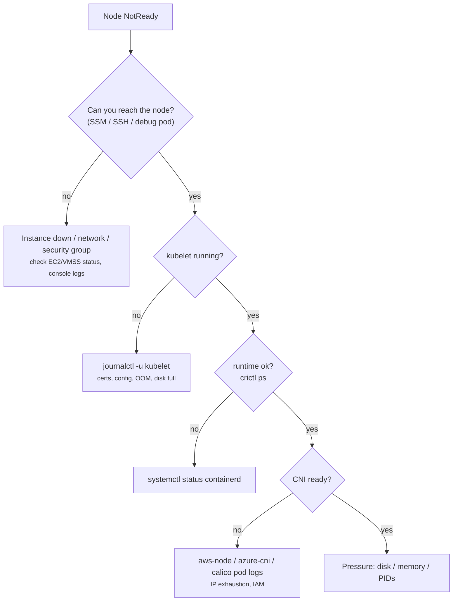

# 25 - Node Troubleshooting

> **One-liner:** A node is healthy when its **kubelet** keeps posting status, its **container runtime** works, its **CNI** is ready, and it has enough memory, disk and PIDs. Most node incidents are `NotReady` or **pressure** conditions, so you need both `kubectl` and **on-node** debugging.

---

## Node conditions

| Condition | Healthy value | Unhealthy means |
| --- | --- | --- |
| `Ready` | `True` | `False`: the kubelet reports unhealthy (runtime/CNI). `Unknown`: no heartbeat (node down, kubelet dead, network). |
| `MemoryPressure` | `False` | Memory below the eviction threshold |
| `DiskPressure` | `False` | `nodefs` or `imagefs` low on space or inodes |
| `PIDPressure` | `False` | Too many processes |
| `NetworkUnavailable` | `False` | Routes or CNI not configured |

**Heartbeats:**
- The kubelet renews a **Lease** in `kube-node-lease` about every 10 seconds.
- After roughly **40 seconds** without one, the node becomes `Unknown` / `NotReady` and gets the taint `node.kubernetes.io/unreachable:NoExecute`.
- Pods are evicted after their `tolerationSeconds`, **300 seconds** by default.



## Eviction

When a node is under pressure, the **kubelet evicts Pods** to protect itself. It evicts in QoS order, **BestEffort first, then Burstable over its requests, Guaranteed last**. Default hard thresholds:

| Signal | Default threshold |
| --- | --- |
| `memory.available` | < 100Mi |
| `nodefs.available` | < 10% |
| `imagefs.available` | < 15% |
| `nodefs.inodesFree` | < 5% |

Kubelet-driven **eviction** produces Pods with status `Evicted`. This is different from the kernel **OOM killer**, which kills a container that exceeds its own memory limit (`OOMKilled`, exit 137).

## Common commands

```bash
# Overview
kubectl get nodes -o wide
kubectl get nodes -L topology.kubernetes.io/zone,node.kubernetes.io/instance-type,karpenter.sh/capacity-type
kubectl describe node <node>                      # Conditions, Taints, Allocatable, Allocated resources, Events
kubectl top nodes

# Conditions only
kubectl get node <node> -o jsonpath='{range .status.conditions[*]}{.type}={.status} {.reason}: {.message}{"\n"}{end}'

# Last heartbeat
kubectl get lease <node> -n kube-node-lease -o jsonpath='{.spec.renewTime}{"\n"}'

# Pods on the node
kubectl get pods -A -o wide --field-selector spec.nodeName=<node>

# Get a shell on the node without SSH (host filesystem at /host)
kubectl debug node/<node> -it --image=busybox:1.36
#   chroot /host           # then use the node's own tools
# AWS: aws ssm start-session --target <instance-id>
# AKS: kubectl debug node/<node> -it --image=mcr.microsoft.com/cbl-mariner/busybox:2.0

# Maintenance
kubectl cordon <node>
kubectl drain <node> --ignore-daemonsets --delete-emptydir-data --timeout=10m
kubectl uncordon <node>
```

**On the node** (after `chroot /host` or SSM):

```bash
systemctl status kubelet containerd
journalctl -u kubelet --since "30 min ago" --no-pager | tail -100
journalctl -u containerd --since "30 min ago" --no-pager | tail -50
crictl ps -a                       # containers incl. exited
crictl pods
crictl logs <container-id>
crictl images ; crictl rmi --prune # free image disk
df -h ; df -i                      # disk + inodes
free -m ; dmesg -T | grep -i -E 'oom|killed process'
ps aux --sort=-%mem | head
ls /etc/cni/net.d/                 # CNI config present?
# EKS AMI log collector:
#   sudo bash /etc/eks/log-collector-script/eks-log-collector.sh
```

## Troubleshooting

| Symptom | Likely cause | What to check / fix |
| --- | --- | --- |
| `NotReady`, reason `KubeletNotReady: container runtime network not ready: cni plugin not initialized` | CNI DaemonSet Pod not running on the node (IAM, image pull, IP exhaustion) | `get pods -n kube-system -o wide | grep <node>`; aws-node/calico logs |
| `NotReady`, status `Unknown` (`Kubelet stopped posting node status`) | Node crashed or hung, kubelet dead, network partition, or the instance was terminated | EC2/VMSS console and status checks; SSM; `journalctl -u kubelet` |
| kubelet won't start | Expired client cert, bad config, disk full, swap on | `journalctl -u kubelet`; `df -h` |
| `DiskPressure=True` | Image bloat, container logs, `emptyDir` growth | `crictl rmi --prune`; check `/var/log/pods`; image GC thresholds; bigger root volume |
| `MemoryPressure=True`, Pods `Evicted` | Pods without limits, or with high usage vs requests; system daemons | `kubectl top pods`; set requests/limits; `kube-reserved` / `system-reserved` |
| `PIDPressure=True` | Fork bomb or thread leak | `ps -eLf | wc -l`; set `podPidsLimit` |
| Many `Evicted` Pods left over | Eviction leaves failed Pod objects behind | `kubectl delete pods -A --field-selector=status.phase=Failed` |
| New Pods stuck `ContainerCreating` on one node: `failed to assign an IP address` | **VPC CNI IP exhaustion** (ENI/IP per instance type, or the subnet is out of IPs) | `kubectl describe pod`; aws-node logs; enable prefix delegation; check subnet free IPs |
| `Too many pods` | Node `maxPods` reached | `describe node` → Capacity pods; prefix delegation; larger instances |
| Node `Ready` but Pods can't reach other nodes | Security group rules, route tables, MTU | Node-to-node SG on all ports; CNI logs |
| `drain` hangs | A PDB allows 0 disruptions, or bare Pods / local storage | `kubectl get pdb -A`; add `--force` (bare Pods) or `--delete-emptydir-data` |
| Node flaps Ready/NotReady | CPU starvation of the kubelet, network blips, kernel issues | Reserve resources for the system; `dmesg`; instance health |
| Clock skew errors (TLS, tokens) | NTP not synced | `chronyc tracking` |

```bash
# Nodes not Ready, with reason
kubectl get nodes -o json | jq -r '.items[] | .metadata.name as $n | .status.conditions[] | select(.type=="Ready" and .status!="True") | "\($n) \(.status) \(.reason): \(.message)"'

# Nodes with any pressure condition
kubectl get nodes -o json | jq -r '.items[] | .metadata.name as $n | .status.conditions[] | select(.type!="Ready" and .status=="True") | "\($n) \(.type)"'

# Evicted pods and why
kubectl get pods -A --field-selector=status.phase=Failed -o json | jq -r '.items[] | select(.status.reason=="Evicted") | "\(.metadata.namespace)/\(.metadata.name): \(.status.message)"'

# EKS: IPs available per node (VPC CNI)
kubectl get nodes -o custom-columns=NAME:.metadata.name,TYPE:.metadata.labels.node\\.kubernetes\\.io/instance-type,MAXPODS:.status.capacity.pods
aws ec2 describe-subnets --subnet-ids <subnet> --query 'Subnets[].AvailableIpAddressCount'
```

## Interview questions

<details>
<summary><b>A node shows NotReady. Walk through your debugging.</b></summary>

1. Run `kubectl describe node` and read the Ready condition's reason and message, plus events.
2. Check `Unknown` vs `False`. `Unknown` means no heartbeat, so check the instance itself, the network and whether the kubelet is alive. `False` means the kubelet is reporting a problem.
3. Get onto the node with `kubectl debug node`, SSM or SSH.
4. Check `journalctl -u kubelet`, `systemctl status containerd` and `crictl ps`.
5. Check the CNI Pod on that node.
6. Check disk, memory and PIDs (`df`, `free`, `dmesg`).
7. If it can't be fixed quickly, cordon and drain the node and replace it. On managed node groups or Karpenter, just terminate it.
</details>

<details>
<summary><b>Eviction vs OOMKilled?</b></summary>

**Eviction** is done by the **kubelet** when the *node* is under pressure. The whole Pod is terminated, its status becomes `Evicted`, and lower QoS classes go first.

**OOMKilled** is done by the **kernel** when a *container* exceeds its own memory limit. The container restarts inside the same Pod, with exit code 137.
</details>

<details>
<summary><b>What happens to Pods when a node dies?</b></summary>

1. After about 40 seconds without a heartbeat, the node becomes `NotReady`/`Unknown` and is tainted `unreachable:NoExecute`.
2. After `tolerationSeconds` (300 seconds by default), its Pods are marked for deletion.
3. Controllers (ReplicaSet, etc.) create replacements on healthy nodes.
4. StatefulSet Pods aren't recreated until the old Pod is confirmed gone.
5. Bare Pods are lost.

You can lower `tolerationSeconds` for faster failover.
</details>

<details>
<summary><b>How do you safely take a node out for maintenance?</b></summary>

1. `kubectl cordon` to stop new Pods landing on it.
2. `kubectl drain --ignore-daemonsets --delete-emptydir-data`, which evicts Pods while respecting **PodDisruptionBudgets**.
3. Do the maintenance.
4. `kubectl uncordon`.

On EKS managed node groups and Karpenter, upgrades and replacements do this automatically.
</details>

<details>
<summary><b>Why do EKS nodes hit "Too many pods" or IP assignment errors?</b></summary>

The VPC CNI gives Pods real VPC IPs, and each instance type supports a limited number of ENIs and IPs. Fixes:
- enable **prefix delegation** (a /28 per ENI slot);
- use larger instances;
- use custom networking with secondary CIDRs;
- make sure the subnets have enough free IPs.
</details>

## Quick revision

| Topic | Remember |
| --- | --- |
| `Unknown` | No heartbeat (node/kubelet/network) |
| `False` | kubelet reports a problem (runtime/CNI) |
| Shell on node | `kubectl debug node/<n>` + `chroot /host`, or SSM |
| Key logs | `journalctl -u kubelet`, `crictl ps -a` |
| Eviction order | BestEffort → Burstable → Guaranteed |
| Maintenance | cordon → drain → uncordon (PDBs respected) |
| EKS IPs | Prefix delegation |
