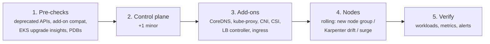

# 26 - Cluster Operations: etcd Backup and Restore, Upgrades, Certificates, Disaster Recovery

> **One-liner:** Day-2 operations keep a cluster alive: **back up etcd** (self-managed) or **back up resources and volumes** (managed), **upgrade one minor version at a time** (control plane, then add-ons, then nodes), keep **certificates** from expiring, and have a **tested DR plan**.

---

## Who owns what

| Task | Self-managed (kubeadm) | EKS / AKS (managed) |
| --- | --- | --- |
| etcd backup | **You**: `etcdctl snapshot` | Provider (you can't access etcd) |
| Workload/state backup | Velero / GitOps | **You**: Velero, AWS Backup for EKS, Azure Backup for AKS, GitOps |
| Control plane upgrade | **You**: `kubeadm upgrade` | One API call / console click |
| Node upgrade | **You** | **You** trigger it (managed node groups, Karpenter drift, AKS node image upgrade) |
| Add-on upgrade | **You** | **You** (CoreDNS, kube-proxy, VPC CNI, CSI drivers) |
| Control-plane certificates | **You**: `kubeadm certs renew` | Provider |

## etcd backup and restore (kubeadm)

```bash
# Backup (run on a control-plane node)
ETCDCTL_API=3 etcdctl snapshot save /backup/etcd-$(date +%F-%H%M).db \
  --endpoints=https://127.0.0.1:2379 \
  --cacert=/etc/kubernetes/pki/etcd/ca.crt \
  --cert=/etc/kubernetes/pki/etcd/server.crt \
  --key=/etc/kubernetes/pki/etcd/server.key

etcdutl snapshot status /backup/etcd-2026-10-17-0200.db -w table

# Restore (single-member example)
# 1. Stop the API server + etcd: move their static pod manifests away
sudo mv /etc/kubernetes/manifests/{kube-apiserver,etcd}.yaml /tmp/
# 2. Restore to a NEW data dir
sudo etcdutl snapshot restore /backup/etcd-2026-10-17-0200.db --data-dir /var/lib/etcd-restored
# 3. Point etcd.yaml's hostPath volume at /var/lib/etcd-restored, then move the manifests back
sudo mv /tmp/{etcd,kube-apiserver}.yaml /etc/kubernetes/manifests/
```

Encrypt backups, store them **off-cluster** (S3 with versioning or Object Lock), and **test restores** regularly.

## Velero (works on any cluster, including EKS/AKS)

```bash
velero install --provider aws --plugins velero/velero-plugin-for-aws:v1.10.0 \
  --bucket my-velero-bkt --backup-location-config region=ap-south-1 \
  --snapshot-location-config region=ap-south-1 --service-account-name velero   # IRSA

velero backup create prod-$(date +%F) --include-namespaces payments,orders --snapshot-volumes
velero schedule create nightly --schedule "0 2 * * *" --ttl 720h
velero backup get
velero backup describe prod-2026-10-17 --details
velero restore create --from-backup prod-2026-10-17 --namespace-mappings payments:payments-restore
velero restore describe <restore-name>
```

## Upgrades

**Rules:**
- Upgrade **one minor version at a time** (1.31 → 1.32 → 1.33).
- Respect version skew: the kubelet can be up to **3 minor versions** older than the API server, but **never newer**.
- Kubernetes supports roughly the last 3 minors. EKS standard support is about 14 months per version, followed by paid extended support.



| Step | What to do |
| --- | --- |
| **Find deprecated APIs** | `kubent` (kube-no-trouble), `pluto detect-files`, EKS **Upgrade Insights**, API server metric `apiserver_requested_deprecated_apis` |
| **Check add-on compatibility** | `aws eks describe-addon-versions --kubernetes-version 1.33` |
| **Protect apps** | PDBs, ≥ 2 replicas, readiness probes, so the node roll is zero-downtime |
| **Strategy** | In-place rolling for minor upgrades; **blue/green cluster** for big jumps or risky changes |
| **Rollback** | **There is no control-plane downgrade.** Your rollback is restoring to a new cluster (GitOps plus backups). Test in non-prod first. |

```bash
# EKS
aws eks update-cluster-version --name my-cluster --kubernetes-version 1.33
aws eks describe-update --name my-cluster --update-id <id>
aws eks update-addon --cluster-name my-cluster --addon-name coredns --addon-version <ver> --resolve-conflicts PRESERVE
aws eks update-nodegroup-version --cluster-name my-cluster --nodegroup-name ng-1
aws eks list-insights --cluster-name my-cluster

# AKS
az aks get-upgrades -g rg -n my-aks -o table
az aks upgrade -g rg -n my-aks --kubernetes-version 1.33.x --control-plane-only
az aks nodepool upgrade -g rg --cluster-name my-aks -n nodepool1 --kubernetes-version 1.33.x --max-surge 33%

# kubeadm
kubeadm upgrade plan
kubeadm upgrade apply v1.33.x          # first control-plane node
kubeadm upgrade node                   # other control-plane nodes + workers
# then per node: drain → upgrade kubelet/kubectl packages → restart kubelet → uncordon
```

## Certificates (kubeadm)

```bash
kubeadm certs check-expiration         # control-plane certs (default 1 year)
kubeadm certs renew all                # then restart control-plane static pods
# kubelet client certs rotate automatically (rotateCertificates: true)
```

A `kubeadm upgrade` also renews the certificates, which is one reason to upgrade at least yearly.

## Troubleshooting

| Symptom | Likely cause | What to check |
| --- | --- | --- |
| `kubectl` returns `x509: certificate has expired` | Control-plane or kubeconfig certificates expired (kubeadm) | `kubeadm certs check-expiration`; renew; update `admin.conf` |
| Apps fail after upgrade: `no matches for kind "X" in version "Y"` | A removed API version (e.g. `policy/v1beta1`) | Migrate the manifests or Helm charts to current APIs; `kubent` |
| Upgrade blocked (EKS) | Upgrade insights flagged an issue, or add-on versions are incompatible | `aws eks list-insights`; update add-ons |
| Node group upgrade stuck | A PDB blocks the drain, or new nodes fail to join | `kubectl get pdb -A` (`ALLOWED DISRUPTIONS 0`); node join logs |
| Pods `Pending` during the node roll | Not enough surge capacity | Raise max-surge, or add capacity temporarily |
| Webhook errors after upgrade | Admission webhooks (cert-manager, Kyverno) incompatible or down | `get validatingwebhookconfigurations`; upgrade those charts first |
| etcd restore: cluster shows old state | Expected: everything after the snapshot is lost | Reconcile with GitOps; restart controllers |
| etcd `mvcc: database space exceeded` | etcd hit its quota (2 GiB default) | `etcdctl defrag`, compaction, `etcdctl alarm disarm`; find object bloat |
| Velero restore partially fails | Existing objects, CRDs missing, or volume snapshots in another region/AZ | `velero restore describe --details`; `velero restore logs` |

```bash
# Deprecated API usage before upgrading
kubent
kubectl get --raw /metrics | grep apiserver_requested_deprecated_apis

# Version skew check
kubectl version
kubectl get nodes -o custom-columns=NAME:.metadata.name,KUBELET:.status.nodeInfo.kubeletVersion

# Disruption blockers before draining
kubectl get pdb -A

# etcd health (kubeadm)
ETCDCTL_API=3 etcdctl endpoint health --cluster --endpoints=https://127.0.0.1:2379 \
  --cacert=/etc/kubernetes/pki/etcd/ca.crt --cert=/etc/kubernetes/pki/etcd/server.crt --key=/etc/kubernetes/pki/etcd/server.key
ETCDCTL_API=3 etcdctl endpoint status --cluster -w table   # (same TLS flags)
```

## Interview questions

<details>
<summary><b>How do you upgrade an EKS cluster with zero downtime?</b></summary>

1. Check for deprecated APIs (Upgrade Insights, `kubent`) and add-on compatibility.
2. Upgrade the control plane by one minor version.
3. Upgrade the add-ons: VPC CNI, CoreDNS, kube-proxy, CSI drivers, LB controller.
4. Roll the nodes, through a managed node group rolling update or Karpenter drift. PDBs, multiple replicas and readiness probes keep apps available.
5. Validate.

Do it in non-prod first. For risky jumps, use a blue/green cluster with DNS or traffic shifting.
</details>

<details>
<summary><b>How do you back up a Kubernetes cluster?</b></summary>

- **Self-managed:** etcd snapshots, stored off-cluster and encrypted.
- **Any cluster:** keep the desired state in **Git** (GitOps), use **Velero** for resources plus volume snapshots, and back up databases at app level.

Managed control planes (EKS/AKS) don't expose etcd, so focus on workloads, PVs and GitOps. Test restores regularly.
</details>

<details>
<summary><b>Can you downgrade Kubernetes?</b></summary>

Not the control plane, on EKS, AKS or kubeadm. Rollback means building a cluster on the old version and restoring into it (GitOps plus Velero). That's why pre-checks, staging upgrades and blue/green clusters matter.
</details>

<details>
<summary><b>What is the Kubernetes version skew policy?</b></summary>

- The kubelet may be up to 3 minors older than kube-apiserver, but never newer.
- kubectl is supported within ±1 minor of the API server.
- Control-plane components must be no newer than the API server.

That's why you upgrade the control plane first, then the nodes.
</details>

<details>
<summary><b>Describe your disaster recovery strategy for EKS.</b></summary>

- Infrastructure as code (Terraform) to recreate the VPC and cluster.
- GitOps (Argo CD / Flux) to redeploy workloads.
- Velero or AWS Backup for cluster resources and EBS/EFS volumes.
- Managed databases with cross-region snapshots or replicas.
- Secrets in Secrets Manager (replicated).
- Route 53 health checks for failover.
- Define RTO and RPO, and run regular DR drills.
</details>

## Quick revision

| Topic | Remember |
| --- | --- |
| etcd backup | `etcdctl snapshot save` (self-managed only) |
| Managed clusters | GitOps + Velero / cloud backup |
| Upgrade order | Pre-checks → control plane → add-ons → nodes |
| Steps | One minor at a time; no downgrade |
| Skew | kubelet ≤ 3 minors older than the API server |
| Deprecated APIs | `kubent`, Upgrade Insights |
| kubeadm certs | 1 year; `kubeadm certs renew` |
