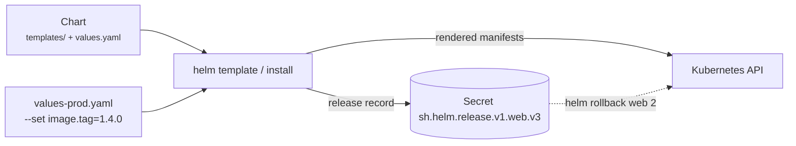

# 27 - Helm

> **One-liner:** Helm is the **package manager for Kubernetes**. A **chart** is a templated bundle of manifests, **values** customise it, and each install is a versioned **release** you can upgrade and **roll back**.

---

## Concepts

| Term | Meaning |
| --- | --- |
| **Chart** | A directory or package: `Chart.yaml`, `values.yaml`, `templates/`, `charts/` (dependencies) |
| **Values** | Configuration merged in this order: chart defaults → `-f values-prod.yaml` → `--set key=val` (**last wins**) |
| **Release** | One installed instance of a chart in a namespace (`helm install web ./chart`) |
| **Revision** | Every install, upgrade or rollback creates a new revision, stored as a **Secret** `sh.helm.release.v1.<name>.v<N>` in the release namespace |
| **Repository** | HTTP chart repo or **OCI registry** (ECR, ACR, GHCR) |
| **Hooks** | `pre-install`, `pre-upgrade`, `post-upgrade`, ..., e.g. run a DB migration Job before upgrading |



Helm 3 has **no Tiller**. It uses your kubeconfig and RBAC directly.

## Chart layout and a template

```
mychart/
├── Chart.yaml            # name, version (chart), appVersion (app)
├── values.yaml           # defaults
├── values.schema.json    # optional: validate values
├── templates/
│   ├── _helpers.tpl      # named templates (labels, fullname)
│   ├── deployment.yaml
│   ├── service.yaml
│   ├── ingress.yaml
│   └── NOTES.txt
└── charts/               # dependencies
```

```yaml
# templates/deployment.yaml
apiVersion: apps/v1
kind: Deployment
metadata:
  name: {{ include "mychart.fullname" . }}
  labels:
    {{- include "mychart.labels" . | nindent 4 }}
spec:
  {{- if not .Values.autoscaling.enabled }}
  replicas: {{ .Values.replicaCount }}
  {{- end }}
  selector:
    matchLabels:
      {{- include "mychart.selectorLabels" . | nindent 6 }}
  template:
    metadata:
      labels:
        {{- include "mychart.selectorLabels" . | nindent 8 }}
      annotations:
        checksum/config: {{ include (print $.Template.BasePath "/configmap.yaml") . | sha256sum }}  # restart on config change
    spec:
      containers:
        - name: app
          image: "{{ .Values.image.repository }}:{{ .Values.image.tag | default .Chart.AppVersion }}"
          resources:
            {{- toYaml .Values.resources | nindent 12 }}
```

```yaml
# values-prod.yaml
replicaCount: 3
image:
  repository: 111122223333.dkr.ecr.ap-south-1.amazonaws.com/api
  tag: "1.4.0"
autoscaling:
  enabled: true
resources:
  requests: { cpu: 200m, memory: 256Mi }
  limits:   { memory: 512Mi }
```

## Common commands

```bash
# Repos / OCI
helm repo add bitnami https://charts.bitnami.com/bitnami && helm repo update
helm search repo nginx
helm pull oci://111122223333.dkr.ecr.ap-south-1.amazonaws.com/charts/mychart --version 1.2.0
helm show values bitnami/redis > redis-values.yaml

# Author / validate
helm create mychart
helm lint ./mychart -f values-prod.yaml
helm template web ./mychart -f values-prod.yaml > rendered.yaml      # render locally
helm install web ./mychart -f values-prod.yaml --dry-run=server     # validate against the cluster

# Install / upgrade (idempotent, CI-friendly)
helm upgrade --install web ./mychart -n demo --create-namespace \
  -f values-prod.yaml --set image.tag=1.4.0 \
  --atomic --wait --timeout 10m                 # auto-rollback if not healthy

# Inspect
helm list -A
helm status web -n demo
helm history web -n demo
helm get values web -n demo                     # user-supplied values
helm get values web -n demo --all               # merged values
helm get manifest web -n demo                   # what was applied

# Diff before upgrading (helm-diff plugin)
helm plugin install https://github.com/databus23/helm-diff
helm diff upgrade web ./mychart -n demo -f values-prod.yaml

# Rollback / remove
helm rollback web 2 -n demo --wait
helm uninstall web -n demo
```

## Troubleshooting

| Error / symptom | Likely cause | What to do |
| --- | --- | --- |
| `Error: UPGRADE FAILED: another operation (install/upgrade/rollback) is in progress` | A previous run crashed and left the release `pending-upgrade` | `helm history` → `helm rollback <rel> <last-good>`; as a last resort, delete the stuck release Secret for that revision |
| `has no deployed releases` on upgrade | The first install failed | `helm uninstall`, then reinstall; or `upgrade --install` with `--atomic` |
| `rendered manifests contain a resource that already exists ... invalid ownership metadata` | The object was created outside Helm or by another release | Delete it, or adopt it: add the `meta.helm.sh/release-name` and `release-namespace` annotations and the `app.kubernetes.io/managed-by=Helm` label |
| `YAML parse error on templates/x.yaml` | Indentation or whitespace (`{{-`, `nindent`) | `helm template --debug`; check `nindent` values |
| `nil pointer evaluating interface {}.foo` | A values key is missing | Use `default`, `required`, or guard with `if`/`with`; add a values schema |
| `no matches for kind "X" in version "Y"` | The chart uses a removed API, or the CRD isn't installed | Update the chart; install CRDs first |
| Upgrade "succeeded" but Pods are broken | Without `--wait`, Helm only checks that the API accepted the manifests | Use `--atomic --wait`, plus readiness probes |
| `--wait` timed out | Pods never became Ready, or a Service of type LB has no IP | `kubectl get pods,events`; increase `--timeout` |
| Values not applied | Wrong key path, precedence, or `--reuse-values` keeping old ones | `helm get values --all`; `helm template` and grep |
| CRDs not upgraded | Helm installs `crds/` only once and never upgrades them | Apply CRDs separately (`kubectl apply --server-side`) |
| Config change didn't restart Pods | The manifest hash is unchanged | `checksum/config` annotation |
| `UPGRADE FAILED: ... Forbidden` | The CI identity's RBAC lacks permissions | `kubectl auth can-i` as the CI SA |

```bash
# Render exactly what Helm would apply, with debug
helm template web ./mychart -f values-prod.yaml --debug | less

# Release status & stuck states
helm list -A --all | grep -Ei 'pending|failed'
kubectl get secrets -n demo -l owner=helm,name=web

# Compare live objects with chart output
helm get manifest web -n demo | kubectl diff -f -

# Which release owns an object?
kubectl get deploy web -n demo -o jsonpath='{.metadata.annotations.meta\.helm\.sh/release-name}{"\n"}'
```

## Interview questions

<details>
<summary><b>How does Helm 3 store state, and what happened to Tiller?</b></summary>

Tiller, the in-cluster server with broad permissions, was removed in Helm 3. Helm now talks to the API using the user's own kubeconfig and RBAC, and stores each release revision as a **Secret** in the release's namespace. Rollback reads those Secrets.
</details>

<details>
<summary><b>What is the values precedence?</b></summary>

From lowest to highest:
1. the chart's `values.yaml`
2. parent chart values for subcharts
3. each `-f` file, in order
4. `--set`, `--set-string` and `--set-file`

The last one wins.
</details>

<details>
<summary><b>How do you make Helm deployments safe in CI/CD?</b></summary>

- Run `helm lint` and `helm template` with schema validation (kubeconform).
- Run `helm diff` in PR review.
- Deploy with `helm upgrade --install --atomic --wait --timeout`, which rolls back automatically on failure.
- Pin chart versions and image tags.
- Keep env-specific values files in Git.
- Use a least-privilege CI identity.
- Better still, let **Argo CD or Flux** render and sync charts through GitOps.
</details>

<details>
<summary><b>Helm vs Kustomize?</b></summary>

- **Helm** offers templating, packaging, versioned releases with rollback, and a chart ecosystem. It suits third-party software and parameterised apps.
- **Kustomize** is template-free patching of plain YAML through overlays, built into kubectl. It suits environment overlays of your own manifests.

Many teams combine them: a Helm chart plus Kustomize post-rendering, or Argo CD with both.
</details>

## Quick revision

| Topic | Remember |
| --- | --- |
| Release state | Secrets `sh.helm.release.v1.*` |
| Precedence | defaults < `-f` files < `--set` |
| Safe deploy | `upgrade --install --atomic --wait` |
| Preview | `helm template`, `helm diff` |
| Stuck release | `pending-upgrade` → rollback |
| CRDs | Installed once, not upgraded |
| Config restart | `checksum/config` annotation |
